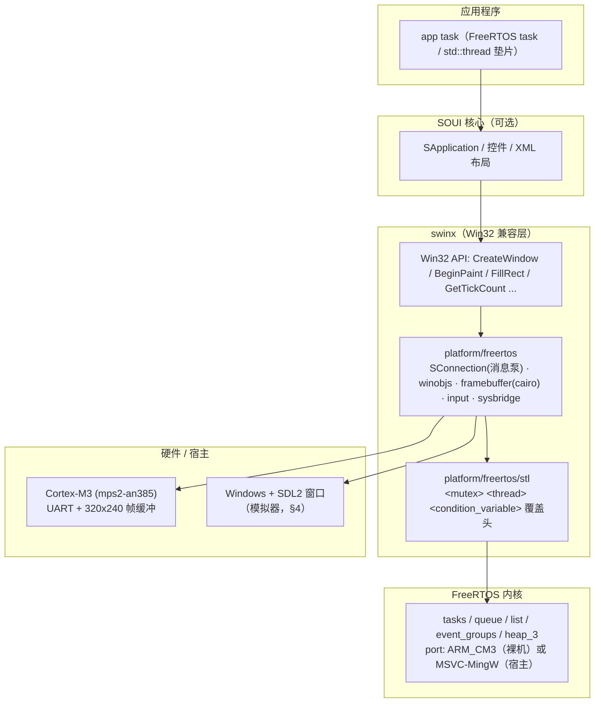
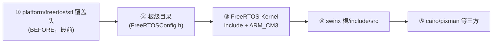
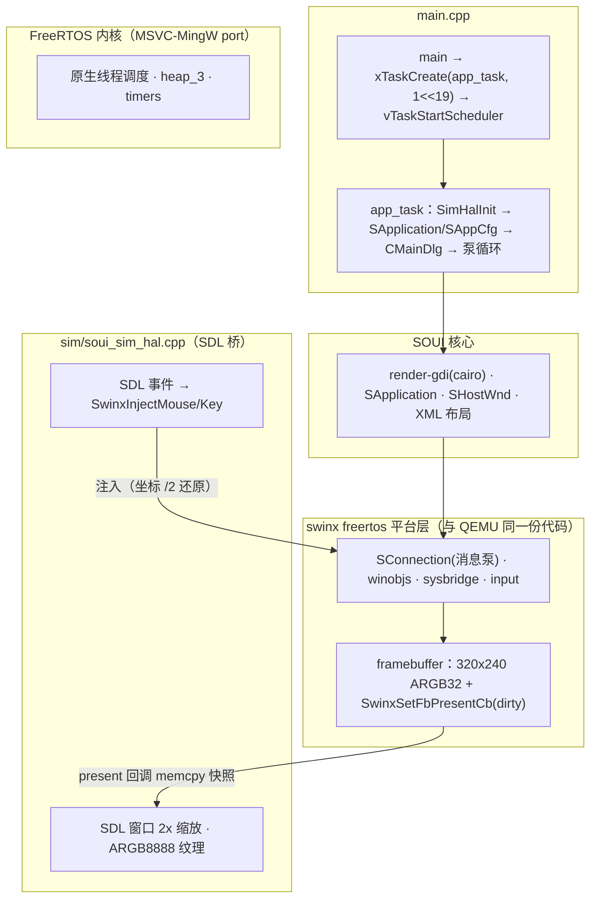

# SOUI5 FreeRTOS 开发指南

> **覆盖范围**：构建体系、QEMU/裸机参考工程、Windows 宿主模拟器、应用开发流程、坑速查。
> **工程位置**：soui4 仓库的 git 子模块 `soui-freertos`（`git submodule update --init soui-freertos`，origin = `https://gitee.com/setoutsoft/soui-freertos.git`），子模块路径 `/d/work/soui4/soui-freertos`。
> **名称**：对外产品名 **SOUI5**（5.x 线），源码目录仍叫 `soui4`。
> **验证状态**：已通过 `soui_sim`、`templates/app` 全量构建与启动，`swinx_test` 交叉编译 + QEMU 实跑验证（结果见 §3.2、§4.3）。

---

## 1. 概述

### 1.1 定位

SOUI5 的跨平台策略是"应用层写 Win32，平台差异由 swinx 吸收，渲染走 cairo/pixman 软件光栅"。FreeRTOS 是这条策略上的**第七端**（Windows / Linux / macOS / Android / iOS / OHOS 之后的"带显示 MCU"场景）。

这次移植只做了三件事：

| # | 内容 | 落点 |
|---|---|---|
| 1 | **swinx 新增 `platform/freertos`**：消息泵、窗口对象、帧缓冲、输入注入、同步原语、字体桥全部改用 FreeRTOS 原语（无 X11、无 POSIX 线程） | `swinx/src/platform/freertos/` |
| 2 | **不新写渲染器**：复用 `components/render-gdi` 的 cairo 后端，把"画到窗口表面"换成"画到 swinx 帧缓冲" | `components/render-gdi/` + `framebuffer.cpp` |
| 3 | **构建从零到一**：一个 `include` + 一个 `soui_fr_project()` 管掉内核、三方库、swinx、SOUI、资源打包、宿主运行时 | `cmake/soui.cmake` |

### 1.2 能力边界

| 能力 | 状态 | 验证方式 |
|---|---|---|
| swinx 同步层（CRITICAL_SECTION / SRWLOCK / INIT_ONCE / 事件 / 信号量 / 线程） | ✅ | QEMU mps2 实跑，全部 `OK` |
| swinx 消息泵 / SConnection / 定时器 / 输入注入 | ✅ | QEMU 实跑（鼠标键盘 → 消息队列 → wndproc 端到端） |
| cairo 软件渲染 + 帧缓冲 `commitCanvas` | ✅ | QEMU 帧缓冲 dump 出图目检 |
| SOUI 核心编译（core + control + activex 全量） | ✅ 100% 可编译 | `arm-none-eabi-gcc` 13.3 / cortex-m3 / `-Os` |
| SOUI 核心链接 | ✅ 0 未定义符号 | `soui_fr` census 链接（§3.3） |
| 完整 SApp + XML 布局渲染（QEMU） | ✅ 出图目检通过 | `soui_fr` 真跑 SApp |
| Windows 宿主模拟器 | ✅ 出图 + 鼠标交互 | `soui_sim`（§4） |

### 1.3 分层架构



### 1.4 三种验证载体

| 载体 | 跑什么 | 什么时候用 | 局限 |
|---|---|---|---|
| `soui_sim`（Windows 宿主） | 同一份 swinx freertos 层 + 同一份 app 代码，出图换 SDL2 | 日常迭代：改 XML / 控件 / 应用逻辑，秒级重编 + 直接鼠标交互 | 验证不了裸机启动链、内存布局、真实时序（§4.7） |
| QEMU mps2-an385（`swinx_test` / `soui_fr` / `demo`） | 交叉编译的 Cortex-M3 镜像 | 交付前必过：裸机启动链、堆锁、链接脚本、无 OS 依赖 | 慢（交叉编译 + semihosting dump），交互只能靠注入 |
| 目标板 | 换 uart 驱动 + 链接脚本 + LCD 控制器 | 交付 | 手上有板子才谈得上 |

推荐顺序：**模拟器迭代到功能稳定 → QEMU 跑通 → 目标板**。

---

## 2. 构建体系

### 2.1 唯一入口：`cmake/soui.cmake`

新工程的整个构建系统就是下面两行（`templates/app/CMakeLists.txt` 除 `project()` / 编译标准外无其它内容）：

```cmake
include(<soui-freertos>/cmake/soui.cmake)
soui_fr_project(hello SOURCES main.cpp SIM_HOST)   # 裸机则去掉 SIM_HOST
```

`soui_fr_project()` 一次做完：

| 步骤 | 内容 |
|---|---|
| 内核 | `FreeRTOS-Kernel` + 按宿主/裸机自动选 port（`MSVC-MingW` / `GCC/ARM_CM3`）、heap_3 |
| 三方库 | cairo/pixman/libpng/zlib；宿主默认用系统包（`SOUI_FR_USE_SYSTEM_DEPS`），交叉编译强制 vendored 源码 |
| 平台层 | swinx freertos 层（`src/*.cpp` + `platform/freertos/*` + cairo gdi 后端 + 字体桥） |
| SOUI | utilities + core + render-gdi + imgdecoder-stb（whole-archive 保留 COM 注册对象） |
| 资源 | `uires/uires.idx` → uiresbuilder → windres COFF → `.incbin` 数据段（§2.6） |
| 宿主 | `SIM_HOST` 时链 `sim/soui_sim_hal.cpp`；Windows system-deps 构建把运行时 DLL 收拢到 exe 同级（§4.3） |

参数全部可选：`SOURCES`（必填）、`RESOURCES`（默认 `./uires`）、`RESOURCE_SCRIPT`、`NO_RESOURCES`、`FREERTOS_CONFIG`（默认 `./config`）、`SIM_HOST`、`INCLUDES`、`LIBRARIES`、`OUTPUT_NAME`。

需要更细控制时底层仍然可用：`soui_fr_add_all()` + `soui_fr_link_app(<target>)`，以及 `soui_fr::thirdparty` / `::swinx` / `::soui` / `::freertos` / `::app` 这些 INTERFACE target（定义在 `cmake/SouiFreeRTOS.cmake`）。

### 2.2 平台宏：`FREERTOS_HOST` 与 `SFR_*` 派生开关

🚨 **宿主编译只认 `FREERTOS_HOST` 一个名字**（由 `SOUI_PLATFORM_FREERTOS_HOST` 统一改名）。它的语义是"下面有一整套宿主 OS + C 运行时"，由 `cmake/SouiFreeRTOS.cmake` 在 `if(NOT SOUI_FR_BARE_METAL)` 时加到 INTERFACE target 上（裸机判定看 `CMAKE_CROSSCOMPILING` / `CMAKE_SYSTEM_NAME STREQUAL "Generic"`）。

构建参数与派生开关：

| 构建参数 | 谁定义 | 派生开关（`swinx/include/sfr_config.h`） |
|---|---|---|
| `SOUI_PLATFORM_FREERTOS` | `swinx/freeRTOS.cmake` | `SFR_PLATFORM = 1` |
| `FREERTOS_HOST` | `cmake/SouiFreeRTOS.cmake`（宿主） | `SFR_PLATFORM = 1`、`SFR_HOSTED = 1` |
| `SOUI_FREERTOS_REAL` | 工具链文件 / `soui.cmake` | `SFR_KERNEL_REAL = 1`（真内核 API） |
| `SOUI_FREERTOS_HOST_EMU` | `-DSOUI_FREERTOS_EMULATE_HOST=ON` | `SFR_KERNEL_EMU = 1`（POSIX 模拟） |

两条铁律：

1. **swinx 代码内部只写 `SFR_*`**（`#if SFR_HOSTED` / `#if !SFR_PLATFORM`），不直接测 `FREERTOS_HOST`：这样新增一种配置只需改 `sfr_config.h` 一处。四个开关在任何平台都恒有定义（0/1），不存在"未定义即假"。
2. 🚨 **旧名字是 `#error` 而不是静默忽略**。漏掉 `FREERTOS_HOST` 的后果不是"少一个分支"，而是 swinx 认为没有宿主 CRT，于是自己重新声明 `wcscpy_s` / `_wtof` / `_open_osfhandle`、并给实现加 `DECLSPEC_IMPORT`，编译期是一屏 `conflicting declaration of C function` 与 `'DECLSPEC_IMPORT' does not name a type`。统一宏时就踩过这个坑：`soui.cmake` 改了名字，`soustid.h` / `SouiCtrls.h` / `sfr_config.h` 三处还留着旧名，宿主构建直接失败。

SOUI/utilities 侧的用法（同一语义，不同判据）：

| 位置 | 判据 | 含义 |
|---|---|---|
| `SOUI/src/SApp.cpp`、`utilities/src/utilities.cpp`、`utilities/src/helper/slog.cpp` | `#if defined(_WIN32) && !defined(FREERTOS_HOST)` | 宿主模拟器**不要**走 Windows 专属路径（`SWndSurface::Init`、PE 版本查询、`EnumFonts`、`OSVERSIONINFOEX`） |
| `SOUI/include/souistd.h` | `#if !defined(FREERTOS_HOST)` | 不 include 系统 `<olectl.h>`（与 swinx shim 类型冲突） |
| `SOUI/include/control/SouiCtrls.h` | `#if defined(_WIN32) && !defined(FREERTOS_HOST)` | 不编 `SActiveX.h`（缺 `<mshtmhst.h>` shim） |
| `components/render-gdi/GradientFillHelper.cpp`、`SOUI/src/core/SHostPresenter.cpp` | `#if defined(_WIN32) && !defined(FREERTOS_HOST)` | 走 cairo 渐变 / BitBlt presenter 分支 |

> 其它端的构建（Windows/Linux/Android/iOS/OHOS）从不定义 `FREERTOS_HOST`，所以以上判据对它们等价于原来的代码。

### 2.3 目录结构

```
soui-freertos/                    # soui4 的 git 子模块
├── cmake/
│   ├── soui.cmake                # ★ 唯一公共入口（soui_fr_project / soui_fr_add_resources / soui_fr_add_sim_host）
│   ├── SouiFreeRTOS.cmake        # 依赖描述：kernel/swinx/SOUI/cairo... 的 INTERFACE target
│   ├── CopyRuntimeDlls.cmake     # system-deps 构建的 DLL 收拢
│   └── soui_fr_compat.h          # 强制预包含的兼容头
├── sim/soui_sim_hal.{h,cpp}      # SDL2 宿主壳：窗口 / ARGB 纹理 / 鼠标键盘注入
├── templates/app/                # 复制即用的新工程模板（CMakeLists + main.cpp + config + uires）
├── soui_sim/                     # ★ Windows 宿主模拟器 demo（§4）
├── demo/                         # 最小 FreeRTOS 基座：startup / syscalls / uart / FreeRTOSConfig / 链接脚本 / 工具链
│   └── cmake/toolchain-arm-freertos.cmake
├── swinx_test/                   # swinx 平台层单测（6 个 main_*.cpp，QEMU 实跑）
├── soui_fr/                      # SOUI 核心编译/链接探针 + SApp 冒烟（QEMU 真出图）
├── FreeRTOS-Kernel/              # vendored 官方内核（ARM_CM3 + MSVC-MingW 两个 port）
└── README.md
```

### 2.4 工具链与 include 顺序

`demo/cmake/toolchain-arm-freertos.cmake` 的关键点：

```cmake
set( CMAKE_SYSTEM_NAME Generic )
set( CMAKE_TRY_COMPILE_TARGET_TYPE STATIC_LIBRARY )   # 不需要完整链接即可 try-compile
set( CMAKE_C_FLAGS_INIT   "-mcpu=cortex-m3 -mthumb -ffunction-sections -fdata-sections" )
set( CMAKE_CXX_FLAGS_INIT "${CMAKE_C_FLAGS_INIT} -fno-rtti" )
add_definitions( -DSOUI_FREERTOS_REAL )               # STL 垫片据此选真 FreeRTOS 实现
```

🚨 **include 顺序**（顺序错就等于编不过）：



1. `swinx/src/platform/freertos/stl`（覆盖 `<mutex>/<thread>/<condition_variable>`）必须 `BEFORE` 排最前，否则落回标准库头，链接期才炸出 pthread 符号。
2. `swinx/src` **绝不能排在 FreeRTOS-Kernel 头之前**：swinx/src 里有 Wine 派生的 `list.h`，会遮蔽内核的 `list.h`，把 `list.c/tasks.c/queue.c` 全部编坏。

### 2.5 裸机基座四要素（任何新工程都要带上）

**① `syscalls.c` —— newlib 堆锁 + heap_3（🚨 最重要）**

newlib 的 `__malloc_lock/__malloc_unlock` 裸机默认是空实现。swinx/SOUI 会从多个任务并发 malloc（消息队列节点、同步对象），无锁 ⇒ 堆腐蚀 ⇒ 句柄变垃圾 ⇒ 挂死点随机漂移。且**必须递归锁**：newlib 内部 `_realloc_r` 会递归调 `_malloc_r/_free_r`，普通锁首次 realloc 即自死锁。

🚨 **内核堆必须用 heap_3（newlib malloc 薄封装），不要 heap_4**：heap_4 的 `pvPortMalloc/vPortFree` 全程 `vTaskSuspendAll()`，任何任务 malloc 期间其他任务的**阻塞式**等待都会踩中 queue.c 的"挂起期禁止阻塞"断言（结构性冲突，无解）。

```c
static SemaphoreHandle_t s_heapMutex = NULL;

/* Reset_Handler 里、调度器启动前调用一次：heap_3 鸡生蛋——
   __malloc_lock → 懒建锁 → xQueueCreate → pvPortMalloc → malloc → __malloc_lock 递归活锁。 */
void heap_lock_early_init( void ) { s_heapMutex = xSemaphoreCreateRecursiveMutex(); }

void __malloc_lock( struct _reent * r )
{
    ( void ) r;
    /* 只在 RUNNING 态取锁：NOT_STARTED 单流放行；SUSPENDED（vTaskSuspendAll 窗口，
       如 xTaskCreate 分配 TCB/栈）天然单流，且挂起期阻塞取锁不合法。 */
    if( xTaskGetSchedulerState() != taskSCHEDULER_RUNNING ) return;
    xSemaphoreTakeRecursive( s_heapMutex, portMAX_DELAY );
}
```

配套 `FreeRTOSConfig.h`：`configUSE_RECURSIVE_MUTEXES=1`、`INCLUDE_xTaskGetSchedulerState=1`、`configCHECK_FOR_STACK_OVERFLOW=2`、`configUSE_MALLOC_FAILED_HOOK=1`，三个钩子定义在**独立 C 文件**（避免 C++/C 链接冲突）。

**② `startup.c` —— 向量表接线 + `__libc_init_array`（🚨 二号）**

FreeRTOS ARM_CM3 port 直接操作 NVIC/SysTick（无需 CMSIS），但 SVC/PendSV/SysTick 必须位于向量表第 **11 / 14 / 15** 项。`Reset_Handler` 顺序：`msr msp` → `.data` 拷贝 → `.bss` 清零 → `heap_lock_early_init()` → **`__libc_init_array()`** → `entry()`。

🚨 `-nostartfiles` 下没人替你调 `__libc_init_array`——`.init_array` 不执行，**所有命名空间级动态初始化全局都是 bss 零态**。SOUI 里有大量 `static const SStringW kXxx = L"..."`，零态字符串指针进 `SStringW` 拷贝构造即在 `InitFromIString` HardFault，表象是"第一个窗口构造必崩"。修复三件套：

1. 链接脚本补 `.preinit_array/.init_array/.fini_array`（`KEEP(*(SORT_BY_NAME(.init_array*)))` + `PROVIDE` 起止符号）；
2. `startup.c` 在 `entry()` 前调 `__libc_init_array()`；
3. 排除 crtbegin/crtend 时自供空 `_init(){}`。

**③ 链接脚本 —— `.bss` 必须独立成 `(NOLOAD) > RAM AT > RAM`**

🚨 不能并入 `.data` 的 `AT > FLASH`：QEMU 按 `p_paddr + p_memsz` 提交整个 `PT_LOAD`，`.bss` 混进 data 段会把 FLASH 侧范围撑到 `LMA(.data)+data+bss`——text 接近 4MB 时越过 mps2-an385 的 ssram1 上限，**整个 blob 被拒绝提交、代码区全零**，表象是"复位向量读数正常、首指令 INVSTATE 锁死"。

| 区域 | 地址 | 大小 | 用途 |
|---|---|---|---|
| ZBT SSRAM1（FLASH 别名） | 0x00000000 | **4MB 物理上限** | 代码 + 向量表 |
| SRAM | 0x20000000 | 4MB | data / bss / heap |

> 🚨 **FLASH 4MB 是物理铁律**：text 越过 0x00400000 即与 0x20000000 的 RAM 物理重叠。链接脚本可写 `LENGTH = 8M` 做 census 闭环证明，但**超过 4MB 的镜像在 mps2-an385 上不可运行**；可运行版必须 `--gc-sections`。

**④ `main` 入口 —— app task**

```cpp
extern "C" void entry(void)
{
    uart_init();
    std::thread t(app_task);   // STL 垫片：std::thread → xTaskCreate
    t.detach();
    vTaskStartScheduler();
    for(;;) ;
}
```

### 2.6 资源流水线

```
uires/uires.idx ──uiresbuilder──> resource.h + .rc  ──windres──> COFF ──incbin──> .balign 4 数据段
```

- 资源最终以 PE 资源段形式交给现成的 PE/mem provider，所以**应用代码与桌面版 SOUI 完全一致**（`SAppCfg` 的 `SetSysResPeHandle/SetAppResPeHandle` 传一个假 HINSTANCE 即可）。
- 🚨 `.balign 4`：Cortex-M 上非对齐常量数据会 fault。
- 自己搭这套流水线时两个必踩的坑：① `resource.h` 必须是 custom command 的**第二个 `OUTPUT`**（`BYPRODUCTS` 是 order-only，会用到隔夜旧头 ⇒ `'struct _R' has no member named 'id'`）；② custom command 必须给 **`WORKING_DIRECTORY <项目根>`**（uiresbuilder 的 `-h` 靠工作目录回读 `uires/xml/*.xml` 抓 `name=`，缺了它 `R` 表全空）。`soui_fr_project()` 里这两条已经固化。

---

## 3. QEMU / 裸机参考工程

三个工程都跑在 QEMU **mps2-an385**（Cortex-M3）上，共用一个 vendored 内核与同一套工具链文件。

### 3.1 `demo` —— 最小 FreeRTOS 基座

```bash
cd /d/work/soui4/soui-freertos/demo
cmake -S . -B build -G Ninja -DCMAKE_TOOLCHAIN_FILE=cmake/toolchain-arm-freertos.cmake
cmake --build build                 # build/demo.elf + demo.hex
qemu-system-arm -M lm3s6965evb -nographic -kernel build/demo.elf
```

只链内核 + 一个 `main.cpp`，用来验证基座（UART、调度器、堆锁）本身。

### 3.2 `swinx_test` —— swinx 平台层全量验证

`swinx_test/CMakeLists.txt` 同时也是**可复用的库配方样板**（`soui.cmake` 出现之前，各工程的静态库设置都是从它摘的）。

| 库 | 内容 | 关键设置 |
|---|---|---|
| `swinx_core` | swinx `src/*.cpp` + commctrl + `platform/freertos/*` + gdi/cairo 后端 + 字体桥 | 🚨 **不 GLOB `src/platform/posix/`**（POSIX 系统 API 实现全迁到那里，linux/macos/ios/mobile 才编它）；`-include swinx_stl.h` |
| `cairo_fr` | vendored cairo（image surface + png，排除 ft/quartz/xcb/xlib/pdf/ps/svg） | include 路径带 `platform/freertos`（`cairo-features.h` 桩） |
| `pixman_fr` | pixman（排除 SIMD 文件） | `PIXMAN_NO_TLS` |
| `png_fr` / `zlib_fr` | vendored libpng + zlib | — |

```bash
cd /d/work/soui4/soui-freertos/swinx_test
cmake -S . -B build -G Ninja \
    -DCMAKE_TOOLCHAIN_FILE=../demo/cmake/toolchain-arm-freertos.cmake \
    -DBOARD=mps2                      # mps2（4MB）| lm3s（256KB，只够同步层）
cmake --build build

# 交互观察：串口直出 stdio
qemu-system-arm -M mps2-an385 -nographic -kernel build/swinx_test.elf

# 需要完整跑完（读日志）：串口写文件
qemu-system-arm -M mps2-an385 -kernel build/swinx_test.elf \
    -serial file:C:/temp/qemu.log -display none
```

测试内容：6 个模块、源码里 **193 处 `CHECK` 断言点**（判据打在 UART）：

| 模块 | 文件 | 覆盖面 |
|---|---|---|
| 同步原语 | `main.cpp` / `main_syncobj.cpp` | CS 递归/互斥、SRWLOCK 读写并发、INIT_ONCE、事件/信号量/`std::thread` |
| SConnection | `main_conn.cpp` | 消息泵、定时器、跨任务 postMsg |
| 渲染 | `main_render.cpp` | RegisterClass → CreateWindow → WM_PAINT → commitCanvas → 帧缓冲像素断言 |
| 输入注入 | `main_input.cpp` | `SwinxInjectMouse/Key` → 路由 → 消息队列 → 泵 → wndproc（含 WM_CHAR） |
| 出图 | `main_dump.cpp` | semihosting dump 整帧 → `fb.ppm`（含像素断言） |

> 🚨 **QEMU "挂死"先查 guest tick 再定性**：`-nographic` 下串口走 stdio 管道，每字符一次 write，打印密集的探针会把 tick 拖到 ~14 次/秒，长等待测试被外部 timeout 杀掉，表象是 exit=124 的"假 hang"。判定：换 `-serial file:` 排除背压。
> 🚨 **Windows 版 qemu 不认 MSYS 路径**：`-serial file:/tmp/x.log` 会直接 `rc=1` 且不产日志，必须写 `-serial file:C:/Users/.../x.log`。

本工程交叉编译通过（`swinx_test.elf`，9.9MB，未裁剪），QEMU 实跑 **35 项 `OK` / 0 `FAIL`**，末行 `SWINX WINOBJS FREERTOS PASS`，`fb.ppm` 正常落盘（320×240，230415 字节）——裸机路径（`SFR_HOSTED=0`）行为稳定。

### 3.3 `soui_fr` —— SOUI 核心探针 + SApp 冒烟

```bash
"/c/Program Files/CMake/bin/cmake" -S D:/work/soui4/soui-freertos/soui_fr \
    -B D:/work/soui4/soui-freertos/soui_fr/build -G Ninja -DSOUI_FR_CENSUS=ON
ninja -C D:/work/soui4/soui-freertos/soui_fr/build
cd D:/work/soui4/soui-freertos/soui_fr
qemu-system-arm -M mps2-an385 -kernel build/soui_fr.elf \
    -serial file:soui_run.log -display none -semihosting     # 出 soui_fb.ppm
```

- `SOUI_FR_CENSUS=ON`：`--whole-archive` 且关 `--gc-sections`，把全部符号缺口一次性暴露出来（>4MB，**只链不跑**）；`OFF` 时开 gc-sections，是可运行版（SApp 全链路 text 约 2.7MB）。
- 编译范围：utilities 全套 + SOUI core + res.mgr + helper/layout/matrix/event/animation + **control + activex 全量** + `rendergdi_fr`。仅排除 4 个文件：`SwndAccessible.cpp`（msaa）、两个 NDK resprovider、`SOhosApp.cpp`（NAPI）。
- 编译垫片只剩 1 个 `soui_fr_compat.h`（🚨 CMake 会**去重**重复的 `-include`，第二个会变成裸输入文件报 multiple files——多个预包含必须折进一个头）。
- 链接侧原 49 个桩已全部归位 swinx `platform/freertos/`（`sysbridge.cpp` 扩容 + `dlfreertos.cpp` + `dlghelper.cpp`），census **0 未定义**。

SApp 冒烟链路：`mem_res_provider.cpp`（表驱动内存 `IResProvider`，内嵌 `LAYOUT:APP_MAIN` XML）→ `Render_Gdi_SCreateInstance` → `SApplication` → `AddResProvider` → `SHostWnd` → `CreateEx` → `ShowWindow/UpdateWindow` → semihosting dump PPM。

🚨 XML 8 位颜色串是 **`#RRGGBBAA`**（`SNamedValue.cpp` 里 `swscanf("%02x%02x%02x%02x",&r,&g,&b,&a)`），按 AARRGGBB 写会把 alpha 当 R 用、颜色发灰发暗。

---

## 4. Windows 宿主模拟器 `soui_sim`

### 4.1 定位

`soui_sim` 把 FreeRTOS 移植层跑在 **Windows 桌面**上：FreeRTOS 内核以 MSVC-MingW port（原生线程）调度，swinx freertos 平台层原样复用，帧缓冲呈现到 SDL2 窗口，SDL 鼠标事件注入回 swinx 输入路径。与 QEMU 目标 **95% 同构**——同一份平台层代码、同一套 STL 垫片、同一份应用代码。

它是一个**普通 SOUI 工程**，目录组织与 `wizard/CmakeApp` 一致（§4.4），只是工具链换成了"FreeRTOS + swinx + SDL2"。

### 4.2 架构与三条关键机制



1. **调度器接管主线程**：`xPortStartScheduler()` 不返回 ⇒ SDL 初始化与事件泵必须在 **app 任务内**；`main()` 只做 `xTaskCreate` + `vTaskStartScheduler`。
2. **出图走 dirty 回调**：SOUI `WM_PAINT` → `EndPaint` → `commitCanvas` → `swinxFbPresent` → `fb_present_cb`（memcpy 全帧到快照 + 置 dirty）→ app 任务里 `SimHalRenderIfDirty()`。fb 是 ARGB32 premultiplied（0xAARRGGBB 小端）== `SDL_PIXELFORMAT_ARGB8888` 内存布局，直接 memcpy 不转换。
3. **输入走注入 API**：SDL 事件把窗口坐标 /2 还原后调 `SwinxInjectMouse(hwnd, msg, x, y, fwKeys)`。🚨 `input.h` 里这两个函数**没有 `extern "C"`**（C++ mangle，HWND/WPARAM 按 `unsigned long long` 展开），HAL 自声明必须精确匹配 linkage。

### 4.3 构建与运行

```bash
cd /d/work/soui4/soui-freertos/soui_sim

# 默认优先用系统 cairo/pixman/libpng/zlib（pkg-config 能证明存在时）
cmake -S . -B build_sys -G Ninja
ninja -C build_sys && ./build_sys/soui_sim.exe

# vendored 源码（可复现；交叉编译一定走这条）
cmake -S . -B build -G Ninja -DSOUI_FR_USE_SYSTEM_DEPS=OFF
ninja -C build && ./build/soui_sim.exe
```

正常启动日志（四行，卡在哪一行问题就在哪一步）：

```
[sim] SDL window ready (320x240 fb, 2x window)
[app] SApplication ready (render-gdi + imgdecoder-stb)
[sim] first frame presented
[app] main window up, hwnd=0000...
```

`-DSOUI_FR_USE_SYSTEM_DEPS=ON` 全量构建通过（首次约 2 分钟），上述四行日志齐全；`templates/app` 同样构建通过（约 3 分钟）。

| 构建项 | 值 | 原因 |
|---|---|---|
| `CMAKE_BUILD_TYPE` | 默认 Release | 无 NDEBUG 时 `SASSERT` 变真 assert（例如 `GetModuleHandleA("user32")` 在宿主恒 NULL ⇒ 启动即 abort） |
| `WCHAR_SIZE` | `__SIZEOF_WCHAR_T__` | MinGW `wchar_t`=2B；见 §6 |
| `CAIRO_WIN32_STATIC_BUILD` | 所有含 cairo 头的 target（含 `cairo_fr` 自身） | 否则 vendored `cairo.h` 推 `__declspec(dllimport)` ⇒ `__imp_cairo_*` 全线未定义 |
| `-Wl,--allow-multiple-definition` | 链接选项 | swinx 自带 WaitForSingleObject/Sleep/CreateEvent 等约 25 个 Win32 实现，与 libkernel32 冲突；swinx_core 链接序在前 ⇒ swinx 版胜出（与真机一致），SDL2 是 DLL 不受影响 |
| `SWINX_FR_DEFAULT_STACK_WORDS` | 32768 | STL 垫片建任务的默认栈 |
| fb 尺寸 | `SWINX_FB_WIDTH/HEIGHT`（默认 320×240） | 改尺寸要同步三处（§4.5） |

🚨 **运行时 DLL 影子问题**：system-deps 构建链接 `libcairo-2.dll` 时，PATH 里另一套 MinGW（WorkBuddy/PortableGit、Android platform-tools、xampp）会影子掉 `libwinpthread-1.dll` / `zlib1.dll` / `libiconv-2.dll`，进程在 `main()` 前以 `0xc0000139 ENTRYPOINT_NOT_FOUND` 秒退，**看着像代码 bug**。判据：最小 cairo 程序也挂。`cmake/CopyRuntimeDlls.cmake` 已用 `file(GET_RUNTIME_DEPENDENCIES)` POST_BUILD 把 20 个 DLL 收拢到 exe 同级（exe 目录优先级最高，收拢后与 PATH 无关）。

### 4.4 代码组织（对齐 wizard/CmakeApp）

| 文件 | 与 wizard 的对应关系 |
|---|---|
| `CMakeLists.txt` | `file(GLOB ...)` + `source_group` + `target_precompile_headers(stdafx.h)`；构建细节全在 `soui_fr_project()` |
| `stdafx.h/.cpp` | `SCOM_MASK = scom_mask_render_gdi\|scom_mask_imgdecoder_stb` + `souistd.h` + 控件头 + `resource.h` |
| `MainDlg.h/.cpp` | `SHostWnd` + `SDpiHandler<CMainDlg>` + `IAnimatorUpdateListener`；`EVENT_MAP_BEGIN()` / `EVENT_NAME_COMMAND(L"btn_close",…)` / `EVENT_ID_COMMAND(R.id.btn_test, …)` / `EVENT_MAP_END2(SHostWnd)` |
| `main.cpp` | `SApplication` + `SAppCfg::DoConfig()` + `InitXmlNamedID(R.name, R.id, n)`；唯一差别是 `app.Run()` 换成"SDL 泵 + `PeekMessage`"的非阻塞循环 |
| `main.rc` | `soui_res.rc2` + `theme_sys_res.rc2` |
| `uires/uires.idx` | `XML_INIT` / `XML_MAINWND` / `values(string\|color\|skin)` / `PNG` / `SVG` |
| `uires/xml/dlg_main.xml` | `_skin.sys.wnd.bkgnd` 背景 + `<caption>` 标题栏（`_skin.sys.btn.minimize/.close`）+ `class="normalbtn"` |
| `uires/uidef/init.xml` | `<unit>` / `<deffont>` / 样式类；文案与颜色走 `@string/*`、`@color/*` |
| `config/FreeRTOSConfig.h` | FreeRTOS 专有（栈、heap_3、hook 开关） |
| `../sim/soui_sim_hal.{h,cpp}` | 模拟器专有宿主壳：`SimHalInit` / `SimHalPumpEvents` / `SimHalSetTargetHwnd` / `SimHalRenderIfDirty` |

两处受平台层能力限制、与 wizard 不同：

- 🚨 swinx freertos 的 `LoadImageW/A`、`CreateIconFromResource` 还是 NULL 桩 ⇒ XML 里**禁用** `<icon src="ICON_xxx">` 与 `bigIcon`（否则 `load icon failed`）。标题栏 logo 用 ``（PNG 皮肤）。
- 🚨 该工具链**不定义 `_UNICODE`**（`TCHAR == char`）⇒ 字面量一律 `_T(...)`，`L"..."` 塞不进 `LPCTSTR` 接口。

### 4.5 开发流程

**改布局**：编辑 `uires/xml/dlg_main.xml`（`uires.idx` 里 `XML_MAINWND` 指向它），`ninja -C build_sys` 秒级重编。要把别的 demo 布局搬进来，把它的 XML 拷进 `uires/xml/`，在 `uires.idx` 加一行，再把 `CMainDlg` 的布局 id 指过去。

```xml
<SOUI name="mainWindow" title="@string/title" wndType="appMain" appWnd="1"
      margin="0" resizable="0" translucent="0">
  <root skin="_skin.sys.wnd.bkgnd" cache="1" width="320" height="240">
    <!-- 模拟标题栏：logo（PNG 皮肤）+ 标题 + 两个系统皮肤按钮 -->
    <caption pos="0,0,-0,28" font="adding:2" layout="hbox" gravity="center" padding_left="10">
      
      <text name="txt_title" text="@string/title" extend_left="6" colorText="@color/thm_txt_normal"/>
      <window size="0,0" weight="1" visible="0"/>
      <imgbtn name="btn_min" skin="_skin.sys.btn.minimize" animate="1"/>
      <imgbtn name="btn_close" skin="_skin.sys.btn.close" tip="close" animate="1"/>
    </caption>

    <!-- 内容区：左边位图（PNG/SVG 切换），右边两行文本 -->
    
    <text class="cls_txt_title" text="@string/hello" pos="88,44,-14,66"/>

    <!-- 命令按钮：event 走 CMainDlg 的 EVENT_ID_COMMAND(R.id.xxx) -->
    <button name="btn_test" class="normalbtn" pos="14,118,110,144" text="@string/btn_switch" animate="1"/>
    <button name="btn_anim" class="normalbtn" pos="118,118,214,144" text="@string/btn_anim" animate="1"/>

    <!-- 动画目标：值动画器直接改它们的 pos / alpha -->
    <window name="anim_box" pos="14,178,54,204" colorBkgnd="@color/orange"/>
    <window name="fade_box" pos="14,208,54,234" colorBkgnd="@color/blue"/>
  </root>
</SOUI>
```

要点：**颜色/文案一律走 `@color/*`、`@string/*`**（`uires/values/`，8 位色按 `#RRGGBBAA`），文本样式（`cls_txt_title` 等）来自 `uires/uidef/init.xml`。

**加控件与事件**：控件写在 XML 里（SOUI 内建控件全可用，ActiveX 除外）；事件两种写法都支持——

```cpp
EVENT_MAP_BEGIN()
    EVENT_NAME_COMMAND(L"btn_close", OnClose)       // 按 name 路由（系统皮肤按钮）
    EVENT_ID_COMMAND(R.id.btn_test, OnSwitchImage)  // 按 uires.idx 里的 id 路由
EVENT_MAP_END2(SHostWnd)
```

**改画布尺寸**（三处必须一致）：

1. configure 参数 `-DSWINX_FB_WIDTH=xxx -DSWINX_FB_HEIGHT=yyy`（静态分配 `W*H*4` 字节）；
2. 快照缓冲尺寸（HAL 里取自 `SwinxFbWidth()/Height()`，通常自动跟随，但静态分配的要改）；
3. XML 的 `<root width height>`。

SDL 窗口固定 2x 逻辑尺寸（`SDL_RenderSetLogicalSize`），拉伸窗口不改变逻辑坐标。

**体验方式**：直接鼠标点——悬停 `btn_test` / `btn_anim` 看 hover 与 `animate="1"` 淡入，按住看 push 态，点 `btn_test` 在 PNG / SVG 之间换图（走 `EVENT_ID_COMMAND(R.id.btn_test)`），点 `btn_anim` 冻结时间轴动画；标题栏按钮是 `_skin.sys.*` 系统皮肤。

> **模拟器不含自动化测试**：脚本化输入注入（`SIM_SCRIPT`）、像素比对（`sim_test.py`/`fbprobe.py`）与"F12 存帧"都已删除。原因是那几个脚本把控件坐标硬编码进 txt、还得为 swinx 吞掉首个 `WM_MOUSEMOVE` 的缺陷写 workaround，改一次布局就全废，而它对"体验移植效果"没有帮助。回归方式改为人工点验；要留证据用系统截图。

### 4.6 调试

**日志**：`main()` 开头的 `setvbuf(stdout, NULL, _IONBF, 0)` 是铁律——stdout 进管道默认全缓冲，挂死时缓冲里的日志全丢，表象是"静默消失"。

```bash
./build_sys/soui_sim.exe 2>&1 | tee sim.log
```

**截图**：⚠️ `PrintWindow` 对 SDL 窗口输出全黑，只能用 BitBlt 屏幕拷贝；且抓图进程必须**先声明 DPI 感知**（`SetProcessDpiAwarenessContext(-4)`），否则 `ClientToScreen` 是逻辑坐标而 `BitBlt` 是物理像素，在 125% 缩放下坐标全错（差 1.25 倍）。

**崩溃 / 断言 / 挂死**：

| 症状 | 排查 |
|---|---|
| `FreeRTOS ASSERT at file:line` | `configASSERT` → `fr_sim_assert`；按 file:line 查内核断言（常见：挂起期阻塞、队列满） |
| `*** STACK OVERFLOW *** 任务名` | `vApplicationStackOverflowHook`；加大 `xTaskCreate` 栈或 `SWINX_FR_DEFAULT_STACK_WORDS` |
| `FreeRTOS malloc failed` | heap_3 依赖转发到宿主的 malloc |
| 静默退出、无日志 | 先确认 `setvbuf` 在；再查 SDL 初始化失败路径 |
| 进程在但窗口黑 | 查 `UpdateWindow` 返回、`[sim] first frame presented` 是否出现 |
| 调试 | MSYS2 mingw64 gdb 直接可用；断点打 `app_task`、`fb_present_cb`、`SwinxInjectMouse` |

**逐字节排查编码问题**（历史案例模板，10 分钟定位 `WCHAR_SIZE=4` 错误）：

```cpp
SNS::SStringA a("LAYOUT:APP_MAIN");
for (int i = 0; i < a.GetLength(); ++i) printf(" %02x", (unsigned char)a.c_str()[i]);
SNS::SStringW w = SNS::SStrCpCvt::CvtA2W(a, CP_UTF8);
for (int i = 0; i < w.GetLength(); ++i) printf(" %04x", (unsigned)w.c_str()[i]);
// 'L' 后跟 0000 = UTF-32 数据被 16 位 wchar 消费 → 查 WCHAR_SIZE
```

### 4.7 与 QEMU / 真机的边界

- 模拟器验证的是**逻辑层**：消息泵、渲染管线、XML 布局、控件行为、输入路由——与 QEMU 同源同代码。
- 模拟器**不能**替代 QEMU：裸机启动链（startup/链接脚本/newlib 堆锁）、内存布局（`.bss` 段 / FLASH 4MB 上限）、真实中断时序。§2.5 的四个坑只在裸机显形；反过来 §6 里标了「宿主」的坑只在 Windows 上显形。

---

## 5. 应用开发流程

### 5.1 从模板起步

```bash
cp -r soui-freertos/templates/app  my_app
cmake -S my_app -B my_app/build -G Ninja
ninja -C my_app/build && ./my_app/build/hello_freertos.exe
```

| 路径 | 作用 |
|---|---|
| `CMakeLists.txt` | `include(soui.cmake)` + `soui_fr_project(... SIM_HOST)` |
| `main.cpp` | FreeRTOS 任务 → SOUI 启动 → SDL/消息泵主循环 |
| `config/FreeRTOSConfig.h` | 内核配置（栈、heap_3、tick、hook 开关） |
| `uires/uires.idx` | 资源索引（`LAYOUT:MAIN` → `xml/main.xml`） |
| `uires/uidef/init.xml` | 全局 UIDEF（`uidef:xml_init`） |
| `uires/xml/main.xml` | 界面布局 |

裸机工程在此基础上：复制 `demo/` 的裸机基座（§2.5 四要素）、去掉 `SIM_HOST`、换交叉工具链。

### 5.2 写一个画图的窗口（摘自 `swinx_test/main_dump.cpp`）

```cpp
#include "swinx_stl.h"       // 由 CMake -include 预包含亦可
#include "SConnection.h"     // 消息泵 / 窗口管理
#include "framebuffer.h"     // SwinxFbClear / SwinxFbBits ...

static LRESULT CALLBACK my_wndproc(HWND hWnd, UINT msg, WPARAM wp, LPARAM lp)
{
    if (msg == WM_PAINT)
    {
        PAINTSTRUCT ps; HDC hdc = BeginPaint(hWnd, &ps);
        RECT rc = { 0, 0, 1000, 1000 };              // 超出部分由 cairo 裁剪
        HBRUSH hbr = CreateSolidBrush(RGB(0x20,0x70,0xC0));
        FillRect(hdc, &rc, hbr); DeleteObject(hbr);
        EndPaint(hWnd, &ps);
        return 0;
    }
    if (msg == WM_NCCREATE) return TRUE;             // Win32 语义：必须放行创建
    return DefWindowProc(hWnd, msg, wp, lp);
}

void run_app(void)
{
    SwinxFbClear(0xFF103018);                        // 320x240 fb 背景色
    WNDCLASSA wc = {};                               // 必须清零
    wc.lpfnWndProc = my_wndproc;
    wc.lpszClassName = "myapp";
    RegisterClassA(&wc);
    HWND h = CreateWindowExA(0, "myapp", "demo", WS_VISIBLE, 40, 50, 120, 90, NULL, NULL, NULL, NULL);
    UpdateWindow(h);                                 // 同步绘制 → commitCanvas → fb

    uint32_t *fb = SwinxFbBits();                    // ARGB32 小端
    int stride = SwinxFbStride();                    // 单位 = pixel
    // fb[50*stride + 40] 即 (x=40, y=50) 像素
}
```

### 5.3 输入注入（无真实输入设备时）

```cpp
SwinxSetCursorPos(x, y);                          // 光标状态
SwinxInjectMouse(tid, WM_LBUTTONDOWN, MK_LBUTTON, MAKELPARAM(x, y));
SwinxInjectKey(tid, WM_KEYDOWN, 'A', 0);          // 经 postMsg 路由到目标窗口任务
```

🚨 **`htCode` 铺底**：WndObj 的 `htCode` 初始为 `HTNOWHERE`，建窗后的**第一个** client move 会被 `CallWindowProcPriv` 吞掉（转成 `NCMOUSELEAVE`）。注入鼠标轨迹前先铺一个 move（Linux 平台有 X11 enter 事件先行，所以没这个问题）。

### 5.4 帧缓冲出图目检

1. 目标程序调用 `main_dump.cpp` 的 `dump_fb_ppm("fb.ppm")`（ARM semihosting：`bkpt 0xAB` + SYS_OPEN/SYS_WRITE/SYS_CLOSE，QEMU 加 `-semihosting`）。
2. 宿主机转图：`ffmpeg -i fb.ppm fb.png`（PPM 是裸 RGB，任何图像工具都能开；仓库里的一次性转换脚本已随测试脚本一起清理）。
3. 目检预期画面：`swinx_test` = 暗绿背景 + 蓝窗 (40,50,120×90) + 琥珀内矩形 + 灰条纹；`soui_fr` = `#103018` 深墨绿背景 + `#2070C0` 蓝窗 (20,20,280×100) + 白字标题 + `#E0B020` 琥珀第二行。

🚨 颜色不对先查是不是 `#RRGGBBAA` 写反了，不要急着怀疑字节序——dump 的 `(px>>16, px>>8, px)` = R,G,B 与 swinx fb 约定自洽。

### 5.5 多线程规则（与其它平台一致）

- 🚨 `SStringT` 是单线程的（COW 裸引用计数）——跨线程传字符串一律 `std::string / std::wstring`。
- 🚨 被静态析构 / 多任务访问的函数局部静态必须 leak-on-purpose。
- 定时器到期回调在定时器线程上下文，业务自己切线程。
- `std::thread` 垫片建的任务栈默认 `SWINX_FR_DEFAULT_STACK_WORDS`（裸机 8192 字 / 宿主 32768 字）。

---

## 6. 坑速查表

| 坑 | 适用端 | 症状 | 规避 |
|---|---|---|---|
| newlib 堆无锁 | 裸机 | 间歇挂死、挂点漂移、句柄变垃圾 | `syscalls.c` 堆锁，**递归**（§2.5①） |
| 非递归堆锁 | 裸机 | 首次 realloc 永久挂死 | `xSemaphoreCreateRecursiveMutex` |
| heap_4 挂起窗口 | 裸机 | 任一任务 malloc 期间别人阻塞调用踩 queue.c 断言 | 内核堆换 **heap_3** |
| 堆锁懒初始化 | 裸机 | `__malloc_lock` → 建锁 → `pvPortMalloc` → `malloc` 递归活锁 | `heap_lock_early_init()` 在 Reset_Handler 预热 |
| 挂起期阻塞取锁 | 裸机 | `xTaskCreate` 分配 TCB 时断言 | 只在 `taskSCHEDULER_RUNNING` 态取锁 |
| `.init_array` 未执行 | 裸机 | 第一个窗口构造即在字符串深拷贝 HardFault | `__libc_init_array()` 三件套（§2.5②） |
| `.bss` 并入 data 段 | 裸机 | QEMU 拒提交 blob，复位即 INVSTATE | `.bss (NOLOAD) > RAM AT > RAM`（§2.5③） |
| FLASH > 4MB | 裸机 | 复位即 HardFault | census 只链不跑；运行版 gc-sections |
| 任务栈偏小 | 裸机 | -O0 全量构建栈溢出，症状离奇（mutex 里出现 a5a5） | `SWINX_FR_DEFAULT_STACK_WORDS=8192` |
| 串口 stdio 背压 | QEMU | 被 timeout 杀，假 hang | `-serial file:`；删打印探针 |
| qemu 不认 MSYS 路径 | QEMU | `-serial file:/tmp/x.log` 直接 `rc=1` 无日志 | 写 `file:C:/.../x.log` |
| include 次序 | 全部 | pthread 符号链接失败 / 内核编不过 | stl 覆盖头 `BEFORE`；`swinx/src` 别盖内核头（§2.4） |
| CMake `-include` 去重 | 全部 | 第二个头变裸输入文件报 multiple files | 多个预包含折进一个 compat 头 |
| 旧宏名 `SOUI_PLATFORM_FREERTOS_HOST` | 全部 | 宿主构建报一屏 `conflicting declaration` / `DECLSPEC_IMPORT` | 统一用 `FREERTOS_HOST`（§2.2），`sfr_config.h` 对旧名 `#error` |
| MSYS2 cmake + `D:/` 路径 | 全部 | configure 失败 | 用 Windows 版 cmake + 绝对 `-S/-B` |
| MSB6001 | 宿主 | configure 报代理变量冲突（`HTTPS_PROXY` 与 `https_proxy` 并存） | 先 `unset https_proxy http_proxy HTTPS_PROXY HTTP_PROXY` |
| `WCHAR_SIZE` 与 `wchar_t` 不符 | 宿主 | 字符串交错 NUL、`LAYOUT` 乱码、布局加载失败全黑窗（ARM 不复现） | `-DWCHAR_SIZE=__SIZEOF_WCHAR_T__`（已配）；转换实现在 `platform/freertos/sysbridge.cpp`，改 `sysapi.cpp` 无效 |
| 缺 `CAIRO_WIN32_STATIC_BUILD` | 宿主 | `__imp_cairo_*` 全线未定义（含 `libcairo_fr.a` 内部） | 所有含 cairo 头的 target 都加（§4.3） |
| swinx Win32 实现 vs libkernel32 | 宿主 | 约 25 个符号多重定义 | `-Wl,--allow-multiple-definition`，swinx 链接序在前 |
| 缺 NDEBUG | 宿主 | 全新 configure 后启动即 abort | `CMAKE_BUILD_TYPE=Release` 默认；验收用全新构建树 |
| DLL 影子 | 宿主 | `main()` 前 `0xc0000139` 秒退，像代码 bug | `CopyRuntimeDlls.cmake` 收拢到 exe 同级（§4.3） |
| `SDL.h` 不最先 include | 宿主 | 系统 `windows.h` 与 swinx shim 混战 | HAL 顶部 `<SDL.h>` 第一行；swinx 入口自声明 |
| stdout 管道全缓冲 | 宿主 | 挂死后日志全丢，表象静默消失 | `setvbuf(stdout, NULL, _IONBF, 0)` |
| `PrintWindow` 全黑 | 宿主 | 截图误判"没渲染" | BitBlt 屏幕拷贝 + 先声明 DPI 感知（§4.6） |
| XML 颜色串写反 | 全部 | 颜色发灰发暗 | 8 位串 `#RRGGBBAA`（§3.3） |
| `ICON:` 图标不可用 | 宿主 | `load icon failed`，标题栏空白 | 用 PNG 皮肤 ``（§4.4） |
| `L"..."` 给 `LPCTSTR` | 宿主 | 编译报类型不匹配 | `_T("...")`（工具链不定义 `_UNICODE`） |
| 改 fb 尺寸只改一处 | 宿主 | 快照缓冲越界 / 画面错位 | 三处同步（§4.5） |
| `SStringT` 跨线程 | 全部 | COW 引用计数竞争 | 跨线程传 `std::string`（§5.5） |
| stale 增量构建假绿 | 全部 | 增量"通过"，fresh 全量必现回归 | 改基座（.ld/堆/栈/宏）后一律全新 configure |

---

## 7. 移植进展与下一步

已完成：

1. ✅ 原 49 个链接桩归位 swinx `platform/freertos/`（`sysbridge.cpp` 扩容 + `dlfreertos.cpp` + `dlghelper.cpp`），census 0 未定义。
2. ✅ 3 个 shim 头收编：swinx 侧 `platform/freertos/sys/{mman.h,dirent.h}`；SOUI 侧上游补显式 include（`SSingleton2.h` / `SAnimation.h` / `souicoll.h`）。
3. ✅ QEMU 真跑 SApp 出图（§3.3）。
4. ✅ Windows 宿主模拟器 `soui_sim`（§4），并重排成标准 wizard 工程形状。
5. ✅ 构建收敛：`cmake/soui.cmake` 成为唯一入口，`templates/app` 复制即用。
6. ✅ 平台宏收敛：宿主编译只认 `FREERTOS_HOST`，swinx 侧只在 `sfr_config.h` 一处做派生（§2.2）。

下一步（按价值排序）：

| # | 事项 | 说明 |
|---|---|---|
| 1 | 目标板适配 | 换 uart 驱动 + 链接脚本 + FreeRTOSConfig 时钟/堆；把固定 320×240 fb 换成 LCD 控制器帧缓冲 |
| 2 | 字体 | 当前字体桥能跑但**测宽与绘制不一致**，末尾会被截断（`...fra\|mebuffer.`）。要真用起来需要接 freetype 或换位图字体 |
| 3 | 缺桩补齐 | `LoadImageW/A`、`CreateIconFromResource` 仍是 NULL 桩，直接卡住 `ICON:` 资源与窗口图标 |
| 4 | swinx 输入缺陷 | 建窗后第一个 `WM_MOUSEMOVE` 被吞（§5.3）；真人连续移动不受影响，但注入类场景都要铺底 |
| 5 | 自动化回归 | 目前没有像素级回归（§4.5 末尾的取舍）。若要做，正确做法是断言控件状态（`GetState/GetAlpha/GetWindowRect`）而不是比像素 |

---

## 附录 A 关键源码索引

| 主题 | 位置 |
|---|---|
| 渲染接口 `IRenderFactory` | `SOUI/include/interface/SRender-i.h` |
| 渲染引擎选择 ID | `components/com-cfg.h`、`components/commgr2.h` |
| App 构造传入工厂 | `SOUI/src/SouiFactory.cpp` |
| 主消息循环 `Run/PeekMsg` | `SOUI/src/core/SMsgLoop.cpp` |
| 宿主分支分流点 | `SOUI/src/SApp.cpp`、`SOUI/src/core/SHostPresenter.cpp` |
| 后台线程 `std::thread` | `components/TaskLoop/thread.cpp` |
| 内存封装 `malloc` | `utilities/src/soui_mem_wrapper.cpp` |
| 资源接口 `IResProvider` | `SOUI/include/interface/SResProvider-i.h` |
| XML 颜色解析（`#RRGGBBAA`） | `SOUI/src/res.mgr/SNamedValue.cpp` |
| swinx 平台开关唯一入口 | `swinx/include/sfr_config.h` |
| swinx 宿主分支能力差异 | `swinx/include/{commctrl,ctypes,fileapi,strapi,sysapi}.h` |
| swinx freertos 平台层 | `swinx/src/platform/freertos/`（`SConnection.cpp` / `winobjs.cpp` / `framebuffer.cpp` / `input.cpp` / `syncapi.cpp` / `sysbridge.cpp` / `stl/`） |
| swinx POSIX 系统 API 实现 | `swinx/src/platform/posix/`（freertos **不**编这一目录） |
| 帧缓冲接口 | `swinx/src/platform/freertos/framebuffer.h`（`SWINX_FB_WIDTH` / `SwinxSetFbPresentCb` / `SwinxFbBits`） |
| 输入注入接口 | `swinx/src/platform/freertos/input.h`（`SwinxInjectMouse` / `SwinxInjectKey`） |
| 字符串转换实装（`WCHAR_SIZE`） | `swinx/src/uniconv.h` + `swinx/src/platform/freertos/sysbridge.cpp` |
| 构建入口 | `soui-freertos/cmake/soui.cmake`、`cmake/SouiFreeRTOS.cmake` |
| 裸机基座权威实现 | `soui-freertos/demo/{syscalls.c,startup.c,mps2/mps2-an385.ld}` |

## 附录 B 编译定义总表

| 宏 | 谁加 | 作用 |
|---|---|---|
| `SOUI_PLATFORM_FREERTOS` | `swinx/freeRTOS.cmake` | 平台分支选择（`SFR_PLATFORM=1`） |
| `FREERTOS_HOST` | `cmake/SouiFreeRTOS.cmake`（仅宿主） | 宿主 OS + CRT 存在（`SFR_HOSTED=1`）；SOUI/utilities 据此绕开 Windows 专属路径 |
| `SOUI_FREERTOS_REAL` | 工具链文件 / `soui.cmake` | STL 垫片的线程原语走真 FreeRTOS API |
| `SOUI_FREERTOS_HOST_EMU` | `-DSOUI_FREERTOS_EMULATE_HOST=ON` | 用 POSIX 模拟内核原语（测试用） |
| `SWINX_NO_EXCEPTIONS` | `-DSOUI_FREERTOS_NO_EXCEPTIONS=ON` | 配合 `-fno-exceptions -fno-rtti`，`swinx_stl.h` 把 `throw` 改成 abort |
| `WCHAR_SIZE=__SIZEOF_WCHAR_T__` | `swinx/freeRTOS.cmake` + `soui.cmake` | `uniconv.h` 的转换宽度，永远取编译器内建 |
| `SWINX_FR_DEFAULT_STACK_WORDS` | 同上 | STL 垫片建任务的默认栈（裸机 8192 / 宿主 32768 字） |
| `SWINX_FB_WIDTH/HEIGHT` | configure 参数 | 帧缓冲尺寸（默认 320×240，静态分配） |
| `CAIRO_WIN32_STATIC_BUILD` | `soui.cmake`（宿主） | 让 vendored cairo 用静态导入而不是 `dllimport` |
| `SOUI_FR_CENSUS` | configure 参数（`soui_fr`） | census 链接：保留全部段，暴露符号缺口 |
