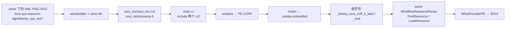

# SOUI4 on ESP32-S3（2.8" IPS / ILI9341V + FT6X36）

把 SOUI4 的 FreeRTOS 版（swinx 平台层 + SOUI 核心 + render-gdi/cairo）编成
ESP-IDF 固件，直接跑在这块 2.8 寸 SPI 屏开发板上：屏幕、电容触摸、消息循环、
XML 布局、图片、值动画全部走 SOUI 自己的路径，没有任何 LVGL 代码。

当前跑的界面就是 `soui_sim` 那个 demo（标题栏 / PNG 图 / 下拉框 / 按钮 /
两个值动画），不是简化版 Hello。

| 指标 | 实测 |
|---|---|
| 固件 | `soui_esp32s3.bin` = 4,653,360 字节 / 0x46F930（6MB app 分区剩 26%；比只有 toy font 的版本多 ~105 KB：烘焙字模 82.5 KB + 图标读取器 15.5 KB + 内嵌图标 ~5.4 KB） |
| 启动到首帧上屏 | 约 4.4 s（上电 → COFF 资源解析 → 布局 + SVG 皮肤 → cairo 首帧 + 整屏 SPI；其中 UI 任务内部约 3.0 s） |
| 稳态刷新 | **20~22 fps**（`paint` 42~45 ms + `flush` <1.5 ms；两个动画：扫动 + alpha） |
| 资源 | windres COFF 87,352 B / 59 条（app uires 9 + 系统主题 47 + 测试图标 3：`GRPICONDIR` 与两帧 `RT_ICON`），`SResProviderPE` 加载 |
| 稳定性 | 连续运行无 panic、无 task_wdt |

> 只想跑一遍"编译 → 烧录 → 看日志"的话，看 **[BUILD_FLASH.md](BUILD_FLASH.md)**，
> 里面是可粘贴的完整命令和故障对照表。本文件讲的是设计与调试过程。

---

## 1. 硬件与参数

| 项 | 值 |
|---|---|
| SoC | ESP32-S3 rev0.2，16MB Flash，8MB Octal PSRAM |
| 屏 | ILI9341V，SPI，横屏 320×240 |
| 触摸 | FT6X36，I2C @0x38 |
| 连接 | 原生 USB-Serial/JTAG（303A:1001）→ COM4，921600 烧录 / 115200 日志 |

烧录参数与厂商 LVGL demo 完全一致：
`--flash_mode dio --flash_freq 80m --flash_size 16MB`，
`0x0 bootloader` + `0x8000 partition-table` + `0x10000 app`。

## 2. 目录

```
esp32s3/
├── CMakeLists.txt              顶层；把 IDF 工程挂到已装好的 IDF 上
├── sdkconfig.defaults          PSRAM / 16MB flash / C++ 异常 / 主任务栈
├── partitions.csv              无 BOM！6MB factory + NVS + phy
├── uires/                     原始应用资源（XML / PNG / SVG）——改界面就改这里
├── soui_res/                  uiresbuilder 产物：soui_res.rc2 + resource.h（入库）
├── main.rc                    把 app 与系统两个 rc2 合成一个资源脚本
├── cmake/soui_res.cmake       资源管线：uiresbuilder → windres → .incbin
├── components/
│   ├── soui_cairo/             cairo + pixman + libpng + zlib（纯 C）
│   └── soui/                   swinx(FreeRTOS 平台层) + SOUI + utilities
│       │                       + render-gdi + imgdecoder-stb/aupng
│       ├── include/soui_idf_compat.h   force-include 等补丁
│       └── framebuffer_idf.cpp         ARGB32 framebuffer 放 PSRAM
├── main/
│   ├── app_main.cpp            UI 任务 + SResProviderPE 资源装配 + 消息泵
│   ├── soui_demo.h/.cpp        soui_sim 的 CMainDlg（combobox/按钮/动画）
│   ├── soui_board.h/.cpp       RGB565 转换 + present 回调 + 触摸注入
│   └── soui_board_esp32.cpp    ILI9341V / FT6X36 驱动（强实现）
└── tools/
    ├── esp-idf-v5.4.1/        ESP-IDF v5.4.1 源码，须含子模块（本地下载，不入库）
    ├── .espressif/            工具链 + python env（install 脚本装的，不入库）
    ├── idf_env.sh             手工装配 IDF 环境（绕开 export.sh 的 MSys 检查）
    ├── serial_capture.py      复位 + 抓 N 秒串口日志（非交互）
    └── serial_monitor.py      持续看串口日志（Ctrl+C 停，默认不复位）
```

**资源不是 C 数组**：`uires/` 下的原始文件由 `uiresbuilder` 生成 `.rc2`，
`windres` 编成一个 PE-COFF，再 `.incbin` 进 `.rodata.embedded`；运行时走
SOUI 桌面版同一条 `SResProviderPE` / `FindResource` 路径（见第 4.1 节）。

上游改动只有 4 处，其余全是新增文件：

| 文件 | 改动 |
|---|---|
| `swinx/include/sfr_config.h` | 新增 `SFR_ESPIDF`、`SFR_ARCH_XTENSA`，保留原有两态 |
| `swinx/src/platform/freertos/winobjs.cpp` | 新增 `#elif SFR_ARCH_XTENSA`：`portMUX_TYPE` + `taskENTER_CRITICAL`；Cortex-M3 的 `mrs primask/cpsid i` 留在 `#else` |
| `swinx/src/wnd.cpp` | `pthread_self()` 改走 `GetCurrentThreadId()`（见坑 8） |
| `SOUI/src/control/SRichEdit.cpp` | `printf("%s", dlerror())` 加判空（见坑 10） |

## 3. 环境

| 项目 | 版本 | 位置 |
|---|---|---|
| ESP-IDF | v5.4.1（须含子模块） | `tools/esp-idf-v5.4.1/` |
| 工具链 | Xtensa GCC 14.2.0_20241119 | `tools/.espressif/tools/xtensa-esp-elf/` |
| CMake / Ninja | 3.30.2 / 1.12.1 | `tools/.espressif/tools/{cmake,ninja}/` |
| Python | 3.13（venv `idf5.4_py3.13_env`） | `tools/.espressif/python_env/` |
| openocd / esp-rom-elfs | v0.12.0-esp32-20241016 / 20241011 | `tools/.espressif/tools/` |

两个目录都不入库（`esp32s3/.gitignore` 里的 `tools/esp-idf*/`、`tools/.espressif/`）。
`tools/idf_env.sh` 用 `$BASH_SOURCE` 定位它们，**不写死任何绝对路径**，所以在
`esp32s3/`、仓库根、`build/` 里调用都等价。要放到别处就设环境变量覆盖：
`IDF_ROOT`（含 `esp-idf-v5.4.1/` 的目录）、`IDF_TOOLS_DIR`（含 `tools/`、
`python_env/` 的目录）。

### 3.1 这些工具从哪里来

两步，装完就是上表的样子。体积：IDF 源码 640 MB，工具链目录本机是 5.1 GB
（`install.bat esp32s3` 单目标约 1.5 GB，多出来的 `riscv32-esp-elf` 等是给
esp32c/p 系列的，本工程用不到）。

**① ESP-IDF v5.4.1 源码 —— 必须带子模块**

```bash
cd esp32s3/tools
git clone -b v5.4.1 --recursive https://github.com/espressif/esp-idf.git esp-idf-v5.4.1
```

**② 工具链 + Python 环境 —— 用 IDF 自带的 install 脚本**

```bash
cd esp32s3/tools
# Windows cmd
IDF_TOOLS_PATH=%CD%\.espressif esp-idf-v5.4.1\install.bat esp32s3
# Git Bash / Linux / macOS
IDF_TOOLS_PATH="$PWD/.espressif" ./esp-idf-v5.4.1/install.sh esp32s3
```

**`IDF_TOOLS_PATH` 必须指向 `tools/.espressif`**：不设就会装到默认的
`~/.espressif`，`idf_env.sh` 到时候报 `ESP-IDF tools not found`。这一步会下
xtensa-esp-elf、cmake、ninja、esp-rom-elfs、openocd-esp32、python venv
（esp32s3 单目标解压后约 1.5 GB）。各工具版本由
`esp-idf-v5.4.1/tools/tools.json` 锁定，不要手工换。

国内网络建议先挂 Espressif 的镜像（`idf_tools.py` 会用 `IDF_GITHUB_ASSETS`
替换 github.com 的下载地址）：

```bash
export IDF_GITHUB_ASSETS=dl.espressif.cn/github_assets
```

另外 `windres` 不在 IDF 里，编资源要用宿主 mingw 的一份，见 4.1。

**官方的 `export.sh` / `export.ps1` 在这台机器上两个都用不了**，所以自备了
`tools/idf_env.sh`（第 4 节）。两个坑：

| 入口 | 失败点 |
|---|---|
| Git Bash `source export.sh` | `check-python-dependencies` 直接判 `MSys/Mingw is not supported` 退出 |
| PowerShell `export.ps1` | 把 shell 名传成 `powershell.EXE`（大写扩展名），不在 `activate.py` 白名单里 → 不走 `activate` 分支 |

`tools/idf_env.sh` 就是绕开这两层，手工把 PATH / `IDF_PATH` / `IDF_TOOLS_PATH`
装配好，顺带补上两个 `export.sh` 平时隐式设置、但手工装配时容易漏掉的变量：

```bash
# 这两个不设，只要改动任何 CMakeLists，cmake 重配就会崩
export ESP_ROM_ELF_DIR=...        # tools/cmake/gdbinit.cmake 里的 file(TO_CMAKE_PATH $ENV{ESP_ROM_ELF_DIR} ...)
export OPENOCD_SCRIPTS=...
```

`ESP_ROM_ELF_DIR` 漏了的表现很有欺骗性：`ninja` 报
`error: rebuilding 'build.ninja': subcommand failed`，真正的报错藏在上一行
`file must be called with exactly three arguments`（`gdbinit.cmake:40`，参数传个
空值就成了 2 个参数）。

**IDF 目录换过位置（或从别处拷来的 `build/`）之后，第一次编译要清 bootloader**：

```bash
rm -rf build/bootloader && mkdir -p build/bootloader
rm -f build/bootloader-prefix/src/bootloader-stamp/bootloader-{configure,done}
```

顶层 `build/CMakeCache.txt` 里存的是主工程，`build/bootloader/` 是 ExternalProject
拉起来的**第二份独立配置**，两者不共享缓存。只清顶层的话主工程编得过，一到
bootloader 就 `does not match the source ... used to generate cache`（见坑 25）。

## 4. 构建

用 `tools/idf_env.sh` 包住命令，它自己会装配环境再 exec 传进来的参数：

```bash
cd /d/work/soui4/soui-freertos/esp32s3
export CCACHE_DISABLE=1
./tools/idf_env.sh ninja -C build -j2 1> b.out 2> b.err
```

**`idf.py` 完全不要用，它是静默空转的**：

```
$ ./tools/idf_env.sh idf.py --version
MSys/Mingw is no longer supported. ...
$ echo $?
0
```

打印一行警告、**退出码 0、什么都不做**。这就是最早"`idf.py build` 只留下一行
`FAILED:`"的真相——它不是吞掉错误，它根本没开始编。同理 `idf.py flash` / `-C` /
`menuconfig` 全部无效。

所以：

- **配置**不用手动触发。改了 `CMakeLists.txt` 后 `ninja` 会自己重跑 cmake
  （`build.ninja` 里带 regeneration 规则）；改了 `sdkconfig` 靠 IDF 的 `confgen`
  依赖触发。  那条 regeneration 规则崩掉时，报错就是第 3 节说的 `ESP_ROM_ELF_DIR`。

  真要从头配（新建 `build/`）是这一条，**注意源目录是 `.` 不是 `..`**
  （`esp32s3/` 自己就是 CMake 工程根），而且 `-DPYTHON_DEPS_CHECKED=1`
  **不能省**：

  ```bash
  ./tools/idf_env.sh cmake -B build -G Ninja -DPYTHON_DEPS_CHECKED=1 .
  ```

  不加那个 define，配置阶段的 `idf_tools.py check-python-dependencies` 会因为
  Git Bash 里存在 `MSYSTEM=MINGW64` 而直接 `fatal('MSys/Mingw is not supported')`
  （`tools/idf_tools.py` 的 `__main__`）。现有 `build/CMakeCache.txt` 已缓存
  `PYTHON_DEPS_CHECKED=1`，所以只有新建目录才会撞到。
- **编译**只走 `ninja -C build`。
- **烧录**只走 `esptool ... @flash_args`（第 5 节）。

三条硬性要求，都是踩出来的：

1. **必须 `-j 2`**。本机默认并行度会随机挂死 `cc1plus`（CPU 占用归零、20 分钟
   无进展），清进程、关 ccache 都无效，降并行度立刻恢复。挂死时直接
   `Stop-Process cc1plus,cc1,ninja -Force` 然后重跑 `-j2` 即可**增量续编，
   不需要 clean**。
2. **必须 `cd build && ninja`**。理由见上：`idf.py` 是空转的，而 `ninja` 直接跑
   才能拿到真实的编译/链接器 stderr；重定向到文件是为了不被并行输出打散。
3. **全量重编（改 `sdkconfig`、改全局 `-O` 级别）之前先有心理准备**：这套源码
   （cairo + pixman + richedit41）全量编译在本机 `-j2` 要 15~20 分钟，中途
   别以为是挂死。

### 4.1 资源管线：改 XML / PNG / SVG 只要重新编译

早期版本用 `tools/gen_uires.py` 把资源转成一个 30 万行的 C++ 字符串字面量表
（`main/generated/uires_res.cpp`），改一个字符串要重跑脚本，控件 id 还得另外
手写一份 `soui_resource.h` 同步枚举。现在改成和 `soui_sim` / 桌面版同一条路，
**编辑原始资源文件后直接 `ninja` 即可**：



| 层 | 谁生成 | 说明 |
|---|---|---|
| `uires/` | 手工编辑 | 应用资源：`uires.idx` + XML / PNG / SVG。是 soui_sim 的副本，唯一差别是根窗口 `cache="0"`（见坑 16） |
| `soui_res/*.rc2`、`resource.h` | `uiresbuilder.exe` | 前者列出 9 条 app 资源，后者给出 `UIRES.*` / `R.id.*` / `R.name` / `R.ID.*`（13 个命名 id）。**产物入库**，非 Windows 宿主直接复用 |
| `main.rc` | 手工编辑 | 三件事：`#include "soui_res.rc2"`、`#include "theme_sys_res.rc2"`（后者来自 `soui-sys-resource-light`，47 条 SVG/PNG/XML 系统皮肤），以及一行 `"APP_ICON" ICON "../res/app.ico"`（标题栏 `<icon src="APP_ICON:16">` 用的 `RT_GROUP_ICON` + 两帧 `RT_ICON`） |
| PE-COFF | `windres --target=pe-x86-64 -O coff` | 一个装了 59 条资源的 COFF **对象文件**，87,352 B |
| `.rodata.embedded` | `xtensa-esp32s3-elf-gcc -c blob.S` | `.incbin` 把 COFF 当数据塞进镜像，导出 `_binary_soui_coff_o_start/_end` |
| 运行时 | `swinx/src/resapi.cpp` | `LoadModuleResources()` 先试 `dlsym`，静态镜像回落到那两个弱符号，交给 `WindResResourceParser::Parse()`；`SResProviderPE` 通过 Win32 的 `FindResource`/`LoadResource`/`LockResource` 读字节 |

四个实现上必须讲清的点：

1. **为什么要多一次 `.incbin`。** COFF 是给链接器看的**对象文件**，但这里没有任何代码引用它，swinx 是把整个文件当**磁盘映象**解析（先读段头再定位 `.rsrc`）。所以它必须以"数据"的形式存在于镜像里，而不是被链接成代码。
2. **段名必须是 `.rodata.embedded`。** 桌面管线用 `.section .rdata`，但 IDF 的 linker fragment（`components/esp_common/common.lf`）只把 `.rodata+` / `.srodata+` 收进 flash；`.rdata` 匹配不到任何规则，符号会指到未放置的垃圾地址。`.rodata.embedded` 也是 IDF 自己 `target_add_binary_data()` 用的名字。实测符号落在 `0x3c39f6f8`（DROM 映射区）。
3. **判断宿主用 `CMAKE_HOST_WIN32`，不能用 `WIN32`。** IDF 的交叉工具链把 `CMAKE_SYSTEM_NAME` 设成 `Generic`，`WIN32` 恒为 `FALSE` —— 第一次配置就是走了"非 Windows 宿主"分支，导致 `uiresbuilder` 的自动重建规则根本没生成。`uiresbuilder.exe` 是宿主工具，能不能跑取决于宿主而不是目标平台。两个 GLOB 都带 `CONFIGURE_DEPENDS`，新增/删除资源文件也能被感知。
4. **windres 需要补齐 PATH。** 它默认用 `gcc -E -xc -DRC_INVOKED` 预处理 `.rc`；IDF 的 ninja 规则统一走 `cmd.exe`，其 PATH 是 Xtensa 工具链 + IDF python，没有 mingw 的 gcc / cc1 / 运行时 DLL，windres 只报一句含糊的 `preprocessing failed.`（在 Git Bash 里手工跑同一条命令却成功）。`cmake -E env --modify PATH=path_list_prepend:<windres 所在目录>` 只作用于这一条 custom command。试过显式 `--preprocessor=...gcc.exe`：gcc 找得到，但仍缺 PATH 里的运行时目录，照样退出 1。

`app_main.cpp` 里对 `_binary_soui_coff_o_start/_end` 是**强引用**：swinx 那边只声明成 weak（没资源的镜像也要能链接），而 weak undefined 不会把 archive member 拉进来；这里强引用既保证 blob 不被链接器丢掉，也让"忘了挂资源"在链接期就失败，而不是开机后报 resource not found。

**依赖**：需要 mingw 的 `windres`（MSYS2 `mingw-w64-x86_64-binutils`，Linux `binutils-mingw-w64-x86-64`）。它只用来编 `.rc`，C/C++ 仍全部由 Xtensa 工具链编译 —— 和"用不用 MinGW 编译器"无关。非 Windows 宿主上 `uiresbuilder` 跑不了，`soui_res.rc2` / `resource.h` 已入库可直接用；但**新增资源条目或改控件 `name`** 得回 Windows 重新生成一次。

**实测验证**（改 `uires/values/string.xml` 里的一个字符串后直接 `ninja`）：

```
[1/14]  [uiresbuilder] uires.idx -> soui_res.rc2 + resource.h
[2/14]  windres: main.rc (app + sys resources) -> COFF
[5/14]  embedding soui_res COFF into the image (.rodata.embedded)
[11/14] Linking CXX executable soui_esp32s3.elf
[12/14] Generating binary image from built executable
```

14 步增量（全量是 263 步），新字符串同时出现在 COFF 和 `.bin` 里。启动日志：

```
I (1845) soui_app: resource blob: 81298 bytes at 0x3c39f6f8
... coffparser,2,parse done, found 56 resources ...
I (2094) soui_app: system res flags=0x08   (skin/editmenu/msgbox 全部成功，theme 已加载)
I (2110) soui_app: app res provider added (UIDEF:XML_INIT)
I (2110) soui_app: named ids registered: 13
I (4401) soui_app: main window up
I (7475) soui_app: fps=20.0, paint=44.7ms, flush=0.9ms
```

`56` 与旧 C 数组的条目数逐个对得上（9 + 47），资源内容也逐字节比对过（除旧数组末尾的 `\0` 终止符和新增注释），帧率无退化。

## 5. 烧录与观察

`idf.py flash` 内部要起 Python 子进程做 `check-python-dependencies`，同样会撞上
"MSys/Mingw is no longer supported"。**绕开 idf.py，直接调 esptool**，用
`build/flash_args` 里已经生成好的地址表：

```bash
cd build
./../tools/idf_env.sh python -m esptool --chip esp32s3 -p COM4 -b 921600 \
    write_flash @flash_args
```

观察日志（两种，按需求选）：

```bash
cd /d/work/soui4/soui-freertos/esp32s3

# 1) 一直看，Ctrl+C 停。默认不复位，不打断正在跑的程序
./tools/idf_env.sh python tools/serial_monitor.py COM4
./tools/idf_env.sh python tools/serial_monitor.py COM4 --reset      # 先复位再看
./tools/idf_env.sh python tools/serial_monitor.py COM4 --log run.log # 同时存文件

# 2) 复位 + 抓 22 秒后退出，适合"只想知道启动阶段有没有问题"
./tools/idf_env.sh python tools/serial_capture.py COM4 22
```

两条都要用 `tools/idf_env.sh` 包着：系统 python 没有 pyserial，缺了会
`ModuleNotFoundError`。**不要用 `idf.py monitor`** —— 它在 Git Bash 下直接拒绝
（`MSys/Mingw is no longer supported`），在 PowerShell 下又卡在 IDF 5.4.1 的
`export.ps1` bug（把 shell 名传成 `powershell.EXE`，而白名单里只有
`powershell.exe`）。

不想用脚本的话，任何串口终端连 **COM4 @115200 8N1、UTF-8** 都可以
（PuTTY / MobaXterm / VS Code 的 Serial Monitor）。日志之所以能在 COM4 看到，
是因为 sdkconfig 里 `CONFIG_ESP_CONSOLE_SECONDARY_USB_SERIAL_JTAG=y`：ESP_LOG
同时从 UART0（GPIO43/44，115200）和原生 USB 出去。副作用是 **ROM 引导那几行
（`ESP-ROM:esp32s3-...`）只在 UART0 上**，USB 侧从 `I (xx) boot:` 开始。

串口是独占的：看日志时烧不进去，烧写/`serial_capture.py` 之前要先关掉。

## 6. 实测启动日志

```
I (1364) soui_app: == SOUI4 on ESP32-S3 (soui_sim demo) ==
tid=1070289748, ... coffparser,2,parse done, found 56 resources, coffparser.cpp:236
I (2095) soui_app: app ready: render-gdi + imgdecoder-stb + PE resources
I (2095) soui_app: resource blob: 81346 bytes at 0x3c39f87c
I (2096) soui_app: named ids registered: 13
I (3993) soui_app: main window up, hwnd=0x3c479e3c
I (3993) soui_app: IMessageLoop=0x3fcbe3d0
I (7055) soui_app: fps=25.7, paint=35.0ms, flush=2.9ms | presents=91 (+91/3s, 1.18/frame), pixels=565005 (+565005/3s), 188 kpix/s
I (10069) soui_app: fps=27.0, paint=32.3ms, flush=2.1ms | presents=187 (+96/3s, 1.19/frame), pixels=998088 (+433083/3s), 144 kpix/s
I (13199) soui_app: fps=27.0, paint=33.8ms, flush=2.1ms | presents=281 (+94/3s, 1.16/frame), pixels=1432518 (+434430/3s), 145 kpix/s
```

六点值得注意：

- `resource blob: 81346 bytes at 0x3c39f87c` + `found 56 resources`：windres
  COFF 已经进了 DROM 映射区并被 `WindResResourceParser` 解析成功（9 条 app +
  47 条系统皮肤），见 4.1。这两个值是判断"资源到底挂上没有"最快的依据。
- `app ready: render-gdi + imgdecoder-stb + PE resources` 是 `SAppCfg::DoConfig()`
  返回 TRUE 之后打的一行汇总：render 工厂、图片解码器、两套 PE 资源都在。
  （旧的手写装配会分别打 `Render_Gdi_SCreateInstance -> 1` /
  `imgdecoder-stb installed` / `system res flags=0x08` /
  `app res provider added (UIDEF:XML_INIT)` 四行；改用 SAppCfg 后这些中间步骤
  的日志随之一并消失，`LoadSystemNamedResource()` 的 bitmask 也不再对外暴露。）
- `named ids registered: 13`：来自 `uiresbuilder` 生成的 `R.name` / `R.id`，
  布局里 13 个带 `name` 的控件都能用 `EVENT_ID_COMMAND(R.id.xxx, ...)` 找到。
- `I (1326) spi_flash: flash io: qio`：QIO 真的生效了（镜像头里的 `dio` 是烧录模式，
  见 10.1）。
- `fps=` 就是帧率，直接由**完成的 `WM_PAINT` 次数**算出来，和屏上 `fps_label`
  是同一个口径。`presents` 是**blit 次数**，随重叠窗口数变（历史上 4.3 次/帧，
  现在 1.1~1.2 次/帧——`CreateRenderTarget2` 改成直接画进窗口 DC 之后，一帧只
  提交一次），不能当帧率读。
- `paint=42ms` + `flush=0.4ms`：**paint 是绝对瓶颈，SPI 送屏只占约 1%**。
  最初 paint 是 133ms——说明"刷屏慢"的直觉是错的，时间全花在 CPU 侧的裁剪/
  绘制调度上（见 10.1、10.2）。这组数字是**两个动画**（扫动 + alpha）的场景；
  只有一个扫动时是 28ms / 35fps，两者的差就是 layered 窗口的价钱，拆解见 10.3。

## 7. 踩坑清单

按出现顺序，每条都是真问题，不是"重试就好了"。

| # | 现象 | 根因 / 修法 |
|---|---|---|
| 1 | 组件 requirement 子进程里 `SOUI_ROOT` 为空，路径变成 `/swinx/...` | IDF 的组件元数据阶段不继承顶层变量 → 每个组件 CMakeLists 自己 `get_filename_component(... ../../..)` 推导 |
| 2 | `Field 'type' can't be left empty` | `partitions.csv` 带 UTF-8 BOM，`gen_esp32part.py` 把注释首行当数据 → 无 BOM 重写。**生成配置文件后要复查前 3 字节** |
| 3 | `Invalid character escape '\w'` | `$ENV{IDF_PATH}` 是 `D:\work\...`，IDF 把 INCLUDE_DIRS 序列化成 C 字符串时 `\w` 成非法转义 → `file(TO_CMAKE_PATH ...)` |
| 4 | pixman 309 处指针不兼容报错 | GCC 14(Xtensa) 把 `-Wincompatible-pointer-types` 升级成 error，`-w` 压不住 → 显式 `-Wno-error=incompatible-pointer-types`（`pixman_fixed_t`=`int32_t`=`long`，32 位同宽安全） |
| 5 | `'d' was not declared` | `pixman*.c` glob 命中 `pixman-arm-neon.c` / `-simd.c`，它们不是 `.S` → 从源列表剔除 SIMD 文件 |
| 6 | `FreeRTOS.h: No such file` | IDF 5.3+ 内核头挪到 `FreeRTOS-Kernel/include/freertos/`，`REQUIRES freertos` 只导出 `include/` → 显式补该路径 |
| 7 | 17 处 `push_back({IDOK, u8"确定"})` 报错 | IDF 默认 `-std=gnu++2b`，C++20 起 `u8""` 是 `const char8_t[]` → 整个 soui 组件改 `-std=gnu++17` |
| 8 | `pthread_self` 多重定义 | **不能让 IDF 的版本赢**：它对 `xTaskCreatePinnedToCore` 建的任务直接 `assert(false)` → `winobjs.cpp` 的定义加 `&& !SFR_ESPIDF` 关掉，`wnd.cpp` 改用 `GetCurrentThreadId()` |
| 9 | `'swinx_fr' has not been declared` | 该命名空间原本靠 `stl/mutex` 垫片间接触发，而 ESP-IDF 用真 libstdc++ → `syncapi.cpp` / `SConnection.cpp` 显式 include |
| 10 | 启动即 `Guru Meditation / EXCVADDR 0x0`，回溯落在 `STextServiceHelper` 的 `printf` | `SRichEdit.cpp` 里 `printf(...err=%s, dlerror())`：swinx 的 `dlerror()` 按 POSIX 返回 NULL，**newlib 的 vfprintf 对 `%s`+NULL 不判空直接解引用**（glibc 才打 `(null)`）→ 加判空 |
| 11 | 启动日志 `no LCD driver linked`，屏全黑 | `libmain.a` 里 `__attribute__((weak))` 的桩已满足 `app_main` 的引用，链接器**不会**再抽出 `soui_board_esp32.cpp.obj` → 删掉弱桩，每个钩子一份强定义 |
| 12 | 跑起来 5 秒后 `task_wdt: CPU 1: soui_ui` | 值动画每 16ms 请求一帧，而一帧要几百 ms（cairo + polling SPI），一次性排空消息队列会让 UI 任务连续几秒不让出，IDLE1 饿死 → 给消息泵加预算：每轮最多 8 条 + 最长 200ms，然后 `vTaskDelay(1)`（1 tick = 1ms，见第 9 节第 5 点） |
| 13 | PNG 全部 `resource content ... not found!`（装了 imgdecoder 也没用） | 日志来自 `SResProviderMgr::LoadImage` 的**第二次**判断：`HasResource` 通过、但 `provider->LoadImage` 返回 NULL。当时的 `MemResProvider` 直接 `return NULL` → 照 `SResProviderPE` 的做法调 `SResLoadFromMemory::LoadImage(bytes,len)`（内部走 `GETRENDERFACTORY->CreateBitmap` + `LoadFromBitmap(_memory)`）。**现在已换成 `SResProviderPE`，这条由它原生满足**（见 4.1） |
| 14 | 引 `res.mgr/SResProvider.h` 报 `SStringT does not name a type` | 该头依赖 `souistd.h` 提供的 SStringT/SMap → 先 `#include <souistd.h>` |
| 15 | 触摸"点了没反应，过几秒才动"，且一次画一帧期间的点按直接丢失 | 两个独立缺陷：①`updateMsgQueue` 每个 16ms 动画 tick 都往队列压一条 `WM_TIMER`，慢渲染下队列无限增长，输入排在几百条过期计时器后面（Win32 的 `WM_TIMER` 是生成型消息，同 id 最多一条）；②采样在消息泵里做，一帧 100ms 内的按下+抬起**根本没被读到**。修法见第 9 节 |
| 16 | 脏矩形只有 40×16，一次 `WM_PAINT` 却要 162ms | 布局根窗口 `cache="1"`：`_PaintClient` 每次失效都把**整窗**重画进 cache 表面，再整幅 `AlphaBlend`。桌面在显存里做划算，PSRAM 上不划算 → 根窗口改 `cache="0"`（162ms → 126ms）。旧的 `gen_uires.py --strip-window-cache` 是在**生成时**做这个替换；现在资源按原样编译，所以 `uires/xml/dlg_main.xml` 里直接写的就是 `"0"`，别从 soui_sim 复制时把它带成 `"1"` |
| 17 | richedit41 一链就 53 个 `undefined reference` | 它是个完整 Win32 程序：剪贴板、OLE 剪贴板、拖放、IME、profile、kernel32 文件 API 全用。→ `swinx/src/platform/freertos/win32_rich.cpp` 补桩，剪贴板**真转发**到 `SConnection::SClipboard`，其余惰性返回失败（不要假装成功，否则 TOM 的 Save 会写出半截内容） |
| 18 | CPU 160→240MHz + 全局 `-O2` 只提升约 20% | 当时误判为"瓶颈是 PSRAM 访存、加时钟没用"。**这个结论后来被推翻**，见第 10.1 节：真正的瓶颈是每帧几十次 cairo 裁剪状态操作（固定开销，与像素数无关） |
| 19 | 加了 `[prof]` 才发现 `updRgn=6073px` 但 `dirty=76800px` | `BeginPaint` 没按 Win32 语义把 DC 裁到 update region，`GetClipBox()` 报整窗 → `SHostWnd::OnPrint()` 把 `rcInvalid` 并成整窗 → present 变成整幅 BitBlt（15.7ms/帧） |
| 20 | 40×16 的空窗口 `fade_box` 单独要 16ms | `DispatchPaint()` 每层无条件 2×`SaveClip` + 2×`PushClip`，每次都是一整套 `cairo_copy_clip_rectangle_list` + `CombineRgn` + `cairo_reset_clip` + `cairo_clip`；再加上 `IsClipClient()` 时 `rcClient==rcWnd` 也照样 `PushClipRect`（恒等裁剪）。修法见第 10.1 节 |
| 21 | 有动画的窗口 paint 时间是静止窗口的数倍 | `SWindow::IsDrawToCache()` = `m_bCacheDraw \|\| m_isAnimating \|\| !m_pAnimatorHandler->IsEmpty()`（`SOUI/src/core/Swnd.cpp:3985`），**任何带动画的窗口**都走整窗离屏表面。桌面在显存里做划算，PSRAM 上是纯亏。框架层没有关闭这个行为的开关，只能让该窗口自己不进入动画、也不显式写 `cache="1"`；本移植的解在资源层：根窗口 `cache="0"`（坑 16） |
| 22 | 组件 `CMakeLists` 里写 `-O2` 却不生效 | `target_compile_options` 排在 `CMAKE_CXX_FLAGS` **之后**，组件里原有的 `-Os` 会**静默覆盖** `CONFIG_COMPILER_OPTIMIZATION_PERF` 给的 `-O2`。改 `sdkconfig` 的优化等级对这几个组件完全无效 |
| 23 | `idf.py build` 立刻返回、日志只有一行 `FAILED:` | `idf.py` 自己带 MSYS 检查，`MSYS_NO_PATHCONV` / 清 `MSYSTEM` 都绕不过 → 它打一行警告就 **`exit 0` 空转**。不是"吞掉错误"，是根本没执行。改用 `ninja -C build` |
| 24 | 改任何 `CMakeLists.txt` 后 `ninja: error: rebuilding 'build.ninja': subcommand failed` | 真正的报错在上一行：`tools/cmake/gdbinit.cmake:40` 的 `file(TO_CMAKE_PATH $ENV{ESP_ROM_ELF_DIR} ...)` 因变量为空退化成 2 个参数 → `export ESP_ROM_ELF_DIR=<idf_tools>/tools/esp-rom-elfs/<ver>/` |
| 25 | 换了 IDF 目录（`idf_env.sh` 的 `IDF_ROOT`）后，主工程能编，到 bootloader 就报 `CMake Error: The source ".../tools/esp-idf-v5.4.1/components/bootloader/subproject/CMakeLists.txt" does not match the source ".../old/esp-idf-v5.4.1/..." used to generate cache` | **`build/bootloader/` 是独立的外部工程，有两份自己的 `CMakeCache.txt`**，删顶层 `build/CMakeCache.txt` 不会碰到它。修法：`rm -rf build/bootloader && mkdir -p build/bootloader && rm -f build/bootloader-prefix/src/bootloader-stamp/bootloader-{configure,done}`。注意**目录必须自己建回来**——`bootloader-mkdir` 的 stamp 还在，ninja 认为已经建过，而 `cmd /C "cd /D ...\build\bootloader"` 对不存在的目录直接报"系统找不到指定的路径" |

其他非报错但要记住的点：

- **IDF 5.4 删了 legacy `driver/i2c.h`**（在废弃的 `driver` 组件里），`esp_driver_i2c`
  只有新 API：`i2c_new_master_bus` / `i2c_master_bus_add_device` /
  `i2c_master_transmit_receive`；`i2c_master_bus_config_t` 没有 `sda_pullup_en`，
  用 `flags.enable_internal_pullup`。
- **main 组件的 `REQUIRES` 要显式写全**：`esp_driver_gpio` / `esp_driver_spi` /
  `esp_driver_i2c`。IDF 5.x 的 main 不再隐式依赖所有组件。
- main 组件也要 `-w`、`-include soui_idf_compat.h`（`SWnd.h` 用 `LLONG_MAX`）、
  `-std=gnu++17`、`-fexceptions`，且 `IMessageLoop` 要写全 `SNS::IMessageLoop`。

## 8. soui_sim demo 是怎么搬过来的

`soui_sim` 本身是 Windows 上的 FreeRTOS 模拟器 + SDL2，不能直接烧。搬的是**应用层 +
资源**，下面的对应关系就是移植的完整工作量：

| 桌面/模拟器 | 这块板子 |
|---|---|
| `SAppCfg::DoConfig()`（头文件实现，内部 `CreateImgDecoder` 走 dlopen） | 同一个 `SAppCfg::DoConfig()`，只有资源描述不同：`SetSysResPeHandle(kAppInstance)` / `SetAppResPeHandle(kAppInstance)` 指向 windres 编进镜像的 PE blob（见 4.1）；`InitXmlNamedID` 仍在 DoConfig 之后手动调用 |
| uires → windres → `.section .rdata` | 同一条路，只是 COFF 用 `.incbin` 落到 `.rodata.embedded`，运行时 `SResProviderPE` 读（见 4.1）。**不再生成 C 数组** |
| `uiresbuilder` 的 `R.id.*` | 同一个 `uiresbuilder` 生成的 `soui_res/resource.h`，`R.id.*` / `R.ID.*` / `R.name` 直接用 |
| 系统资源 `soui_sys_res/theme_sys_res`（PNG 版） | 用 **SVG 版**（`soui-sys-resource-light/theme_sys_res`，内容与 `demos/android-demo/.../theme_sys_res` 只差一行 `_skin.sys.selband`）：render-gdi/cairo 走 nanosvg，不依赖位图解码 |
| `main()` + `vTaskStartScheduler()` | `app_main()` + `xTaskCreatePinnedToCore(49152B, prio 5, core 1)` |
| SDL 事件泵 + `SimHalRenderIfDirty` | `soui_board_poll_touch()` + `swinxFbPresent` 回调 |
| `PeekMessage` + `IMessageLoop::OnMsg` | 同左，但每轮限 8 条消息 / 200ms（见坑 12） |

`SAppCfg` 只有**一处**和桌面 demo 不同：本固件是静态链接的，`SComMgr2` 走
`config.h` 里的 `LIB_SOUI_COM` 分支，而 `commgr2.h` 会按 `SCOM_MASK` 把每个
"启用"组件的 `SCreateInstance()` 调用**编进代码**。默认值是
`scom_mask_scom_all`，会把 render-skia / scriptmodule-lua / translator / log4z
一起拉进来——这些库本固件没链接，于是变成链接错误（不是运行期失败）。所以
`app_main.cpp` 在包含 `<SAppCfg.h>` **之前**必须先写：

```cpp
#include <commask.h>
#define SCOM_MASK (scom_mask_render_gdi | scom_mask_imgdecoder_stb)
```

顺序不能反：`<souistd.h>` 等头一旦先把 `commgr2.h` 拉进来，`#ifndef SCOM_MASK`
的默认值就定型了，之后再 define 只会得到一条重定义警告、mask 仍然全是 1。

`<edit>` 现在走 **SEditLite**（`SOUI_EDIT_LITE`）：`SOUI/src/control/SEditLite.cpp`
里那份自绘的纯文本编辑器，不依赖 `CreateTextServices()` / `Msftedit.dll` /
richedit41。XML 属性面和 `IEdit` 接口与 RichEdit 版一致，所以 `<combobox>`、
`SMaskEdit`、`SDateTimeEdit` 这些依赖方不用改。

> 历史：这里原来是静态链接 `third-part/richedit41` + `lssrc`（msls31 替代），
> `SRichEdit.cpp` 走 `INIT_RICHEDIT` 分支，并为此在
> `swinx/src/platform/freertos/win32_rich.cpp` 补了 53 个 Win32 入口（剪贴板转发到
> `SConnection` 的 `SClipboard`，IME / OLE / 文件 API 惰性桩）。那一层把固件从
> 3.50MB 推到 3.98MB（4MB 分区只剩 5%，于是 app 分区改成 6MB，见
> `partitions.csv`），并且是全量构建里最重的一段。改用 SEditLite 后整套不再编译；
> 需要 RTF 时可以按 git 历史把 richedit41 的源清单加回来（`INIT_RICHEDIT` +
> `SRichEdit.cpp`），同时去掉 `SOUI_EDIT_LITE`。

## 9. 输入链路（触摸 → 控件）

这块是"为什么没有 LVGL 固件跟手"的答案，四个独立的问题叠在一起：

```
FT6X36 ──(soui_touch 任务, 8ms)──► FreeRTOS 队列 ──► 消息泵顶部重放 ──► SwinxInjectMouse
                                                        │
                          每个泵轮先 PeekMessage(WM_MOUSEFIRST..WM_MOUSELAST)
                                                        │
                                                   SOUI 控件 → Invalidate → WM_PAINT
```

1. **采样必须在自己的任务里**（`main/soui_board.cpp` 的 `touch_task`）。
   原先在消息泵里读一次 I2C：一帧要 100ms 以上，**手指按下再抬起如果整个落在一帧
   之内，这个点击不是延迟，而是彻底丢失**。现在 8ms 采样（厂商 LVGL 是 30ms），
   变化才入队，UI 线程只负责把队列按顺序重放成 DOWN/MOVE/UP。
2. **`WM_TIMER` 必须像 Win32 那样合并**（`SConnection.cpp:hasQueuedTimerMsg`）。
   SOUI 的值动画用 16ms `SetTimer` 驱动，一帧 100ms 就意味着每帧往队列压 6 条以上
   计时器消息；不合并的话队列长度随时间线性增长，触摸事件永远排在几百条过期计时器
   后面 —— 表现就是"点了没反应，过几秒才动"。Win32 语义是同一计时器在队列里最多
   一条，到期未取则丢这一拍。
3. **输入优先取**：每轮泵先按 `WM_MOUSEFIRST..WM_MOUSELAST` 范围 `PeekMessage`，
   最多 6 条，然后再处理绘制/计时器。这样一次点击最多等"正在画的那一帧"。
4. **相同坐标不重复注入**：8ms 一个 `WM_MOUSEMOVE` 会把队列灌满无意义消息，
   采样端和注入端各做一次去重。
5. 泵尾的 `vTaskDelay` 从 10ms 改成 **1 tick（`CONFIG_FREERTOS_HZ=1000` → 1ms）**，
   仍然让 IDLE1 跑到（看门狗），但不再给输入凭空加 10ms。

## 10. 显示链路

```
SOUI 控件树
  └─ render-gdi(cairo) 画到 ARGB32 framebuffer   ← PSRAM，307200 B
       └─ SConnection::commitCanvas() blit 脏矩形
            └─ swinxFbPresent(rect)   [soui_board.cpp 注册的回调]
                 └─ ARGB32 → RGB565            ← PSRAM，153600 B
                      └─ soui_board_lcd_flush() [soui_board_esp32.cpp]
                           └─ SPI 大块 polling 写 ILI9341V
```

首帧整屏 320×240 约 470ms（cairo 软件渲染 + 写入全屏）；之后只刷脏矩形，
典型的动画帧 6000~7000 像素。

**per-frame 诊断**：消息泵每 3 秒打一行

```
presents=146 (+48/3s), pixels=1198272 (+328104/3s), paint=116.0ms, flush=3.2ms, 109 kpix/s
```

`flush` 是 SPI 送屏耗时（大块传输后 3ms 左右，已经不是瓶颈），`paint` 是一次
`WM_PAINT` 的墙钟时间（含 cairo 渲染）。两者拆开才知道该优化哪一头。

已做的两项廉价优化：`sdkconfig.defaults` 里 CPU 160MHz → **240MHz**，
全局 **`-O2`**（`CONFIG_COMPILER_OPTIMIZATION_PERF`）。实测 12fps → 16fps。
当时据此判断"剩下的大头是 PSRAM 上软件渲染的访存"，**这个结论是错的**，
见 10.1。

### 10.1 帧率从 ~8fps 到 ~20fps：四个真正的瓶颈

上面那句"大头是 PSRAM 访存"是**错的**。加了 `SOUI_PORT_PROFILE=1` 的分阶段
计时后（`[prof]` 行，见下）才看清：一次 `WM_PAINT` 只脏 6k 像素，却要 133ms，
时间根本不是花在像素上。

复现方法：`components/soui/CMakeLists.txt` 里把 `SOUI_PORT_PROFILE=0` 改成 1，
串口每 20 帧输出（**这个开关已在优化收尾时移除**，要复现得按 git 历史把宏和
`shostwnd.cpp` 里的计时段加回去）

```
[prof] layout=366 paint=26904 present=1215 [begin=409 clip+clr=1880 tree=23873 tail=93] updRgn=5747px dirty=5747px clip=40 calls/42 rects
  [w] 4 windows touched
  [w]              total=21871 own=1369 pre=500 child=19841 post=154 lay=4 n=20
  [w] fade_box     total=6406  own=829  pre=1111 child=1835 post=1838 lay=792 n=20
```

| # | 瓶颈 | 现象 | 修法 | 收益 |
|---|---|---|---|---|
| 1 | `SWindow::IsDrawToCache()` 把"有动画"也算作要缓存 | 每帧 ClearRect 整窗 + 整窗重画进离屏 + 整幅 AlphaBlend，只为 6k 像素脏区 | 用一个临时编译开关（让该函数只认 `m_bCacheDraw`）量出这一项，确认它是主因；**这个开关没有留在代码里**，最终的解落在资源层：根窗口 `cache="0"`（坑 16） | 162→133ms（临时开关）/ 162→126ms（`cache="0"`） |
| 2 | `BeginPaint()` 没把 DC 裁剪到 update region | `GetClipBox()` 报整窗 → `SHostWnd::OnPrint()` 把 `rcInvalid` 并成整窗 → present 变成 307KB 整幅 BitBlt | `wnd.cpp` 的 `BeginPaint` 用 `wndObj->invalid.hRgn` 设 `RGN_AND` 裁剪（Win32 语义，`ReleaseDC` 的 `RestoreDC(-1)` 撤销） | present 15.7→1.2ms |
| 3 | `DispatchPaint()` 对**每个**可见窗口**无条件**付 2 次 `SaveClip` + 2 次 `PushClip` | 一屏 25 个窗口就是上百次裁剪运算，而真正相交的只有 3 个 | ① 整窗不在脏区 → 函数开头直接 return；② 只在真有 `m_clipRgn/m_clipPath` 时 `SaveClip`；③ `rcClient == rcWnd` 时跳过 `PushClipRect` | 85→54ms，窗口 25→4 |
| 4 | layered 窗口（alpha≠255，如 `fade_box`）每帧新建/释放离屏 RT | `CreateRenderTarget` + `cairo_create` + `Release` ≈ 6ms/帧，窗口只有 40×16 | 新增 `m_layeredRT` 成员跨帧复用，尺寸变化时在 `OnSize` 里丢弃重建 | 16.2→6.4ms |

第 1 项之所以不在框架层留开关：`IsDrawToCache()` 现在（以及当时提交后）
仍然是 `m_bCacheDraw || m_isAnimating || !m_pAnimatorHandler->IsEmpty()`
（`SOUI/src/core/Swnd.cpp:3985`），改它会同时改变 Windows/移动端"动画窗口
自带离屏缓冲"的行为。同一份收益用资源层就能拿到——让根窗口不写 `cache="1"`
（坑 16，162→126ms），代价只有"根窗口每帧重画自己的背景"，而那点面积本来就
落在脏区里。`components/soui/CMakeLists.txt` 里曾经的
`SOUI_DISABLE_AUTO_CACHE` 宏从来没有对应的 `#ifdef` 分支，已删除。

顺带把 `ExtSelectClipRgn(RGN_AND)` 改成快路径（`ApplyRegionAnd`）：cairo 的裁剪
天生就是"与当前裁剪求交"，不需要先 `cairo_copy_clip_rectangle_list` 导出、再做
GDI 区域布尔运算、再 `cairo_reset_clip` 重新应用。

**编译/缓存配置**也补上了（之前漏的）：

- `soui` 组件的 `target_compile_options` 里原来写的是 `-Os`。它排在
  `CMAKE_CXX_FLAGS` 之后，**静默覆盖了全局 `-O2`** —— 整个 cairo/pixman/SOUI
  其实是按 `-Os` 编的。改成 `-O2` 后单这一项就让 paint 从 31.6ms 掉到 26.9ms
  （固件 4.01MB → 4.40MB，6MB 分区还剩 30%）。
- **同一个坑在 `components/soui_cairo/CMakeLists.txt` 里还有一份**（`-w -Os`），
  漏掉了 169 个文件：cairo 107、pixman 32、png、zlib 30 —— 也就是**真正碰像素的
  那部分代码**。改 `-O2` 后固件 4.40MB → 4.49MB（+94KB），但 `paint` 只从
  48.6ms 降到 46.3ms。**这个结果本身很有信息量**：把渲染代码全开到 -O2 只买回
  2ms，说明剩下的 46ms 不是指令数，而是别的东西（见下面"还剩的空间"）。
  核对方法：
  ```bash
  python -c "import json;from collections import Counter;
  db=json.load(open('build/compile_commands.json'));
  print(Counter(tuple(o for o in e['command'].split() if o.startswith('-O') and len(o)<=4) for e in db))"
  # 期望 {('-O2',): 1421}；出现 ('-O2','-Os') 就说明某个组件还在偷偷降级
  ```
- `CONFIG_ESPTOOLPY_FLASHMODE_QIO`（原来是 DIO，代码 XIP 取指带宽砍半）。
  注意镜像头里的 `spi_mode` 字节仍然是 `0x02`(DIO)，**这是正常的**：
  `CONFIG_ESPTOOLPY_FLASHMODE="dio"` 只是给 esptool 用的烧录模式，
  bootloader 起来后会自己升到 QIO。运行时看启动日志的
  `I spi_flash: flash io: qio` 才是真的。
- `CONFIG_ESP32S3_DATA_CACHE_64KB`（原来是 32KB，S3 的最大值）。

**最终实测**（COM4 @115200，`SOUI_PORT_PROFILE=0`）：

```
I ( 7345) presents=110 (+110/3s), pixels=912056,  paint=49.2ms, flush=3.9ms, 304 kpix/s
I (10521) presents=230 (+120/3s), pixels=1619096, paint=46.3ms, flush=2.7ms, 236 kpix/s
I (13586) presents=342 (+112/3s), pixels=2390648, paint=48.1ms, flush=3.2ms, 257 kpix/s
```

**先分清两个数，别被 `presents` 骗了**：

| 指标 | 值 | 说明 |
|---|---|---|
| `presents` | **37~40 /秒** | 脏矩形 blit 次数。**一帧会发 1.85 次**（窗口提交 + 重叠窗口重合成），不是帧率 |
| 真实帧率 | **~20 fps** | `paint` 46ms + `flush` 3ms。demo 的 `fps_label` 数的就是这个，屏上显示 18.5~20 |

两者互相对得上：`40 presents/s ÷ 21.6 frames/s = 1.85 presents/帧`。优化前
`presents` 是 14.7/秒，折合帧率 **~8fps**，所以仍是 **2.5×**。

（本文档早先把 `presents` 当成帧率写成"37fps"，是错的，已按上表更正。）

**和 LVGL 那个 100fps 不可直接比**：320×240×2B = 153600 B，40MHz SPI 全屏刷一次
就要 30.7ms（上限 33fps），所以 LVGL 的 100fps 一定是"只刷几十行"的局部刷新
数字，而不是整屏。SOUI 现在的脏区也只有 6k 像素，量级对得上。

**还剩的空间**：把 cairo/pixman 开到 `-O2` 只买回 2ms，说明 46ms 不是指令数问题。
`[prof]` 行里的 `clip=40 calls/42 rects` 是最可疑的线索——**一帧 40 次裁剪操作**，
而 `cairo_clip` 在这个后端单次 1~2ms（每次都要重建 pixman region），40 × 1.1ms
大约就是 45ms。也就是说每帧画的像素只有 6k，**时间全花在"反复告诉 cairo 要裁到
哪里"上**。下一步按收益排序：

1. `PushClipRect` / `PushClipRegion` 加**包含性快路径**：新矩形若已包含当前
   `GetClipBox()`，`RGN_AND` 是恒等操作，直接跳过（SOUI 每个窗口都推一次
   `rcClient`，而裁剪往往已经更小）。
2. 给 `SRenderTarget_GDI` 加一层 clip 状态缓存，同一组裁剪矩形不重复下发。
3. 渲染目标 ARGB32 → RGB565，内存和带宽都减半（改动面最大）。
4. SPI 提到 80MHz，把全屏刷新的上限从 33fps 抬到 66fps——只在脏区变大
   （整屏滑动）时才有意义，现在 `flush` 只占 3ms，不是瓶颈。

### 10.2 裁剪到底有多贵：直接量出来，然后修掉

10.1 的结论是"每帧 40 次裁剪 ≈ 45ms"，但这是推算。为了不靠推算，做了一次
**消融实验**，结论还差点把人带偏：

- 把 RT 层的 `PushClipRect / PushClipRegion / PopClip / SaveClip / RestoreClip`
  全部改成空实现（当时用一个临时编译开关做开关，量完即拆，代码里没有留下
  `SOUI_ABLATE_CLIP` 这个名字），板子上的帧率**反而从 19fps
  掉到 14fps**。原因是那些空实现把裁剪一起删掉了，绘制不再被限制在 6k 像素的
  脏区里，填充面积成倍放大——**"删掉裁剪"和"裁剪很贵"两件事被混在一起了**。

所以改成直接测量。在开机时对一块和绘制目标同尺寸（320×240 ARGB32）的 HDC
跑固定次数的操作（临时基准，现已删除）：

| 操作 | 单次成本 |
|---|---|
| `SelectClipRgn(NULL)`（只 `cairo_reset_clip`） | **0.5 µs** |
| `GetClipBox` | 5 µs |
| `SaveDC`+`RestoreDC`（无裁剪） | 58 µs |
| `CreateRectRgnIndirect`+`DeleteObject` | **193 µs** |
| `AND clip`，4×4 / 40×30 / 320×240 | **500 µs（三者相同）** |
| `COPY clip`，40×30 | 545 µs |
| `SaveDC`+`RestoreDC`（有裁剪） | 878 µs（含上一个 clip） |
| `PushClipRect` 1 矩形 + `PopClip` | **931 µs** |
| `PushClipRect` 4 矩形 + `PopClip` | **3359 µs** |

三点结论：

1. **裁剪成本与面积无关**（4×4 和 320×240 一样是 500µs），是纯固定开销，
   所以"减少脏区面积"对这个数字没用。
2. **每多一个矩形多 ~800µs**：4 矩形的区域是 1 矩形的 3.6 倍。SOUI 每次推的是
   多矩形的不规则区域，这才是最贵的一档。
3. 20 次/帧 × 0.9~3.4ms = **18~68ms**，和 `tree` 的 45ms 完全对得上。
   同时 `SelectClipRgn(NULL)` 只要 0.5µs，说明 cairo 本身不慢——贵的是
   "重建裁剪区"这一整套（建区域对象 + `SaveDC` 复制 gstate + `cairo_clip` 求交）。

修法（`SRenderTarget_GDI::PushClipRect / PushClipRegion / PopClip`）：

- **包含性快路径**：`RGN_AND` 时先 `GetClipBox`（5µs），若新矩形已完全包含当前
  裁剪框，则该裁剪是恒等操作，直接返回。SOUI 每个可见窗口都会推一次
  `rcClient`，而帧级裁剪通常已经更小，所以绝大多数推送都能跳过。
  跳过时必须在 `PopClip` 里也跳过对应的 `RestoreDC`，否则 DC 状态栈会失衡、
  裁剪会跨帧累积——用一个按嵌套层记录的位图 + 一个小 mark 栈实现
  （`SaveClip`/`RestoreClip` 也要带上它，因为 `SWindow::DispatchPaint`
  是用 `RestoreClip` 而不是 `PopClip` 撤销裁剪的）。
- **复用区域对象**：`PushClipRect` 原来每次 `CreateRectRgnIndirect` +
  `DeleteObject`（193µs），改成构造时建一个 `m_hClipTmp`，每次 `SetRectRgn`。

当时为了把"动画本身的帧率"单独量出来，把 demo 临时精简成**只有一个动画**
（删掉 `fade_box`）。这一刀后来按用户要求撤回了，两种动画混跑的真实代价见 10.3。

**结果**（COM4 @115200）：

| | 优化前 | 现在 |
|---|---|---|
| `paint` | 46.3 ms | **28.0 ms** |
| `flush` | 2.7 ms | 0.5 ms |
| `presents` | 40/s | **62/s** |
| 帧率 | ~20 fps | **~35 fps** |

（这是"只有一个动画"的对照点。两个动画都开时的最新数字是 20.3fps，见 10.4。）

固件 4,492,976 字节，6MB 分区剩 29%。

**下一步**：`paint` 仍是 28ms，而每帧只脏约 1000 像素——还是固定开销主导，
不是像素。剩下的候选：`SaveClip`/`RestoreClip` 每窗口一对（58µs×2）、
`ClearRect` 的 cairo 填充、以及每帧 4 次 `cairo_create`（`cairo_new=4`）。

### 10.3 两个动画混跑的真实代价：35fps → 18fps（+20ms/帧）

> LVGL 是专门为嵌入式写的，SOUI 是全平台框架——两者目标不同，绝对数字不该直接
> 横向比。这一节只是把"多一个 alpha 动画要付多少钱"量出来，供取舍用。

`fade_box`（40×16 的 layered 窗口，`SByteAnimator` 驱动 alpha 40↔255，
900ms 往返）恢复后重新实测，并加了一个中间点 B 来把"layered 窗口存在"和
"alpha 每帧在变"分开：

| 点 | 场景 | fps | `paint` | 其中 `tree` | clip 次数/帧 | `cairo_create`/帧 | 脏区 bbox |
|---|---|---|---|---|---|---|---|
| A | 只有 `anim_box` 扫动 | **35** | 28.0 ms | ~19 ms | 20 | 1~2 | 46×16 |
| B | `anim_box` + `fade_box`（静态不驱动 alpha） | **30.7** | 29.6 ms | 19.4 ms | 20~22 | 1~2 | 46×16 |
| C | `anim_box` + `fade_box` alpha 动画 | **18** | 50 ms | 30.4 ms | **40~44** | **4** | **292×36** |

所以那 20ms 的构成是：

1. **+11ms 在 `tree`**：alpha 每变一次，整个 layered 窗口就要重走一遍
   "离屏表面 → 绘制 → `AlphaBlend` 提交"，裁剪操作数**翻倍**（20 → 42 次）。
   每次裁剪 ~0.5ms 的固定开销又回来了，只是这次不是 SOUI 乱推，而是 layered
   路径本身要求的两段：画离屏一次、合成一次。
2. **+4ms 在 flush**：两次提交的 SPI 时间是 3.2ms/次（A 点是 1.3ms/次）。
3. 剩下是 `present` 与窗口遍历。

第 2 条背后有个容易被忽略的坑：`SConnection::commitCanvas()` 用的是
**`GetRgnBox()` 的外接矩形**，不是区域里的矩形列表。两个 40×16 的小方块
（y 204..220 和 224..240）合并后，送去屏上的是 **292×36 = 10512 像素**的一条
横带（串口日志里能直接看到 `flush #200 rect (14,204)-(306,240)`），而实际脏
像素只有 1280。**面积被放大了 8 倍**。单个动画时两行不并存，所以这个问题一直
没暴露——它是"加第二个动画"才浮出来的。

`paint` 里剩下的固定开销（20 次裁剪 × ~0.5ms）依然是最大的一块，但再往下压就
不是"修 bug"而是改架构了（渲染目标换 RGB565、cairo clip 状态缓存）。

### 10.4 逐矩形提交（18 → 20.3fps），以及"能不能靠 SIMD 救 AlphaBlend"

#### (1) `commitCanvas` 改成按矩形列表提交

10.3 里发现提交用的是脏区**外接矩形**。改成遍历 `invalid.hRgn` 的矩形逐个
blit + flush（`kMaxPresentRects = 8`，超了退回外接框；`GetRegionData` 失败也退回）：

```c
flush #200 rect (14,224)-(54,240)      // 之前是 (14,204)-(306,240) 一条 292x36 的横带
```

| | 外接矩形 | 逐矩形 |
|---|---|---|
| 送屏面积/帧 | 10512 px | **约 4200 px** |
| 首帧后 `flush` | 2.9 ms/次 | 0.4~0.9 ms/次 |
| `paint` | 50 ms | **43 ms** |
| 帧率 | 18.0 | **20.3** |

代价是每帧多付几次 SPI 事务的固定开销（实测每次 flush ≈ 1.1ms 固定 + 0.27µs/px），
所以矩形数超过 8 个就不划算了，这也是那个上限的来由。

#### (2) BitBlt 替掉 AlphaBlend：只快 1ms

把 `SWindow::OnCommitSurface()` 里的 `AlphaBlend` 换成 `BitBlt`（等于完全不做
混合、丢失半透明）：

| | `paint` | 帧率 |
|---|---|---|
| `AlphaBlend` | 42.5 ms | 20.7 |
| `BitBlt` | 41.5 ms | **21.7** |

**混合本身只值 1ms。** 所以"cairo 没有 SIMD 导致 AlphaBlend 慢"这个方向可以排除，
这也和下面（3）的微观数据一致。既然只差 1ms 还要丢半透明，就保留了 `AlphaBlend`。

#### (3) 微观基准：混合是内存带宽，不是算力

开机时对一块 ARGB32 表面做固定次数的操作（临时基准，现已删除）：

| 操作 | 40×16（640px） | 320×240（76800px） |
|---|---|---|
| cairo `save`+`clip`+`restore` | 21 µs | 24 µs |
| **cairo `paint`（`AlphaBlend` 的内部路径）** | **709 µs**（1.11 µs/px） | **24063 µs**（0.31 µs/px） |
| 手写标量 ARGB 混合 | 75 µs（0.12 µs/px） | 16030 µs（0.21 µs/px） |

三点：

1. cairo 的**状态开销极低**（21µs），之前在 10.2 里量到的 `PushClipRect` 931µs
   属于 GDI 那层（建区域 + 导出矩形 + 求交），不是 cairo 本身。
2. `cairo_paint` 对小面积的**单价**反而高 3.6 倍（1.11 vs 0.31 µs/px），说明它每次
   调用有一笔几百微秒的固定开销，与面积无关。
3. 手写标量循环是 **0.21 µs/px ≈ 50 周期/像素**，而它每像素只有十来个整数操作
   —— 也就是**卡在 PSRAM 带宽**（614KB / 16ms ≈ 38MB/s），不是 ALU。
   加 SIMD 换不来带宽，所以对 640px 的 alpha 方块，SIMD 的理论收益是"最多 1ms"。
   只有"全屏级半透明叠加"才值得考虑，而且上限也就 24ms → 16ms 这个量级。

#### (4) 真正的钱花在哪：每帧的绘制操作次数

同一份插桩（`SOUI_PORT_PROFILE=1`）按窗口拆出来的每帧微秒数：

| 窗口 | `total` | `own`(自绘) | `pre` | `child` | `post` | `lay`(离屏提交) |
|---|---|---|---|---|---|---|
| root | 30459 | 6948 | 400 | 22968 | 8 | 0 |
| **fade_box**（40×16 layered） | **8125** | 3046 | 1164 | 77 | ~~3726~~ | 1540 |
| anim_box（40×16 普通） | 5807 | 2923 | 425 | 74 | ~~2232~~ | 0 |
| fps_label（每 7 帧才动一次） | 5010/3 次 | 4594 | 56 | 19 | 319 | 0 |

> **`post` 这一列作废**（划掉的两格）。`post` 的定义是 `pw4 - pw3`，而这一段
> 只剩 `_PaintNonClient` 和 `RestoreClip(nSave1)`：前者在 `rcWnd == rcClient`
> 时立刻 `return`（`Swnd.cpp:1854`），后者只在 app 层真的调过 `SetWindowRgn`
> （即 `m_clipRgn`/`m_clipPath` 非空）时才有 `nSave1 != -1`。demo 里两个都不
> 成立，所以 `post` 只能是 0 —— 实测却报了 2.2ms，说明我把串口里
> `child`/`post` 两列读串了。**下面只依赖 `own` 和 `lay` 两列**，这两列的位置
> 没有歧义（`lay` 还和 10.4(2) 的 BitBlt 实验互相印证）。

- `lay`（`EndDraw` + `AlphaBlend`）只有 **1.54ms**，和 (2) 的结论一致。
- 一个 40×16 的普通窗口每帧要 **5.8ms**，其中**自绘 2.9ms 是画 640 个像素**——
  折合 4.5µs/px，而全屏填充实测是 0.13µs/px，差 35 倍，所以这 2.9ms 也不是像素。
- 结论仍然是 (3) 第 2 条的固定开销：一个窗口每帧有 4~6 次绘制调用，每次 ~0.7ms，
  跟画了多少像素无关。**每帧的绘制调用次数**才是要压的东西。

## 10.5 下拉窗的"黑一帧"：画布的 alpha 被 memcpy 丢掉了

**现象**：弹出 combobox 的下拉列表时，下拉窗的位置会先整块变黑一帧，下一帧才正常。

**根因**（不是"未初始化的内存"，也不是"隐藏窗口被上屏"）：

1. `SConnection::SetWindowVisible()` 里先 `dwStyle |= WS_VISIBLE`，再
   `InvalidateRect(hWnd, NULL, TRUE)`，**最后**才 `SendMessage(WM_SHOWWINDOW)`
   （`swinx/src/wnd.cpp:3352-3353`）。所以第一次 `WM_PAINT` 送到 SOUI 时，
   Win32 侧已经可见、SOUI 侧 `SWindow::m_bVisible` 还是 false。
2. `SHostWnd::_RedrawRegion()` 先 `ClearRect(rcInvalid, 0)`——
   **第二个参数是 alpha，0 表示清成全透明**（`shostwnd.cpp:723`）。
3. 接着 `SWindow::DispatchPaint()` 第一句 `if (!IsVisible(FALSE)) return;`
   直接返回，**一个像素都没画**。于是整块画布停在"全透明"。
4. `EndPaint → ReleaseDC → commitCanvas` 照常提交，而这一版移植的
   `blitCanvas()` 是**整行 `memcpy`**——它不看 alpha，把
   `ARGB32(0,0,0,0)` 原样写进 framebuffer。framebuffer 里没有合成器能兜底，
   于是这块就是纯黑。

**证据**（`SOUI_PORT_PROFILE=1` 时给 `blitCanvas` 加的 see-through 计数）：

```
[show]   hwnd=0x3c657e6c show rc=(14,130)-(306,194)
[blit]   see-through px=18688 of 292x64  hwnd=0x3c657e6c
[commit] first hwnd=0x3c657e6c n=1 rc=(0,0)-(292,64) wnd=(14,130)-(306,194)
```

`292×64 = 18688`，而 see-through 也是 **18688**：首帧**每一个像素**都是
alpha=0。同理 root 的首帧是 `see-through px=76800 of 320x240`（整屏），
只是那里 framebuffer 本来就是空的，看不出来。

**修法**：`blitCanvas()` 改成 source-over 合成。cairo 的 `ARGB32` 是**预乘**
alpha，所以混合就是 `src + dst * (1 - src.a)`，不用再除 alpha：`BlendOverFb()`。
每行先扫一段"连续不透明"的前缀直接 `memcpy`（`memcpy` 是向量化的，混合循环
不是），遇到第一个透明像素才开始逐像素混合——root 这种全不透明窗口的代价
只有那次扫描。

**收益**：黑帧消失，并且是通用修法——下拉列表的圆角、边距、阴影等一切
"窗口没画满"的区域都不会再变成黑块。代价在噪声内：

| | 修前 | 修后 |
|---|---|---|
| `paint` | 42.8 ms | 42.7~45.7 ms |
| fps | 20.3 | 19.7~21.3 |

顺带关掉一个同类的洞：`commitCanvas()` 现在开头就
`if (!IsWindowVisible(hWnd)) return;`。Win32 允许隐藏窗口收到 `WM_PAINT`，
而这里的 `BeginPaint`/`EndPaint` 都不检查可见性，那种提交会 blit 一块
从没画过的画布。（实测下拉窗不是这个路径——它 commit 在 show 之后——
但这个洞是真的，补上不要钱。）

**怎么定位的**（可复用）：在 demo 的 `OnTimer` 里临时让
`cbx_speed->DropDown()` / `CloseUp()` 按固定节拍跑（`#if SOUI_PORT_PROFILE`
包起来，验证完就删），串口按 `[surface] → [show] → [blit] → [commit] first`
的顺序就能读出 popup 的完整首帧时序，不用手点屏幕。

## 10.6 关闭下拉窗闪两下：先贴旧画布，再被新画面盖掉

**现象**：10.5 修掉黑帧之后，弹出正常了；但**关闭**下拉列表时屏幕上会连续变
两次（用户的原话是"弹出窗口和背景窗口的交换"）。

**这个端口的合成模型**（决定了所有这类问题的形状）：framebuffer 没有合成器，
每个窗口一块 cairo 画布，`commitCanvas()` 把自己的脏区 blit 上去，**谁最后
blit，那块地盘就归谁**。所以"上层窗口消失"必须有人主动把露出来的区域补上，
否则那里就停在上层窗口的最后一帧（残影）。原来这件事交给
`composeScreen()`——按 z 序把每个窗口的**整幅画布**自底向顶重贴一遍。

**根因一：整屏重排被当成了"补一块"用。** `composeScreen()` 的 `rcFull` 是
`0,0,320,240`，一次就是 76800px（~21ms 的 SPI 传输，屏幕上能看出自上而下扫
一遍）。它被四个地方调用：

| 调用点 | 原来 | 实际只需要 |
|---|---|---|
| `OnWindowDestroy` | 整屏 | 被销毁窗口的矩形 |
| `SetWindowVisible(FALSE)` | 整屏 | 被隐藏窗口的矩形 |
| `SetWindowPos` / `SetWindowSize` | 整屏 | 该窗口的**旧**矩形 |
| `SetZOrder` | 整屏 | 该窗口自己的矩形 |

打点后一眼就看出来了——**打开一次下拉会连打 4 条整屏重排**：

```
[auto] DropDown
[surface] hwnd=0x3c659128 100x100
[surface] hwnd=0x3c66f388 1x1
[compose] h=0x3c478acc rc=(0,0)-(320,240) local=(0,0)-(320,240)   x4
[show] hwnd=0x3c659128 show rc=(14,130)-(306,194)
```

四条 `[blit] see-through px=46 of 320x240`，内容一模一样——4 × 21ms 纯粹花在
重贴屏幕上根本没变过的像素上（`SetWindowPos` 在 `ShowWindow` 里被走好几次，
而弹出的窗口还没画过，根本没有像素需要"还回去"）。

**根因二：关闭时贴的是旧画布，而下一帧它就过时了。** 关下拉的时序是：

```
SComboBox 自己 Invalidate 了 combobox 区域   ← 内容要变了
SDropDownWnd::EndDropDown → DestroyWindow
  → OnWindowDestroy → composeScreen/composeRegion(弹窗矩形)   ← 贴的是"变之前"的画布
  → 下一帧 WM_PAINT：同一块又被重画一遍（这次才是"变之后"的）
```

于是屏幕上先出现一帧**旧内容**（弹窗消失、combobox 还是旧状态），~50ms 后
再变成**新内容**。两次刷新 = 两次闪烁，用户看到的"交换"就是这个。

**修法**：

1. `composeScreen(HWND hSkip)` 拆成 `composeRegion(rcScreen, hSkip)`——只重排
   传进来的那块屏幕区域，整屏版本退化成 `composeRegion({0,0,320,240})`。
   四个调用点全部改成传自己的矩形。
2. `SetWindowPos` / `SetWindowSize` / `SetZOrder` 先看 `m_committed`：**从没上过
   屏的窗口没有像素在屏幕上，重排是纯粹的浪费**，直接返回（打开下拉的 4 次
   整屏重排就是这样变成 0 的）。`SetZOrder` 不跳过自己——它是 z 序变动的主角，
   那块要按新顺序完整叠一遍。
3. 关闭/隐藏时不再贴旧画布，改成 `invalidateBelow(rcGone)`：把这块交给最上面
   那个与它相交的**下层窗口**，让它自己重绘（`InvalidateRect`，异步，与它本轮
   的其他 invalidate 合并成一次 `WM_PAINT`）。内容和它当时的状态一定一致，
   而且只有一次刷新。代价是这块要等一帧（~45ms）才更新——"晚一帧消失"而不是
   "闪两下"。

**顺带修掉的两个 Win32 语义偏差**（这两个正是让"补一块"变得不可控的原因）：

| 函数 | 原来 | Win32 语义 |
|---|---|---|
| `IntersectRect`（`swinx/src/winuser.cpp`） | 无条件 `return TRUE`，不相交时留下 `left>right` 的退化矩形 | 不相交返回 `FALSE` 并把结果清空 |
| `IsRectEmpty`（同上） | `left == right` | `left >= right` |

`IntersectRect` 恒真的后果是每个 `if (!IntersectRect(...))` 都永远不成立——
`swinx/src/wndclip.h` 的注释白纸黑字写着"返回 FALSE 表示裁剪后为空"，实际
从来没生效过。freertos 的合成路径因此会把面积为零的区域当成有效区域去 blit，
打点里那条 `[compose] rc=(14,130)-(0,0) local=(0,0)-(-14,-130)` 就是它吐出来的。

**证据**（修后，同一段脚本化开关）：

```
[auto] DropDown
[show] hwnd=0x3c657df8 show rc=(14,130)-(306,194)     ← 不再有整屏 compose
[auto] CloseUp
[destroy] h=0x3c66e648 rc=(0,0)-(0,0) rect=1 ztop=3   ← 1x1 消息窗，空矩形直接跳过
[destroy] h=0x3c657df8 rc=(14,130)-(306,194) ztop=2
[invalidate] h=0x3c478acc local=(14,130)-(306,194)    ← 交给 root 自己重绘
```

**收益**（两个动画都在跑）：

| | 修前 | 修后 |
|---|---|---|
| 打开下拉的全屏重排 | 4 × 76800px | 0 |
| 关闭下拉的补绘 | 贴旧画布 + 下一帧再重绘 | 一次重绘 |
| `paint` | 46.1~46.8 ms | 39.4~41.7 ms |
| fps | 19.7~20.3 | 21.3~23.0 |

`paint` 掉了近 6ms 是意外收获：`IsRectEmpty` 改成 `>=` 之后，面积为零的
invalidate 在 `InvalidateRect()` 第一道检查就被挡掉了，不再进入"建区域 → 合并
→ 投递 WM_PAINT → 进 DispatchPaint 空跑一遍"那条链。

**踩坑提醒**：诊断时我打了一条 `[commit] BIG`（脏区 bbox ≥ 20000px 就报），
结果关个弹窗连报两条，一度以为"有两帧各刷了 38252px"。实际上 `rcDirty` 是
**多个小矩形的并集外接框**——`n=6` 个分散的小块（fade_box / anim_box /
fps_label / combobox …）的 bbox 正好是 `(14,109)-(306,240)`，而同一帧
`[prof]` 写着 `updRgn=6229px dirty=6229px`。**判断"刷了多少像素"只能看
`aPresent[]` 各项之和，不能看并集的外接框**，和 10.4 里"外接矩形放大脏区"
是同一个坑的第二次踩。


本机有两份 16MB 整片备份：

- `firmware_backup/factory_flash_16MB_20261113.bin` — 出厂状态
- `firmware_backup/before_soui_16MB_20261113.bin` — 首次烧 SOUI 前

```bash
python -m esptool -p COM4 -b 921600 write_flash --flash_mode dio --flash_freq 80m --flash_size 16MB \
    0x0 firmware_backup/factory_flash_16MB_20261113.bin
```

## 11. clip-free 极简窗口：把窗口树的代价单独量出来

> 本轮是路线 ①/② 验证的收尾实验。结论是**此前把瓶颈归给"20~44 次裁剪状态切换"
> 的说法已经过时**（那是 10.1 优化之前的实测）；10.1 之后每帧只剩约 1 次
> `PushClipRect`，所以路线 ② 的 clip 缓存几乎没有可优化空间。

### 11.1 做法

> **注**：11.1~11.4 记录的是第一轮实现（同一矩形重复 FillRect，档位 1/2/4/8/16）。
> 当前代码已改成 **11.5 的"独立元素数"扫描版**（1/2/4/8/16/32/64，每个元素
> 是不同位置、不同颜色的矩形）。开关、统计口径、脏区大小都没变。

`main/soui_demo.h` 里的 `SOUI_FPS_ONLY`（默认 1）切换两套负载：

- `0`：原来的 soui_sim demo（caption / skin / combobox / 两个动画）。
- `1`：`CFpsWnd`（`main/soui_demo.cpp`），一个 `SHostWnd` 派生窗口**自己接管
  `WM_PAINT`**，只做 `FillRect` + 一次 `DrawTextA` 显示 fps 和帧计数，然后
  `EndPaint`。它**不调用** `SHostWnd::OnPrint()`，因而完全不进
  `SWindow::DispatchPaint()`、不建子窗口 render target、**0 次 `PushClipRect`**。
  `BeginPaint/EndPaint` 保留，所以 canvas → framebuffer → present → SPI 路径与原
  demo 完全相同。

每轮消息泵调用 `soui_fps_tick()` 只 invalidate 一个 **200×28 = 5600 px** 的矩形
（与原 demo 每帧 4~6 kpx 同量级），`postMsg()` 会合并 WM_PAINT，因此帧率只受
"画一帧要多久"限制，没有定时器天花板。为量化"一次 GDI 绘制调用"的代价，每 9 秒
把每帧 `FillRect()` 次数按 **1/2/4/8/16** 轮转；所有调用都填同一个矩形、用同一把
刷子，屏上始终只有一行 fps，改变的只是 cairo `save/rectangle/fill/restore` 的次数。
3 秒报告里额外打一行 `[scan] calls=N` 标档位。

### 11.2 实测（同一块板、同一统计口径：完成的 WM_PAINT / 墙钟秒）

| 负载 | 同口径 fps | paint/帧 | flush/帧 | 像素吞吐 | clip push/帧 |
|---|---|---|---|---|---|
| 原版 demo（基线） | 26.4 | 34.04 ms | 2.23 ms | 148 kpix/s | ~1 |
| 路线 ② clip 状态缓存 | 27.5 | 33.06 ms | 2.20 ms | 153 kpix/s | ~1 |
| 路线 ①+② RGB565 + DMA | 27.3 | 33.01 ms | 2.20 ms | 152 kpix/s | ~1 |
| **clip-free 窗口，1 次调用** | **83.3** | **9.70 ms** | 2.60 ms | 467 kpix/s | **0** |
| clip-free，2 次调用 | 83.3 | 10.10 ms | 2.60 ms | 467 kpix/s | 0 |
| clip-free，4 次调用 | 77.0 | 10.80 ms | 2.60 ms | 431 kpix/s | 0 |
| clip-free，8 次调用 | 71.7 | 12.25 ms | 2.60 ms | 401 kpix/s | 0 |
| clip-free，16 次调用 | 58.3 | 15.10 ms | 2.60 ms | 327 kpix/s | 0 |

日志：`C:/Users/setou/AppData/Local/Temp/soui_fpsonly_scan.log`（17 个 3 秒窗口，
`clip=0/0` 全程成立）。档位边际成本：**(15.10−9.70)/15 = 0.36 ms / 次调用**。

### 11.3 三条结论

1. **路线 ② 的前提已失效，路线 ① 也救不了帧率**。clip 计数显示 `clip=0/77`
   （≈1 次/帧），`SOUI_FAST_CLIP` 的包含性快路径一次都没命中；RGB565 直出 +
   DMA 异步把转换缓冲和上屏等待去掉了，但 `paint` 仍是 33.0 ms、fps 仍是 27.3
   —— 因为 `flush` 本来只占 2.2 ms。**这两条路线都不该继续投入**。
2. ~~**真正的大头是"窗口树 × 每帧几十次 GDI 绘制调用"**~~ —— **此归因已被
   11.5 推翻，勿沿用**。把整个 `DispatchPaint` 拿掉、只留一次填充 + 一次文本，
   帧率确实从 26.4 → 83.3（3.2 倍），但那主要是**画的元素从几十个降到了 1 个**，
   不是窗口树结构变简单了。11.5 在同样 0 clip、同样 5600 px/帧的窗口里把元素数
   补回 64 个，`paint` 立刻 10.3 → 31.9 ms、fps 83.3 → 29.7，几乎复现原 demo
   的 34.0 ms / 26.4 fps。**窗口树遍历 + 那 1 次 clip + skin 合计只值约 2 ms**；
   主导项是每帧 GDI 绘制调用次数 × 约 0.34 ms/次。
3. **GDI/cairo 像素路径本身还有一层固有成本**。0 clip、1 次调用时 `paint`
   仍有 9.70 ms，其中 SPI 2.60 ms，剩 7.1 ms 是 cairo 填充 5600 px + 字形 +
   `commitCanvas` 合成，折合约 **1.27 µs/px**，与 10.2 微观基准 `cairo_paint`
   的 1.11 µs/px 吻合。对照 LVGL 151 fps / 6.56 ms（5064 px/帧），差距约 3 ms
   来自 ARGB32 全屏画布 + Win32 DC 抽象，而不是 SPI。

**所以下一轮该做的不是换渲染器、也不是调 clip**，而是**减少每帧的 GDI 绘制
调用次数**：合并 invalidate 减少参与绘制的窗口、缓存不变内容的离屏 RT（alpha
变化只重新 AlphaBlend）、把同一窗口的多次绘制调用合成一次。11.5 的线性曲线
说明每少一次调用就省 0.34 ms，这是唯一被实测定量过的杠杆。

### 11.4 复现

```powershell
# main/soui_demo.h: SOUI_FPS_ONLY = 1 (极简窗口) / 0 (原 demo)
$env:IDF_PATH = 'D:\work\soui4\soui-freertos\esp32s3\tools\esp-idf-v5.4.1'
$env:IDF_TOOLS_PATH = 'D:\work\soui4\soui-freertos\esp32s3\tools\.espressif'
. "$env:IDF_PATH\export.ps1"
ninja -C 'D:\work\soui4\soui-freertos\esp32s3\build' -j8 app
python -m esptool --chip esp32s3 -p COM4 -b 460800 write_flash \
    --flash_mode dio --flash_size 16MB --flash_freq 80m 0x10000 build\soui_esp32s3.bin
```

板上当前跑的是 `SOUI_FPS_ONLY=1` 的**元素数扫描版**（每 9 秒换一档，屏上读数
在 29.7~83.3 之间跳，屏上同时显示当前 `e=N`）。改回 `SOUI_FPS_ONLY=0`
增量编译重烧即恢复原 demo。

### 11.5 补充实验：83fps 是不是"画得太少"换来的？（是）

第一轮的 83.3 fps 有一个明显的替代解释：极简窗口只画 1 个矩形 + 1 行文本，
而原 demo 有十几个控件。为把这个变量单独拎出来，把 `CFpsWnd` 改成每帧画
**N 个独立的可见元素**——每个都是不同的子矩形、不同的预创建刷子，即一次
真实的额外 `FillRect()` 调用；N 按 **1/2/4/8/16/32/64** 每 9 秒轮转。所有元素
都落在同一个固定的 `200×28 = 5600 px` 脏区内，背景填充 1 次、fps 文本 1 次
保持不变，所以**像素量、SPI flush 全程恒定（2.60 ms）**，唯一变量是绘制调用
次数。日志用 `[scan] elements=N` 标档位。

| 独立元素数 | 同口径 fps | paint/帧 | 帧周期 | flush/帧 | 像素吞吐 |
|---|---|---|---|---|---|
| 1 | **83.3** | 10.27 ms | 12.00 ms | 2.60 ms | 467 kpix/s |
| 2 | 78.2 | 10.60 ms | 12.79 ms | 2.60 ms | 438 kpix/s |
| 4 | 75.0 | 11.20 ms | 13.33 ms | 2.60 ms | 420 kpix/s |
| 8 | 67.3 | 12.65 ms | 14.86 ms | 2.60 ms | 377 kpix/s |
| 16 | 57.9 | 15.40 ms | 17.29 ms | 2.60 ms | 324 kpix/s |
| 32 | 43.7 | 20.80 ms | 22.88 ms | 2.60 ms | 245 kpix/s |
| 64 | **29.7** | **31.90 ms** | 33.67 ms | 2.60 ms | 166 kpix/s |

日志：`C:/Users/setou/AppData/Local/Temp/soui_elements_scan.log`（24 个 3 秒窗口，
`clip=0/0` 全程成立）。曲线严格线性：**(31.90−10.27)/63 = 0.343 ms/元素**，
与第一轮"同矩形重复填充"测得的 0.36 ms/次一致。

**结论**：用户的质疑成立。83.3 fps 主要就是"画得少"换来的，不是去掉窗口树的
功劳。三组数据的**每帧像素量其实完全相同**：

- 原 demo：148 kpix/s ÷ 26.4 fps ≈ 5606 px/帧
- 极简窗口 1 元素：467 kpix/s ÷ 83.3 fps ≈ 5606 px/帧
- 极简窗口 64 元素：166 kpix/s ÷ 29.7 fps ≈ 5589 px/帧

像素一样、SPI 一样、clip 都是 0（原 demo 约 1 次/帧），帧率却差 2.8 倍，
差别只能来自**每帧发起了多少次 GDI 绘制调用**。64 个元素（共 66 次调用）时
`paint` 31.90 ms 已逼近原 demo 的 34.04 ms，剩下约 2.1 ms 才是窗口树遍历、
那 1 次 clip、skin 与多窗口 render target 的合计成本。

这也重新解释了 LVGL 为什么能到 151 fps：不是它的像素循环神奇，而是它**一次
刷新只发起很少几次绘制调用**（一个 `lv_area_t` 脏区、立即模式、无 DC 状态机、
无逐控件 GDI 调用）。SOUI 要提速，最有效的方向是把每帧几十次调用压到几次，
而不是换光栅化器、调裁剪或提 SPI 时钟。

> **11.6 补正**：这句只说对了一半。LVGL 高帧率的另一个同等重要的前提是它
> **从不全屏推屏**（部分缓冲 + 脏矩形，SPI 带宽峰值只用了 32%）。11.6 的
> 空绘制实验证明，一旦要求每帧把 320×240 全送上屏，40MHz SPI 的 31.4ms
> 就是所有方案共同的硬天花板；此时"画多少"反而是次要矛盾。

### 11.6 空 WM_PAINT + 每帧全屏刷新：21.0 fps，天花板是 SPI

**问题**：`OnPaint` 里一次 GDI 都不画，但每帧仍把整块 320×240 送到屏幕，
fps 能到多少？

**做法**：`main/soui_demo.h` 新增 `SOUI_FPS_SCAN_MODE`（默认 1）。`CFpsWnd`
一次烧录自动轮转 4 档 × 9s，`[scan] blank mode=N` 标档位：

| 档 | invalidate | OnPaint | 上屏路径 |
|---|---|---|---|
| 0 `empty_full` | 320×240 | **0 次 GDI** | BeginPaint/EndPaint → commitCanvas → blitCanvas → SPI |
| 1 `empty_small` | 200×28 | **0 次 GDI** | 同上，只提交 5600 px |
| 2 `fill_full` | 320×240 | 1× FillRect(全屏) + 1× DrawText | 同上 |
| 3 `direct_full` | 无 | 无 WM_PAINT | `swinxFbPresent(NULL)` 直推 framebuffer |

档 3 没有 WM_PAINT，用 `soui_board_frame_tick()` 把「一次推屏」记为一个完成
的刷新回合；`app_main.cpp` 的 3s 报告因此改用 `soui_board_frame_count()`
差分算 fps（其余档与原来的 `nPaintCount` 完全相等），并新增 `frame=xx.xms`
帧周期。首帧画一次可见背景，之后档 0/1 严格 **0 次 GDI 调用**（屏上画面
静止，但 SPI 全速推）。另外接管 `WM_ERASEBKGND` 返回 TRUE，排除默认擦背景
偷偷绘制。

**为什么空绘制仍会全速推屏**：`wnd.cpp:3552 ReleaseDCInternal()` 在 FreeRTOS
分支只做 `GetClipBox()` 就无条件 `commitCanvas()`，提交范围来自
`wndObj->invalid.hRgn`，与「有没有调用过 GDI」无关；`hasDirty` 短路只存在于
`__OHOS__`。所以只要保留 `BeginPaint/EndPaint`，中间一个像素不画，整屏照样
blit + 推 153600 字节。（若连 `BeginPaint/EndPaint` 都不调，则一帧都不会
present——`wnd.cpp:1444` 还会清掉脏区。）

**实测**（`C:/Users/setou/AppData/Local/Temp/soui_blank_scan.log`，取每档中间的
稳定窗口，剔除跨档的 3s 混合窗口；两轮 stage 0 都复现 21.0）：

| 档 | 同口径 fps | 帧周期 | paint/帧 | flush/帧 | presents/帧 | 像素/帧 |
|---|---|---|---|---|---|---|
| 0 空 + 全屏 | **21.0** | 47.6 ms | 46.4 ms | 31.4 ms | 1.00 | 76800 |
| 1 空 + 小脏区 | **111.3** | 9.0 ms | 6.7 ms | 2.6 ms | 1.00 | 5600 |
| 2 2 次 GDI + 全屏 | **16.7** | 60.0 ms | 58.5 ms | 31.4 ms | 1.00 | 76800 |
| 3 直推 fb（无 WM_PAINT） | **30.3** | 33.0 ms | 0.0 ms | 31.4 ms | 1.00 | 76800 |

`clip=0/0` 全程，`presents/frame=1.00`（无 composeAbove 干扰）。档 3 的
2330 kpix/s ≈ 4.66 MB/s，已达到 40MHz SPI 理论 5 MB/s 的 93%。

**47.6 ms 花在哪**：

```
空绘制全屏 47.6ms ─┬─ 31.4ms  SPI 推 153600 B（物理上限，不可绕过）
                   ├─ ~15.0ms  canvas(ARGB32) → fb(RGB565) 整屏 BlendOverFb565
                   │           + WM_PAINT 派发 / GetDC / HRGN / cairo_surface_flush
                   └─ ~1.2ms   消息泵其余开销
```

加 2 次 GDI 调用（档 2）再多 12.4ms，主要是一次 **全屏** `FillRect` 的 cairo
软件光栅化；把脏区缩到 5600 px（档 1）则掉到 9.0ms——同一套框架、同样 0
次 GDI，只因像素量少 13.7 倍，帧率从 21.0 涨到 111.3。

**结论**：

1. 直接回答：**21.0 fps**，比原 demo 的 26.4 fps 还低。「不画东西」并不等于
   「免费」，只要要求每帧全屏刷新，就必须付整屏合成 + 整屏 SPI 的钱。
2. **全屏刷新的硬天花板是 SPI，不是 CPU**：40MHz 推满一屏 31.4ms，对应
   31.8 fps；档 3 实测 30.3 fps。任何「每帧全屏」的方案都不可能超过这个值，
   除非提 SPI 时钟 / 换并行接口 / 只推脏区。
3. 补正 11.5 末尾关于 LVGL 的说法：LVGL 能到 151 fps 不只因为绘制调用少，
   **还因为它用部分缓冲 + 脏矩形、从不全屏推屏**（峰值 1.58 MB/s，约 SPI
   带宽的 32%）。让 LVGL 每帧全屏刷新，同样会掉到 ~30 fps。SOUI 的优化顺序
   应是：① 永远只提交脏矩形（本项目已做到，原 demo 每帧仅 5600 px）；
   ② 把每帧几十次 GDI 调用压到几次（11.5 实测 0.343 ms/次）；③ 最后才是
   换光栅化器 / 提 SPI 时钟。
4. 档 1 的 111.3 fps 是这套 swinx/GDI 框架在「零绘制调用 + 最小脏区」下的
   上限：其中 SPI 2.6ms，消息泵 + BeginPaint/EndPaint + commitCanvas 的固定
   开销仅约 4.1ms。框架本身构不成瓶颈。

**复现**：

```powershell
# main/soui_demo.h: SOUI_FPS_ONLY=1, SOUI_FPS_SCAN_MODE=1
$env:IDF_PATH = 'D:\work\soui4\soui-freertos\esp32s3\tools\esp-idf-v5.4.1'
$env:IDF_TOOLS_PATH = 'D:\work\soui4\soui-freertos\esp32s3\tools\.espressif'
$env:ESP_IDF_SHELL = 'powershell.exe'   # 必须：否则 export.ps1 识别成
                                        # "powershell.EXE" 并失败，落到系统 python
. "$env:IDF_PATH\export.ps1"
ninja -C 'D:\work\soui4\soui-freertos\esp32s3\build' -j8 app
python -m esptool --chip esp32s3 -p COM4 -b 460800 write_flash \
    --flash_mode dio --flash_size 16MB --flash_freq 80m \
    0x10000 'D:\work\soui4\soui-freertos\esp32s3\build\soui_esp32s3.bin'
python tools/serial_capture.py COM4 48   # 4 档 × 9s = 36s，加启动余量
```

`SOUI_FPS_SCAN_MODE=0` 可切回 11.5 的元素数扫描（同一份 `CFpsWnd` 内按宏
分支，不需要改 CMake）。板上当前跑的是 11.6 的四档扫描版。

### 11.7 同一个动画矩形：SOUI 111 fps vs LVGL 151 fps，差在框架税

11.5/11.6 的对照都不够公平：11.5 是「固定脏区里叠 N 个静态元素」，11.6 是
「全屏刷新」。而 LVGL 的 150+ fps 测的是**一个 60×60 方块每帧移动 2px**。
这里把那个负载原样搬到 SOUI（`SOUI_FPS_SCAN_MODE=2`）：

| 项 | LVGL (`main.c`) | 本实验 (`soui_demo.cpp`) |
|---|---|---|
| 对象 | 60×60 方块，y=90 | 同 |
| 移动 | x 在 0..180 往返，每帧 ±2px | 同 |
| 不透明度 | `LV_OPA_70`（178/255） | `AlphaBlend(SourceConstantAlpha=178)` |
| 每帧脏区 | old ∪ new = 62×60 = 3720 px | 同（合并后的外接框） |
| 每帧绘制 | 脏区内背景 + 方块 | `FillRect(old,bg)` + 方块，被 invalid 区裁剪 |
| 调度 | `vTaskDelay(0)` | 档 0/1 为 1 tick，档 2 为 0 |

三档：0 不透明方块（2 次 FillRect）；1 opa70（FillRect + AlphaBlend）；
2 同 1 但 `vTaskDelay(0)`。每档 9s，`presents/frame=1.00`、
`+1242480/3s ÷ 334 帧 = 3720 px/帧`，与 LVGL 的脏区完全一致。

**第一轮**（`OnPaint` 里按 LVGL 的做法分别 `InvalidateRect(old)` +
`InvalidateRect(new)`）：

| 档 | fps | frame | paint | flush |
|---|---|---|---|---|
| 0 不透明 | 100.3 | 10.0 ms | 6.9 ms | 1.9 ms |
| 1 opa70 | 86.0 | 11.6 ms | 8.8 ms | 1.8 ms |
| 2 opa70 + nodelay | 94.7 | 10.6 ms | 8.8 ms | 1.8 ms |

比预期低。于是给 `InvalidateRect()` 加了计时，发现**一次就要 0.75 ms**
（`CreateRectRgnIndirect` + `CombineRgn` + `postMsg`），两次正好 1.5 ms。
既然 `RGN_OR` 本来就会把两个 60×60 合并成同一个 62×60 外接框，改成一次
`InvalidateRect(union)` 不改变任何提交像素。

**第二轮**（合并成一次 invalidate，最终数据）：

| 档 | fps | frame | paint | 其中 inval | flush | 像素/帧 |
|---|---|---|---|---|---|---|
| 0 不透明，2 GDI | **111.3** | 9.0 ms | 6.9 ms | 0.75 ms | 1.8 ms | 3720 |
| 1 opa70，2 GDI | **91.0** | 11.0 ms | 8.8 ms | 0.75 ms | 1.8 ms | 3720 |
| 2 opa70，nodelay | **102.0** | 9.8 ms | 8.7 ms | 0.74 ms | 1.8 ms | 3720 |
| LVGL 同负载（历史） | 151 | 6.7 ms | 6.56 ms(CPU) | ~0 | ~1.8 ms | ~5230 |

日志：`C:/Users/setou/AppData/Local/Temp/soui_anim_scan2.log`（第一轮为
`soui_anim_scan.log`）。

**差距在哪**（档 0，9.0 ms vs LVGL 6.7 ms）：

```
SOUI 9.0ms ─┬─ 6.9ms  WM_PAINT：2 次 FillRect + canvas→fb 合成 + 1.8ms SPI
            │          ← 与 LVGL 的 6.56ms CPU 基本持平
            ├─ 0.75ms InvalidateRect（region 运算 + postMsg）
            └─ 1.35ms 消息泵：PeekMessage ×2、poll_touch、vTaskDelay(1)≈1ms
```

1. **渲染已经追平**：SOUI 的 `paint=6.9ms`（含 1.8ms SPI）对 LVGL 的
   `CPU=6.56ms`。11.5 说的「每次 GDI 调用 0.343ms」在 2 次调用上只值
   0.7ms，不再是主导项。
2. **真正的差距是每帧固定框架税 2.1ms**：`InvalidateRect` 0.75ms（LVGL 的
   `lv_obj_set_x` 只是往 `lv_area_t` 里做一次内存并集，代价≈0）+ 泵 1.35ms
   （其中 1ms 是 `vTaskDelay(1)`）。档 2 把 delay 去掉后 11.0→9.8ms、
   91→102 fps，正好验证了这 1ms。
3. **AlphaBlend 比 FillRect 贵 1.9ms**（6.9→8.8ms）：cairo 的
   `cairo_paint_with_alpha` 要建临时图案+裁剪；LVGL 的 opa70 混合是它在
   部分缓冲里顺手做的，所以 151 fps 那一档本来就是带 alpha 的。
4. 结论：**SOUI 在「一个动画矩形」这种真实负载下是 111 fps（不透明）/
   91 fps（70% alpha），不是 26 fps，也不再是「画得多」的问题**；剩下的
   40~60 fps 差距全部落在 `InvalidateRect` + 消息泵 + AlphaBlend 这三处，
   都能针对性修，而且都不涉及光栅化器或 SPI。

**可继续做的三件事**（按收益排序）：

1. `InvalidateRect()` 快路径：`invalid.hRgn` 为空时直接 `SetRectRgn`，
   跳过 `CreateRectRgnIndirect` + `CombineRgn`（预期省 ~0.7ms/帧）。
2. 泵内合并：一次 pump 处理多条待发帧 / 去掉 1ms delay 改为条件让出
   （预期省 ~1ms/帧，档 2 已证明）。
3. `AlphaBlend`：60×60 常量 alpha 的场景走一次 `cairo_paint_with_alpha`
   之外的手写路径，或把方块预混合进一张 62×60 位图（预期省 ~1ms/帧）。

三者都做，档 0 理论上 9.0 → ~7.3ms ≈ 137 fps，档 1 约 9.2ms ≈ 108 fps。

> 前两件已经做完并实测，见 **11.8**：实际 9.0 → 7.4 ms / 111.3 → 135.7 fps。
> 第 1 件的收益来源与当时的猜测略有出入——真正贵的是那个临时 HRGN 句柄，
> 而不是 region 合并本身。

**复现**：`main/soui_demo.h` 里 `SOUI_FPS_SCAN_MODE=2`，构建/烧录/抓日志
同 11.6；`SOUI_FPS_SCAN_MODE` 设 0/1 可切回 11.5/11.6 的扫描。

### 11.8 把两个框架税削掉：111.3 → 135.7 fps

11.7 结尾列的三件事里，前两件（`InvalidateRect` 快路径、去掉泵内固定 1ms）
已经实现并实测（第三件 AlphaBlend 未做）。负载与 11.7 档 0 完全相同：
60×60 方块每帧 ±2px、不透明、两次 `FillRect`、每帧一次 62×60 的
`InvalidateRect`、`presents/frame=1.00`、3720 px/帧。

**改了什么**

| 记法 | 改动 | 位置 |
|---|---|---|
| A | `InvalidateRect()` 不再造临时 HRGN 句柄：`CreateRectRgnIndirect` + `CombineRgn` + `DeleteObject` → 一个栈上 region + 三种精确快路径（空区域 / 已被覆盖 / 单矩形 x 或 y 方向扫掠）；`fp=0` 可恢复旧序列做对照 | `swinx/src/region.cpp` `add_rect_to_region_fast()`、`swinx/src/wnd.cpp` `InvalidateRect()` |
| B | 泵尾不再固定 `vTaskDelay(1)`：改成 `vTaskDelay(0)`（纯让出），每 250 ms 才喂一次 1 tick 给 IDLE1 | `main/app_main.cpp` 泵尾 |

B 之所以要「每 250 ms 喂一次」：`CONFIG_ESP_TASK_WDT_TIMEOUT_S=5` 且
`CHECK_IDLE_TASK_CPU1=y`，纯 `vTaskDelay(0)` 只让给同/更高优先级任务，
IDLE1 永远轮不到，5 秒后任务看门狗就报 `soui_ui`。按 9 ms 一帧算，
250 ms 喂一次 = 0.4% 的墙钟，而不是原来的 11%（1ms/帧）。两轮实测
（80 s 日志）无任何 `task_wdt` 输出。

**实测（4 档 × 9 s，跑了两整轮，两轮同值）**

| 档 | fps | frame | paint | 其中 inval | flush |
|---|---|---|---|---|---|
| A=off B=off（= 11.7 档 0） | 111.3 / 111.3 | 9.0 ms | 6.8 ms | 0.79 ms | 1.8 ms |
| A=on  B=off | **125.0** / 125.0 | 8.0 ms | 6.8 ms | **0.18 ms** | 1.8 ms |
| A=on  B=on | **135.7** / 135.7 | **7.4 ms** | 6.8 ms | 0.18 ms | 1.8 ms |
| A=off B=on | 125.0 / 125.0 | 8.0 ms | 6.9 ms | 0.77 ms | 1.9 ms |
| LVGL 同负载 | 151 | 6.7 ms | 6.56 ms(CPU) | ~0 | ~1.8 ms |

两项收益**完全可加**，两轮都复现：

```
9.00 ms ──A──> 8.00 ms ──B──> 7.40 ms      9.00 ──B──> 8.00 ──A──> 7.40
111.3 fps      125.0 fps      135.7 fps    111.3      125.0      135.7
```

- **A：`InvalidateRect` 0.79 → 0.18 ms（−0.61 ms/帧，+12.3% fps）**。
  与 11.7 预测的 −0.7 ms 基本吻合。注意收益的来源是**去掉了那个临时 HRGN
  句柄**（GDI 句柄表 alloc + free + 三次句柄查找），而不是「空区域判断」
  本身：把快路径的快分支关掉、只保留「栈 region + 泛型 union」时，
  inval 就已经从 0.79 掉到 0.20 ms，再加空/扫掠分支只再省 0.02 ms。
  （`fp=0` 之所以要恢复整段旧序列，就是为了让 A/B 只差这一个变量。）
- **B：−1.0 ms/帧（+12.3% fps）**，与 11.7 档 2 的 91→102 一致。
  `frame 8.0 → 7.4` 里剩下的 0.6 ms 是 `vTaskDelay(0)` 的让出 + 两次
  `PeekMessage` + `poll_touch` + 3 s 上报的分摊。
- **合起来 111.3 → 135.7 fps，帧周期 9.0 → 7.4 ms（−18%）**，与 LVGL 的
  151 fps / 6.7 ms 之间只剩 0.7 ms，而 `paint=6.8 ms` 已经和 LVGL 的
  `CPU=6.56 ms` 基本一致——**渲染侧已经没有差距，剩下的全在泵**。

**现在的 7.4 ms 构成**

```
7.4ms ─┬─ 6.8ms WM_PAINT（2 次 FillRect + 62×60 canvas→fb 合成 + 1.8ms SPI）
       ├─ 0.18ms InvalidateRect
       └─ 0.4ms  泵：vTaskDelay(0) 让出、PeekMessage ×2、poll_touch
```

**默认值**：A 在 swinx 里默认开启（`s_bRegionFastPath = 1`），对真实 demo
的每一次 `Invalidate()` 都生效，不只是这个实验窗口；B 只在
`SOUI_FPS_ONLY` 的扫描里启用，`SOUI_FPS_ONLY=0` 的真实 demo 仍用
`vTaskDelay(1)`（它的帧率由 16 ms 动画器节流，1 ms 不再是瓶颈，而且固定
1 ms 对输入延迟更友好）。要全局启用 B，把 `app_main.cpp` 泵尾那个
`#else vTaskDelay(1)` 分支也换成同一套 pacing 即可。

**复现**：`main/soui_demo.h` 里 `SOUI_FPS_SCAN_MODE=3`（当前默认），
构建/烧录/抓 80 s 日志；4 档每 9 s 轮换，3 s 上报里 `fp=` 是当场生效的
region 快路径开关。日志：`C:/Users/setou/AppData/Local/Temp/soui_opt_scan2.log`。

> **补正（见 11.9）**：A 项的收益与 `InvalidateRect()` 的**调用频率**成正比。
> 这个实验窗口是 100+ 次/秒，值 0.61 ms；真实 demo UI 只有 ~5 次/帧，
> 实测只省 ~0.02 ms/帧，帧率差不出噪声。别把这里的数字外推到真实负载。

### 11.9 真实 UI 28 fps；以及一次"画面错乱"的完整归因（SPI DMA 分块同步）

11.8 的 135.7 fps 是极简实验窗口的成绩。这一节把 `SOUI_FPS_ONLY` 关掉、
恢复原版 demo UI（状态栏 + 控件列表 + 两个动画窗口），量真实场景，然后
处理一个真正的显示 bug。

**真实场景的 fps：28.3 / 29.7（交替，均值 28.5）**

| fps | frame | paint | flush | presents/frame | pixels | clip | region |
|---|---|---|---|---|---|---|---|
| 28.3 | 35.3 ms | 32.5 ms | 2.1 ms | 1.15 | 151 kpix/s | 0/85 | 170/176 |
| 29.7 | 33.7 ms | 30.7 ms | 2.1 ms | 1.17 | 157 kpix/s | 0/89 | 177/184 |

- 两个值交替出现只是 3 s 统计窗把同一个 ~34.5 ms 周期量化成 85 或 89 帧，
  不是两档性能。
- `paint` 32.5 ms 里，SPI 只占 2.1 ms，**其余全是 SOUI 的绘制调用开销**
  （10.3 / 10.4 的 0.343 ms/次乘上调用次数）。
- **region 快路径在真实窗口树里命中率 96.6%**（`fallback=6`/176），
  但帧率与关闭时（27.0~28.3）差不出噪声以外——因为真实 UI 每秒只有
  ~60 次 `InvalidateRect`（约 5 次/帧），而 11.7 的动画窗口是 100+ 次/秒。
  11.8 的 A 项收益与 invalidate 次数成正比，**真实 UI 上它省的是
  ~0.02 ms/帧，不是 0.61 ms**。这条修正很重要：别把实验窗口的数字直接
  外推到真实负载。

**症状**：真实 UI 上屏后，动画窗口**上方**那块区域显示的不是预期界面，
"绘制位置错乱"；关掉 region 快路径后依然，所以和 11.8 的 A 项无关。

**排查路线（四步，每步都在做减法，其中第 2 步是弯路）**

1. **dump framebuffer**：`soui_board_dump_fb()` 把 fb 的 RGB565 逐行 hex
   打回串口（先在 PSRAM 里快照再打印，每 4 行 `vTaskDelay(1)` 喂 IDLE1，
   否则全屏 hex 会触发 `task_wdt: IDLE1`）。重建出图像后发现
   **fb 内容是完好的**——文字清晰、位置正确。所以问题不在 SOUI 渲染，
   而在"fb → 面板"这一段。
   （中间踩过一个假象：2× 降采样 dump 让文字出现锯齿，一度被当成"文字画错"。改成
   1:1 局部裁剪后文字完全正常，才把渲染层彻底排除。降采样 dump 只适合看大色块。）
2. **四象限映射测试图**（`soui_board_test_pattern()`，直接写 fb 并推屏，
   完全绕开 `SWindow`）。报告是"左上绿 右上红"，而 fb 是"左上红 右上绿"
   → 当时判定为**面板左右镜像**，于是把 MADCTL 从 `0x28` 改成 `0xA8`
   （`MV|MY|BGR`）。**这一步是错的**，理由见第 4 步——那次判断是在 DMA bug
   还没修、画面本身就是环绕伪影的情况下做的：损坏的帧把 fb 右边缘的绿色带
   环绕到了最左列，看起来正好像"左上绿 右上红"。真实的 UI 又刚好帮不上忙：
   极简 fps 窗口是整块深色背景 + 一个移动方块，**镜像后看着完全一样**，
   所以这个"镜像"从 10.x 一直没人碰。
3. 改 `0xA8` 后仍不对：黑方块跑到了别的色块、"四个色块没铺满、每块中间有
   细横线"。这一轮把测试图改成**三段式**，一次分清三种可能——
   先整屏刷**品红**（"canary"：任何残留品红 = 全屏那一推没覆盖满，
   看到的是旧像素），再刷四象限，最后推两个**颜色独一无二**的局部方块
   （青色在红区 (100,100)、黑色在黄区 (250,180)）。
   照片结论：**有品红细线残留**（全屏推送边界丢数据）+ 两个方块位置全错。
   → 问题在 SPI 推屏的数据完整性和地址窗口，不在映射，于是去查 DMA 分块（下节）。
   修完 DMA 后测试图完全正确。
4. 修完 DMA 后**真实 UI 仍然左右镜像**（文字反向、`✕/−` 跑到左侧、垂直顺序
   却正常）。这时唯一可靠的判据是**交叉验证 fb 和玻璃**：
   把 fb 的标题条 (0,0)-(320,24) 以 `step=1` dump 回串口、在 PC 上重建成图像——
   里面是正常的 `SOUI5 on FreeRTOS`，`✕`/`−` 在**右**边；而屏上照片是镜像的、
   按钮在**左**边。**fb 正常 + 屏镜像 + 当前 MADCTL=0xA8 ⇒ 镜子是 `0xA8`
   自己加的**（`MV=1` 时 MX/MY 的屏幕语义互换，MY 管的就是水平那一位）。
   改回厂商原值 `0x28`（`MV|BGR`）后，真实 UI 完全正常。
   所以 10.x 一开始抄的厂商值就是对的，第 2 步「修」的是一个不存在的镜像。

**根因：`soui_board_esp32.cpp` 的 DMA 双缓冲同步有两处错**

```c
// 错法一：get_trans_result() 返回的是"队列里最先完成的那笔"，不指定 buffer
void wait_chunk(int idx) {
    if (!s_inflight[idx]) return;
    spi_device_get_trans_result(s_spi, &done, portMAX_DELAY);  // 可能弹回另一个 buffer 的
    s_inflight[idx] = false;                                   // 却标记 idx 已完成
}
```

- **错法一**：`spi_device_get_trans_result()` 无法按 buffer 取结果，只会返回
  最先完成的那笔。拿 A 的结果去清 B 的标志，两个 buffer 的「在飞」状态就
  逐渐漂移：某个 buffer 实际还在被 DMA 读，`s_inflight` 却是 false。
- **错法二**：填下一块之前没等它空闲。`wait_chunk()` 只在 `queue_chunk()`
  里被调用，而调用顺序是「queue(idx) → idx^=1 → 立刻开始写新 idx」，
  等到真正 wait 时**缓冲已经被覆写一轮**：

  ```c
  queue_chunk(idx, used);   // 等的是 idx
  idx ^= 1;
  p = ensure_chunk_buf(idx); // ← 这一块可能还在 DMA 读，立刻被写
  ```

两处叠加的后果分两个层次：
- CPU 改写 DMA 正在读的缓冲 → **每条 chunk 边界（8192 B ≈ 12.8 行）附近
  一小段颜色错误**，就是照片里的细横线/品红残留；
- `wait_all_chunks()` 可能提前返回 → 下一次 flush 的 `0x2A` **在像素流还
  没发完时就拉低了 DC 线**，面板把剩下的像素字节当命令吃掉，
  **地址窗口被写坏** → 整幅图平移、边界外环绕（照片左侧那条绿/黄竖带、
  底部那条黄/蓝横带就是环绕出来的）。

修法（`soui_board_esp32.cpp`）：

```c
// 按身份回收：一直弹到目标 buffer 的那笔回来为止
void wait_chunk(int idx) {
    for (int guard = 0; guard < kNumChunks && s_inflight[idx]; ++guard)
        retire_one_blocking();     // 弹出的那笔属于谁，就清谁的 flag
    s_inflight[idx] = false;
}
// 填之前先等：这个 wait 必须在第一次写入之前
queue_chunk(idx, used);
idx ^= 1;
wait_chunk(idx);
p = ensure_chunk_buf(idx);
```

**代价为零**：修复前后 `flush` 都是 2.1 ms、真实 UI 帧率都是 28.3~29.7。
之前省掉的等待不是优化，是省掉了正确性——异步双缓冲能重叠的只有
「CPU 做字节交换」和「上一块的 DMA」，而这两者本来就是并行的。

**教训**

- `spi_device_get_trans_result()` 的语义是"取任意一笔已完成的结果"，
  ESP-IDF 的 `spi_master` 没有 "wait for transaction X" 的 API。要么用一个
  `SemaphoreHandle_t` 逐笔带回调，要么像这里一样**按指针身份回收**。另外，
  「两个 buffer 轮流用」这个模式里，**等待必须紧挨在写入之前**，
  而不是紧挨在提交之后。
- **画面本身不可信的时候，不能拿画面当判据**。第 2 步把 DMA 损坏造成的
  环绕伪影读成了"左右镜像"，接着"修"出一个真实镜像，白烧了两版固件。
  可靠的判据是**走不同通路的两个观测**：fb 是软件侧的可证状态（dump 走串口，
  和 SPI 显示通路完全无关），照片是玻璃上的实际结果，两者一比就知道镜子
  在链路的哪一段。这类"哪一段出错"的问题，先找一条**不经过可疑环节**的
  观测通路，比在可疑环节上加更多测试图有效得多。

**留下的诊断工具**（`main/soui_board.h`，都是手动调用，不自动触发）：

| 函数 | 用途 |
|---|---|
| `soui_board_dump_fb(step)` / `soui_board_dump_rect(x0,y0,x1,y1,step)` | 把 fb 的 RGB565 逐行 hex 打回串口，off-device 重建；`step=1` 看文字，`step>=4` 看大色块 |
| `soui_board_test_pattern()` | 品红 canary + 四象限 + 两个唯一色局部方块，一次分辨「映射错 / 推屏不完整 / 局部 present 错」 |

### 11.10 28 fps 的真正构成：不是"画得多"，是每帧的框架固定成本

11.9 收尾时真实 UI 是 28 fps。用户指出：只有一个方块在滚，其它地方不该刷新，
理论上应该接近空载（11.5 的 100+ fps）——**28 fps 说明根本原因还没找到**。
这一节把它量到底。

先说结论：**重绘请求本身是对的**。每帧只有 1 次 `WM_PAINT`、只有 1 个窗口
（320x240 的主窗口）、dirty region 只有 1 个矩形（包围盒 ~5.8 kpx ≈ 100x58）。
问题在于这次重绘要走完 SOUI 主窗口的整条 paint 管线，而那条管线的成本与
"脏了多大面积"无关。

**加了三个剖析器**（都是累计值 + 定期清零）。*这些探针已在优化收尾时全部
移除，下表记录的是它们当时的位置与口径*：

| 剖析器 | 位置 | 回答什么 |
|---|---|---|
| `SwinxPaintProf*` | `swinx/src/wnd.cpp` | 每次 WM_PAINT 是哪个 hwnd、窗口多大、dirty region 几个矩形/多少 px、耗时，并拆成 pre / proc |
| `SwinxDrawProf*` | `swinx/src/gdi/cairo/gdi.cpp` | fill / blt / stretch / alpha / text / sel(SelectObject) / measure 各自的次数与累计耗时 |
| `SouiCullProf*` `SouiClipProf*` `SouiHostProf*` `SouiSvgProf*` | SOUI 与 render-gdi | 裁剪判断次数、clip 保存/恢复、`OnPrint` 的 layout/redraw/present、SVG 栅格化 |

时钟统一走 **`QueryPerformanceCounter()`** —— `sysapi.h` 本来就声明了它，各端口
各自实现（POSIX 用 `gettimeofday`、10 MHz；freertos 用 `esp_timer`、1 MHz，见
`swinx/src/platform/freertos/winobjs.cpp`，和 `GetTickCount()` 放在一起）。
各探针在**自己的 TU 里**有一个 `static inline int64_t profNowUs()`，负责
`tick → 微秒`（除以 `frequency/1e6`，频率是常量，读一次就缓存）。

> 早先的版本为此导出了一个 `SwinxProfNowUs()` C 符号，6 个模块各自写一句
> `__attribute__((weak))` 声明去引用它 —— 一个纯粹为调试存在的跨模块 ABI，
> 而且弱引用在静态库里有"`.o` 没被拉进来就静默变 0"的坑。改用 QPC 后
> **没有新增任何对外符号**：探针是文件内 `static`，时钟是框架本来就有的 API。

**第一刀：每窗口每帧 3 次 region 裁剪判断（已修，+37%）**

`SWindow::DispatchPaint()` 对每个子窗口都问"这个矩形和脏区域相交吗"，而且
一问就是 3 次（入口、client、nonclient）。原来的实现只要矩形相交就
`CreateRegion` ×2 + `CombineRgn` ×2 做精确判断——在这个 port 里 region 是
GDI 句柄，一次这样的判断 **0.8 ms**，每帧 14.5 次 ≈ **952 ms/3s**。

修法（`SOUI/src/core/Swnd.cpp`）：单位矩阵下窗口矩形在设备空间里轴对齐，
**包围盒相交就是正确答案**，直接返回，不建任何 region。非单位矩阵
（缩放/旋转）才走原来的多边形精确判断。偏保守（多画一个窗口）是允许的，
像素仍被裁掉。

```
27.0 fps / frame 37.0ms / paint 33.6ms   →   36.0~38.0 fps / frame 26.5ms / paint 23.1ms
cull 952ms/3s (deep=603)                 →   cull 130ms/3s (deep=0)
```

**完整账目**（35.7 fps，paint 24.5 ms/帧，剖析器自身的开销约 5%）

| 项 | ms/帧 | 说明 |
|---|---|---|
| pre | 1.3 | `GetDC` + `SelectClipRgn` + `WM_ERASEBKGND` + 状态型 `ReleaseDC` |
| layout | **0.5** | `GetRoot()->UpdateLayout()`，**不是瓶颈** |
| redraw | **16.2** | `_RedrawRegion`：BeginDraw → PushClip+ClearRect → 窗口树 → EndDraw |
| 　└ cull | 1.4 | 14 次/帧 |
| 　└ fill | 0.67 | 1 次/帧 |
| 　└ text | 0.7~0.9 | 0.5 次/帧 |
| 　└ SelectObject | 0.06 | 13 次/帧，每次 4.6 µs |
| 　└ clip save/restore | 0.7 | 3.5 次/帧 |
| 　└ **未归因** | **~12.7** | 见下 |
| present | 0.1 | `UpdatePresenter` 把 memRT 贴到窗口 DC |
| commit | 3.8 | 其中 SPI 2.1，合成 1.7 |

**已被数据排除的假设**：

- **布局**：0.5 ms。动画只改位置，没有触发整树重排。
- **SVG 栅格化**：稳态 `svg=0c`，只有开机首帧出现 5 次（102 ms，正是
  9-patch 的 9 次全量栅格化）。动画期间确实不触发——用户的判断正确。
  （这条值得记：`DrawSVG` 每次调用都遍历整张 SVG 的所有 shape，而
  `DrawSVG9Patch` 一次要调 9 遍，所以**首帧**会卡 100 ms，稳态无影响。）
- **文字/填充**：合计 1.5 ms/帧。
- **clip 保存/恢复**：0.7 ms/帧。
- **提交/上屏**：3.8 ms/帧，其中 2.1 是 SPI 物理时间。

**剩下的 12.7 ms 在哪**：在 `_RedrawRegion` 内、上述叶子之外，也就是
`BeginDraw`/`BeforePaint`、`EndDraw`/`AfterPaint`，以及 `DispatchPaint`
每窗口那些**没有图元、也没被上面任何探针覆盖**的 state 操作——
`pRgn->IsEmpty()`（2~3 次/窗口）、`pRgn->GetRgnBox()`（1~2 次/窗口）、
`_ApplyMatrix()` 里的 `GetTransform`/`SetTransform`。按已实测的量级
（一次 `IRegionS` 调用约 0.1 ms，每帧 ~40 次），这部分大约能解释 4 ms，
还有约 8 ms 未定位——下一步就是把 `_RedrawRegion` 切成 r0..r4 四段。
（那段计时骨架已随探针一起移除，需要时按 git 历史恢复。）

**顺手修掉的一个真 bug：UI 任务栈贴着上限（并纠正一条错结论）**

往 `_RedrawRegion` 里加几个局部变量后，同一个固件两次运行一次报
`A stack overflow in task soui_ui`、一次正常。当时把它归因到
`SWINX_FR_DEFAULT_STACK_WORDS`（`components/soui/CMakeLists.txt`）并改成 32KB，
**这个归因是错的**：

- `SWINX_FR_DEFAULT_STACK_WORDS` 只是 swinx **内部辅助任务**的默认栈；
- UI 任务在 `main/app_main.cpp` 里用 `kUiTaskStackBytes` 显式创建，
  一直是 **48KB**，上面那个宏怎么改都碰不到它；
- 32KB 那次"好了"纯属运气——它只是恰好熬过了被观察的那十几秒。

真正的位置和峰值：`DispatchPaint()` → `_PaintChildren()` → `DispatchPaint()`
递归下降整棵控件树，每层带 `CRect`/`SMatrix`/`SPainter`/region 引用，而**最深的
一次是首帧建窗，不是稳态**。探针给每层多吃几十字节后，48KB 在首帧就崩了
（`overflow=11`，日志停在 `named ids registered` 之后，backtrace 已 CORRUPTED）。

已改成 **96KB**（`main/app_main.cpp` 的 `kUiTaskStackBytes`），首帧 + 稳态都不再溢出。

教训：**改之前先确认这个值到底管谁**。`SWINX_FR_DEFAULT_STACK_WORDS` 这个名字
太像一个全局栈设置，实际上和 UI 任务毫无关系；"改完不崩了"也就成了假阳性。

**方法论**：这一轮能推进，靠的是**每次只加一个度量、并且度量的对象必须能
证伪一个假设**。`paint=32ms` 而 `pixels=5.8k` 这个矛盾点，用图元计数器一次性
排掉了"画得贵"，用 paintprof 排掉了"画得多"，用 host 三段排掉了"布局"，
最后收敛到"每窗口的固定 state 成本"。中间唯一一次走弯路（11.9 的 MADCTL）
恰恰是**在没有可靠度量的情况下用画面猜原因**。

### 11.11 平台层结构调整：消息泵与时钟收敛到 `platform/common`（2026-11-16）

这一轮不动渲染路径，改的是**代码结构**。起因是 review 时发现 freertos 端口不像
`mobile`（Android/OHOS）那样"复用 posix，只覆盖差异"，而是**照抄了一份**：

| 症状 | 位置（改前） |
| --- | --- |
| 1444 行、9 个不相干主题的抓包文件 | `swinx/src/platform/freertos/sysbridge.cpp` |
| 616 行码表转换逐字拷贝，靠注释 `KEEP IN SYNC` 与 posix 保持同步 | 同上，文件开头 |
| 自带一份 `GetMessage`/`PeekMessage`，WinEvent 排空点散在 4 处 | 同上 `:687-763` |
| QPF/QPC 各一份，且**频率不同**（posix 10MHz / freertos 1MHz 微秒） | `posix/sysapi.cpp` + `freertos/winobjs.cpp` |

`android` 端的形状是：**平台目录只回答"差在哪"，公共语义只有一份**。按这个口径
调整成：

```
swinx/src/platform/
  common/            ← 新增：所有平台一起编的中立层
    msgpump.cpp        GetMessage/PeekMessage/WaitMessage/MsgWait/GetQueueStatus/
                       GetLastInputInfo/键盘查询/CallMsgFilter + WinEvent 排空
    perfclock.cpp      QueryPerformanceFrequency/Counter（唯一一份，10MHz）
    codepage.cpp       MultiByteToWideChar/WideCharToMultiByte（唯一一份，见 11.12）
  posix/             ← 只留"现在多少 tick"：swinx_perf_ticks_100ns()（gettimeofday）
  freertos/          ← sysbridge.cpp 按 Win32 DLL 拆开
    memory.cpp         进程堆 / Global* / Local* / SharedMemory 退化实现
    fileapi.cpp        Find* / GetFileAttributes / _wfopen / CRT _open·_stat
    sysapi.cpp         GetSystemMetrics / 光标 / 时间 / last-error·MulDiv / IMM
                       + newlib 缺失的 iconv_open/iconv/iconv_close 桩
    winobjs.cpp        只留 swinx_perf_ticks_100ns()（esp_timer ×10）
```

三处具体收益：

1. **WinEvent 排空只有一个权威时机**。改前 freertos 的 `GetMessage`/`PeekMessage`
   里各调两次 `SwinxDispatchPendingWinEvents()`，读泵的人无法判断哪个才是"对的
   位置"；现在与 posix 完全同一条代码路径（取消息前后各一次），SOUI 的
   `SMessageLoop` 照旧经 `::PeekMessage` 触发，`app_main` 不用做任何事。
2. **QPF/QPC 只有一份，刻度统一 10MHz**。`SwinxUtils.h` 新增跨平台契约
   `swinx_perf_ticks_100ns()`（与 `swinx_messageBeep` 同一形态：同符号、分目录
   实现、链接期解析），posix 用 `gettimeofday`（1601 纪元），freertos 用
   `esp_timer_get_time()*10`（开机纪元）。两者的**纪元不同不影响任何调用方**：
   QPC 只用来算区间，读挂钟是 `GetSystemTime` 的职责。
3. **`KEEP IN SYNC` 标记消失**。码表转换先合并到 `common/codepage.cpp`（当时
   还是"posix 那份 + 裸机 UTF-16 兜底"的拷贝），随后在 11.12 里彻底变成一份，
   平台差异只剩 `freertos/sysapi.cpp` 的三个 iconv 桩。

顺带修掉一个隐性问题：freertos 的泵以前**不校验 hWnd 归属线程**，现在与 posix
一致（`WndObj::tid` vs `GetCurrentThreadId()`），并且免费拿到了
`GetLastInputInfo`/`GetQueueStatus`。

验证（同一块板、同一口径）：

| 项 | 改前 | 改后 |
| --- | --- | --- |
| 板上 fps | 34.3~37.0 | **35.0~36.3** |
| paint / flush | 24.5 / 2.1 ms | **24.2~25.6 / 2.1~2.6 ms** |
| QEMU 模拟器（mps2-an385） | 首帧 + 导出 bmp 正常 | 同上，`dump rc=0`，画面无错位 |
| swinx API 门禁 | `api_scan.py --check` 通过 | 通过（69 处"实现位置变化"已刷新清单） |

**没有做的事（仍未补齐，不要误读为已完成）**：

- `SystemParametersInfo` 仍是 posix 与 freertos 各一份 —— 它回答的是宿主的两件
  事（滚轮行数、字体灰度抗锯齿），不是 Win32 语义，没有可合并的部分
  （`GetSystemMetrics` 已在 11.13 下沉）；
- `PostThreadMessageA` 在 `freertos/sysapi.cpp` 仍是空桩 —— 模态对话框/`PostQuitMessage`
  在该端口依旧是"永不返回"（见 `swinx/AGENTS.md` §8）；
- `freertos/SConnection.cpp` 保持原样：它才是这个端口的"平台差异"本身。

### 11.12 码表转换合并为唯一一份（2026-11-16）

11.11 把消息泵和时钟收敛到了 `platform/common`，但 `codepage.cpp` 还留在
`platform/freertos/`：它是 posix `sysapi.cpp` 的逐字拷贝，只是额外带了一段
UTF-16 兜底。两份代码总有一天会漂移，所以这一步把它也合并掉。

**做法：平台差异从"编译期两份代码"改成"运行时判定"**

```
to_unicode / to_mb
  ├─ 1. iconv_open(目标, 源) 成功  → 走 iconv（Linux/macOS/iOS 行为完全不变）
  └─ 2. 句柄无效 (0 或 -1)         → 走 cptable.h 的内置表
       ├─ CP936 / Windows-125x     （原有）
       └─ UTF-16LE/BE              （新增，原来只有 freertos 那份有）
```

- 走第 2 条路的是 Android(bionic)、OHOS(musl)，以及裸机 newlib；
- 裸机的 `iconv_open/iconv/iconv_close` 是 newlib 声明了却没实现的三个符号，
  桩留在 `freertos/sysapi.cpp`（返回无效句柄正好是第 2 条路的入口信号），
  **码表转换本身不再有任何 freertos 专属代码**；
- `hasBuiltinTable()` 现在也认 1200/1201，`builtinToUnicode/builtinToMb` 各补一个
  UTF-16 分支（wchar_t=4 时合成/拆分代理对，wchar_t=2 时按单元直通）。

**顺带修掉三个既有的 Win32 语义缺陷**（都不是合并引入的，是探针测出来的）：

| 缺陷 | 后果 |
| --- | --- |
| `WideCharToMultiByte` 的传统代码页分支没处理 `dst == NULL` | 查询长度恒返回 0，调用方拿不到所需大小 → CP936/125x/UTF-16 **写出**等于不可用（CP_UTF8 分支一直是对的，所以平时没暴露） |
| `MultiByteToWideChar` 对 UTF-16 源、`len == -1` 用 `strlen` 数长度 | 在第一个高位为 0 的字节处截断，`L"Hi"` 的 UTF-16 串只解出 1 个字符（COFF 解析传的是显式长度，所以没踩到） |
| 非 UTF-8 分支的返回值不含结尾 NUL，且 UTF-16 的 NUL 只写 1 字节 | `WideCharToMultiByte(1200, -1, ...)` 少 1 字节、返回值与 Win32 差 1，回读时最后一个字符被截 |

**验证**

QEMU（mps2-an385，与 ESP32 同为 wchar_t=4 + newlib + iconv 桩）上的一次性探针：

```
[cp] 936   bytes=10 roundtrip=7 same=0 head=48 69   ← é/emoji 有损是 936 的固有行为
[cp] utf16 bytes=16 roundtrip=7 same=1 head=48 00 69 00
[cp] 1252  bytes=7 roundtrip=7
[cp] 936cn bytes=9 roundtrip=5 same=1 head=d6 d0     ← "中文你好" 无损
[cp] odd   n=2 ok=1                                  ← 末尾半个单元被丢弃
```

测试固化在 `demos/fun_test/test_strapi.cpp` 的 `swinx_codepage` 套件（4 条新用例：
UTF-16 解码/代理对、`len==-1` 按 code unit 数长度、UTF-16 编码的宽 NUL、CP936
查长度+往返）。`fun_test` 全量 **566 条通过**；其中 1200/1201 的用例在真实
Windows 上直接跳过 —— Win32 的这两个 API 不接受这两个 code page，只有 swinx
支持（PE 资源名解析需要），这一点也写进了用例注释。

| 项 | 结果 |
| --- | --- |
| 宿主构建（arm-none-eabi + QEMU） | 通过，`dump rc=0`，画面无变化 |
| 板上 | **fps 35.0~36.7**，paint 23.7~25.2ms、flush 2.1~2.2ms，无 overflow/panic |
| `api_scan.py --check` | 通过；`MultiByteToWideChar`/`WideCharToMultiByte` 的实现位置从 2 处变成 1 处 |
| 代码量 | `freertos/codepage.cpp`（622 行）删除，`common/codepage.cpp` 783 行（含新增 UTF-16 编解码与上述修复） |

### 11.13 第二批下沉：零散 Win32 语义、32 位原子、代码页查询（2026-11-16）

11.11 / 11.12 把"成块的"中立代码（消息泵、时钟、码表转换）搬完之后，posix 与
freertos 之间还剩 12 个**逐字相同**的全局函数。判定方法是脚本比对函数体而不是
看文件名：把两边的 `*.cpp` 展开成 `{函数名 → 去掉注释与空白后的函数体}`，交集里
函数体完全一致的才进候选。这些是同一类问题——"恰好被写进了平台目录"，不是平台
差异。

**搬走的清单**

| 函数 | 为什么算中立 |
| --- | --- |
| `SetLastError` / `GetLastError` | 两边都是 `errno` 代理，一字不差 |
| `MulDiv` | 纯算术（四舍五入 + 溢出保护） |
| `StrToIntExA/W`、`StrToInt64ExA/W` | 纯字符串解析，见下面的语义修正 |
| `GetSystemScale` | 只调 `GetDpiForWindow(0)`，而后者在 `src/wnd.cpp`（语义核） |
| `GetSystemMetrics` | `SM_*` 取值表是 Win32 语义，全平台必须一致才有意义 |
| `GetDoubleClickTime` | 转发到 `SConnection`，间隔值本来就在各平台的连接对象里 |
| `LoadCursorA/W` | 只查 `src/cursormgr.cpp` 的实体名表，不碰屏幕 |
| `_wfopen` | wchar 路径/模式转 UTF-8 再 `fopen` |
| `Interlocked{Increment,Decrement,Exchange,ExchangeAdd,CompareExchange}`（32 位） | 一条 LDREX/STREX 就能编出来 |
| `GetACP` / `IsValidCodePage` / `IsDBCSLeadByte` | 代码页域的"是什么"查询，三者必须同口径 |

落点：新增 `common/sysapi.cpp`（305 行）与 `common/interlocked.cpp`（51 行），
码表那三个并进 `common/codepage.cpp`。`posix/sysapi.cpp` 4640 → 4373 行，
`freertos/sysapi.cpp` 去掉大段 `GetSystemMetrics` 后只剩 255 行。

**新增两个平台契约**（`src/SwinxUtils.h`，形态与 `swinx_messageBeep` /
`swinx_perf_ticks_100ns` 相同：同符号、分目录实现、链接期解析）

| 契约 | 回答的唯一问题 | 平台答案 |
| --- | --- | --- |
| `int swinx_system_metric_scale(int nIndex)` | 这个度量值要不要按 DPI 放大 | 裸机/其余按 `GetSystemScale()`；macOS 的 `SM_CXCURSOR/SM_CYCURSOR` 返回 100 |
| `int swinx_ansi_codepage(void)` | ANSI 串在这平台是什么编码 | posix 家族 `CP_UTF8`；裸机 `1252` |

为什么不用 `#ifdef __APPLE__` 就地解决：common 层不许有平台分支（`AGENTS.md` §2），
而"要不要放大"和"ANSI 是哪个码页"确实是平台约定 —— 抽成一个有名字的契约，比藏在
`#ifdef` 里可读。

**顺带抓到三个既有缺陷**（都不是本次引入，是"两份实现摆在一起比对"暴露的）

| 缺陷 | 后果 | 处理 |
| --- | --- | --- |
| `posix/sysapi.cpp` 的 `InterlockedExchangeAdd` 用 `__sync_add_and_fetch` | 返回**加之后**的值，Win32 语义是加之前 → posix 家族上每个调用方都差一个增量 | 统一按 Win32（`__atomic_fetch_add`） |
| `freertos/win32_rich.cpp` 的 `GetDoubleClickTime` 硬编码 500 | 同目录 `SConnection::GetDoubleClickTime()` 是 400，同一个问题两个答案 | 删掉硬编码副本，唯一来源是 `SConnection`（板上双击间隔 500→400ms） |
| `freertos` 的 `GetACP` 只在 `win32_rich.cpp` 里 | 该文件在 `soui_fr` 的**两个 target** 里都**不参与编译** → 只要有人真调用就链接失败（本次下沉正好触发：`undefined reference to GetACP`） | 契约挪到每个 target 都编的 `freertos/sysapi.cpp` |

**故意没搬的**（判定标准：换个平台，语义会不会变）

- `InterlockedXxx64`：32 位核上 8 字节原子要么调 libatomic、要么关中断
  （freertos 用 `irq_save` 包住 `++/--`），留平台目录；
- `GetACP` 的**值**、`GetLocalTime` / `GetSystemTime` / `GetTickCount`：平台约定与
  时间源；
- `SystemParametersInfo`：它回答的是宿主的滚轮行数与字体抗锯齿（posix 那份 60 行
  里全是 `SPI_GETFONTSMOOTHING*` / `SPI_GETNONCLIENTMETRICS`），没有可合并的部分；
- 文件系统一族（`CreateFileW` / `FindFirstFileA` / `GetFileAttributesA`）、
  `SetCursor` / `DestroyCursor`：本来就是平台差异。

**一个必须记住的坑：`file(GLOB)` 不是 `CONFIGURE_DEPENDS`**

新增 `common/*.cpp` 后 wasm 的第一次构建报 `undefined symbol: GetLastError` ——
不是代码问题，是 `swinx/*.cmake` 里的裸 `file(GLOB)` 只在 configure 时展开。
重跑一次 `cmake -S . -B build` 即可（`soui-freertos/cmake/SouiFreeRTOS.cmake` 用了
`CONFIGURE_DEPENDS`，ESP-IDF 每次全量 configure，所以只有 swinx 自己的平台
cmake 会踩到）。另外 `soui-freertos/swinx_test/CMakeLists.txt` 是**显式清单**，
common 新增文件要手工补一行，否则只有那条链会在链接期报未定义符号。

| 项 | 结果 |
| --- | --- |
| 宿主构建（arm-none-eabi + QEMU，`soui_fr`） | 通过，`dump rc=0`，首帧画面与改动前一致 |
| 平台层自测（当时的 `swinx_test` 工程，现 `soui_fr/selftest`） | 通过，含 `[interlocked] increment/compare/add OK`（覆盖新位置的 32 位原子） |
| wasm（`demos/wasm-demo`，canvas2d） | 构建通过，`node smoke.js` 30 条断言全 PASS |
| `api_scan.py --check` | 通过；上述 21 个函数的实现位置从 2 处变成 1 处 |

### 11.14 给下沉后的 API 补测试：测试自己先暴露了三个问题（2026-11-16）

两次下沉搬动/重写了 21 个 Win32 入口，但 `demos/fun_test` 里对得上的只有 9 个
（`MulDiv`、`InterlockedCompareExchange/Decrement`、`GetSystemMetrics`、`GetACP`、
`IsValidCodePage`、`IsDBCSLeadByte`、`StrToIntExA`、`QPC`）。补测试时按"换平台语义
会不会变"逐项过了一遍，最终新增 13 条：

| 新增用例 | 钉住的语义 |
| --- | --- |
| `swinx_misc.interlocked_exchange_add_returns_previous_value` | 返回**加之前**的值。这正是 11.13 抓到的分叉（posix `__sync_add_and_fetch` 返回新值），原来唯一的调用点传增量 0，所以从未暴露 |
| `swinx_misc.mul_div_failure_paths` | 除数为 0 / 结果溢出都返回 -1；除数为 0 时另置 `ERROR_INT_DIVIDE_BY_ZERO`（真机 `MulDiv` 实测不置 last error，故该断言只在 swinx 侧） |
| `swinx_misc.last_error_roundtrip` | `errno` 代理存什么读什么 |
| `swinx_misc.double_click_time_is_stable_and_sane` | 单一来源（旧 freertos 的硬编码 500 已删）、稳定、非零 |
| `swinx_misc.load_cursor_w_resource_matches_ansi` | `LoadCursorW` 的资源 ID 分支转发到 A 版，两条入口必须拿到同一共享句柄 |
| `swinx_metrics.dpi_scale_hook_reaches_fixed_metrics` | `swinx_system_metric_scale()` 真的参与乘法（`SM_CXICON == MulDiv(32, scale, 100)`），返回 0 或漏乘立刻红；macOS 光标例外单独断言 |
| `swinx_strtoint.leading_zeros_are_decimal_not_octal` | `"010"` = 10（旧 freertos 是裸 `strtol(,,0)`，会读成 8） |
| `swinx_strtoint.leading_whitespace_is_skipped` | 只认空格 / `\t` / `\n`，`\v` 不是分隔符（与 shlwapi 实测一致） |
| `swinx_strtoint.hex_ignores_sign` | `"-0x10"` = `"+0x10"` = 16（符号在进入十六进制分支前就被丢弃） |
| `swinx_strtoint.wide_matches_ansi` / `wide_rejects_non_numeric` / `swinx_strtoint64.wide_full_range` | `StrToIntExW`/`StrToInt64ExW` 现在是唯一实现（A 版先 `towstring` 再调它），A/W 必须逐例同结果 |
| `swinx_file.wfopen_roundtrip_with_wide_path` | `_wfopen` 的路径**与模式**都转 UTF-8：真落盘写读一次才看得出模式串有没有被 `memcpy` 成乱码 |
| `swinx_time.query_performance_counter_monotonic`（补充断言） | swinx 侧 QPF 恒为 10 MHz |

**写测试时被测试抓出来的三个问题**（都不是"新写错"，是原来就在那里的）：

1. **`StrToIntEx` 失败时的输出参数**：新写的断言 `EXPECT_EQ(v, 123)`（保持原值）
   在真机上立刻变红。实测 shlwapi 失败时把结果写成 0（`StrToIntExA("+-12", 0, &v)`
   之后 `v == 0`，即使进来时是 -999）。这不是无关紧要的细节：`SNamedValue.cpp`
   解析 `rgba(x,y,z,1)` 时**忽略返回值**，Windows 上错色是黑色，swinx 上会保留上一个
   通道的值。已按 Win32 语义在 `common/sysapi.cpp` 的四个入口统一"入口先清零"。
2. **平台层自测整条腿在第一个用例就挂死**：`main_conn.cpp`（现 `soui_fr/selftest/t_conn.cpp`）用
   `CHECK(!conn->getMsg(&msg, NULL, 0, 0))` 断言"空队列返回 FALSE"，而 freertos 的
   `getMsg` 是 `GetMessage` 语义（拿不到就 `waitMsg()` 睡下去，模态消息盒靠它）。
   于是 QEMU 永远停在这一行 —— 之前"swinx_test 全绿"的说法只验证了它前面的同步
   用例，后面的 conn / render / input / dump 一次都没跑到。改用非阻塞的 `peekMsg`。
3. **`WM_CHAR` 期望值写错**（`main_conn.cpp`、`main_input.cpp` 各一处）：注入的是
   `VK_A` 且没按 Shift、没开 CapsLock，Win32 下产出小写 `'a'`；两条断言都写成
   `'A'`。以及跨任务注入的线程栈：`SWINX_FR_DEFAULT_STACK_WORDS=8192`（32 KB）在
   `input_cross_task_test` 里触发 `*** STACK OVERFLOW in task: swinx-thr ***`，
   翻倍到 16384 后整条腿跑到 `SWINX WINOBJS FREERTOS PASS` + `dump rc=0`。

顺带补了裸机侧的验证：`swinx_test/main_sysapi.cpp`（新增 `run_sysapi_tests()`，现为
`soui_fr/selftest/t_sysapi.cpp`）
在 REAL FreeRTOS 上跑 `common/sysapi.cpp` 的语义（`StrToIntEx` A/W、`MulDiv`、
`GetSystemMetrics` 缩放、`GetDoubleClickTime`）—— `demos/fun_test` 只在桌面平台
执行，arm-none-eabi 这一侧原先完全没人验证。

| 项 | 结果 |
| --- | --- |
| `demos/fun_test`（Windows/MinGW，真 Win32） | **580 条全 PASS**（其中 13 条为本次新增） |
| 平台层自测（当时 `swinx_test`，现 `soui_fr_selftest`；QEMU mps2-an385，REAL FreeRTOS） | `SWINX WINOBJS FREERTOS PASS`、`[dump] semihosting write rc=0`，含三条新的 `[sysapi]` |

### 11.15 背景皮肤 + `cache="1"`：40fps 掉到 18fps 的完整实测分解（2026-11-16）

10.x 里有一条结论"`cache="1"` 更慢（162→126ms，坑 16）"，但一直没量清楚**慢在哪**。
这一轮把 root 的背景（纯色 / `_skin.sys.wnd.bkgnd` 九宫格）与 `cache` 属性做
2×2 实测，每次都只改 XML 里那一个属性，其它（可见控件、动画、编译选项）完全相同。

**四个格子（320×240，同一块板，每格 5 个 3s 窗口的稳定值）**

| 背景 | `cache` | fps | `frame` | `paint` | 其中 `client` | 其中 `children` |
| --- | --- | --- | --- | --- | --- | --- |
| 纯色 `#cccccc` | 0 | **39~40** | 25.0 ms | 21.4 ms | 1.7 ms | 8.3 ms |
| 纯色 `#cccccc` | 1 | 21.7 | 46.2 ms | 43.9 ms | 22.7 ms | 8.6 ms |
| 九宫格皮肤 | 0 | 36~38 | 26.5 ms | 23.6 ms | 4.5 ms | 7.2 ms |
| 九宫格皮肤 | 1 | **18.0** | 55.6 ms | 55.3 ms | 33.4 ms | 9.0 ms |

读法：`cache` 本身就要 **+18~21ms**（纯色 21.4→43.9），皮肤再叠 **+11ms**
（纯色 43.9→55.3）；而**没有 cache 时皮肤只贵 2ms**（21.4→23.6）。
也就是说"皮肤慢"这个从 10.x 传下来的说法只在 cache 打开时才成立——
**真正的乘数是 `cache`，皮肤只是把其中一次整窗填充的单价抬了 2.1 倍**。

**慢在哪：cache 分支的四段（新增 `cacheprof`）**

| 段 | 纯色 | 皮肤 | 说明 |
| --- | --- | --- | --- |
| `clear` = `ClearRect(整窗, 0)` | 9.40 ms | 9.40 ms | 320×240×4B = 307 KB 写一遍 |
| `erase` = `WM_ERASEBKGND`（背景） | 9.85 ms | **20.63 ms** | 纯色=再写一遍；九宫格=读源+写目标（非 1:1 拉伸） |
| `paint` = 子窗口画进 cache RT | 0.57 ms | 0.59 ms | 几乎为 0：**子窗口不画进 cache**，cache 只缓存窗口自己的背景 |
| `blend` = 整窗 `AlphaBlend` 回宿主 RT | 2.30 ms | 2.30 ms | 被宿主 RT 的脏区裁过，只贴 ~5.7k px |

关键的反直觉点：**cache 只缓存 root 自己的 client 绘制（背景），子窗口仍然由
`_PaintChildren()` 直接画到宿主 RT 上**（`paint=0.57ms` 说明它进 cache 时几乎没干活）。
所以打开 cache 得到的不是"背景只画一次"，而是"每帧多写两遍整窗、再贴回来一次"。

**为什么一次整窗 pass 就是 9ms：PSRAM 的写带宽**

`clear` 9.40 ms / 307 KB = **32.7 MB/s**，这个数字太整，于是直接标定内存带宽
（一次性 memset/memcpy，40 次平均）：

| 区域 | memset | 307 KB 耗时 | memcpy |
| --- | --- | --- | --- |
| PSRAM（`MALLOC_CAP_SPIRAM`） | **34.5 MB/s** | **8.89 ms** | 22.1 MB/s（13.9 ms） |
| 内部 RAM（`MALLOC_CAP_INTERNAL`） | 760 MB/s | — | — |

所以 `clear` 的 9.4ms 就是 PSRAM 的物理下限，**不是 cairo 的算法问题**。
验证过这一点：把 `ClearRect`/`FillRect` 从 `cairo_rectangle()+cairo_fill()`
（pixman general path）改成 `cairo_rectangle()+cairo_clip()+cairo_paint()`
（填色更快的一条路），上板实测 `clear` 仍是 9.41ms、`erase` 仍是 9.84ms，**零收益**，
改动已回退。内部 RAM 快 22 倍（760 vs 34.5 MB/s），但 320×240×4 的整窗表面要 307 KB，
S3 的内部 RAM 装不下——这也解释了 10.3 里"渲染目标换 RGB565"为什么是个方向：
它能把一次整窗 pass 从 8.9ms 压到 4.4ms。

**每帧时间的去向（新增 `stageprof`，覆盖 `DispatchPaint` 顶层）**

| 阶段 | 纯色/无cache | 皮肤/cache |
| --- | --- | --- |
| `mtx`（`_ApplyMatrix`） | 0.55 | 0.52 |
| `clip`（SaveClip/PushClipRect 等） | 0.42 | 0.39 |
| `client`（`_PaintClient`） | 1.70 | 33.41 |
| `children`（`BeforePaint`+`_PaintChildren`+`AfterPaint`） | 8.25 | 9.04 |
| `nc`/`restore` | 0.01 | 0.02 |
| **小计** | **10.9** | **43.4** |
| 余下（`BeginPaint`/`ReleaseDC`/commit/flush/LCD） | ~10.5 | ~12 |

两个此前完全没被度量到的固定成本，正好就是 40fps 的天花板：

- `children` 8.3ms：整棵树的 `DispatchPaint` 递归（每个窗口 ~0.7ms 的固定 state 成本，10.3 的老结论）；
- 余下 ~10.5ms：`commit` 3.8ms + LCD `flush` 2.1ms + 约 4.5ms 未归属（`paint` 记到
  `proc` 之后到 `AfterProcMsg` 之间，下一轮再拆）。

**结论与取舍**

1. **root 上不要写 `cache="1"`**。动画子控件每帧 `InvalidateRect` 会把祖先 cache
   标脏（`SWindow::InvalidateRect` 里 `MarkCacheDirty(true)` 逐级冒泡），于是
   cache 每帧都失效，缓存命中率为 0，只剩整窗擦写的代价。
2. **要皮肤又要帧率：去掉 cache 就够了**（36~38fps，与纯色的 39~40fps 只差 2ms）。
   不需要"背景改用兄弟窗口"这类改造——非 cache 路径本来就按脏区裁剪，背景只画
   ~6k px（`client` 4.5ms）。
3. 真想再往上（>40fps），目标不是皮肤，而是那 ~10.5ms 的固定成本和 `children` 8.3ms。
   ~~以及把 ARGB32 表面换 RGB565（整窗 pass 带宽减半）~~ —— 见 11.16 第 5 条，这个方向是错的。
4. ~~诊断工具已经留在树里~~ —— 11.15/11.16 里的 `cacheprof` / `stageprof` / `cull=` 三个
   探针后来在清理 `Swnd.cpp` 时被一起删掉了（连同 `_WndRectInRgn` 里那段计时），
   `app_main.cpp` 的调用也已同步移除，所以现在 3s 日志里不再有这两行。
   **下面所有分段数字来自带探针的那一版固件**，要复现就按 11.16 的描述把那几个
   计时段加回去。swinx 侧的 `paintprof` / `drawprof` / `commit` 和 11.10 的
   `SouiHostProf*` / `SouiClipProf*` / `SouiSvgProf*` 也在同一次收尾里清理干净了：
   现在 3s 日志只剩一行 `fps=`，所有剖析器与它们的调用点都不在树里。

### 11.16 `cache="1"` 到底错在哪：clear 是白写的，脏标记也是打错的（2026-11-16）

11.15 把 18fps 拆到了段，但留下两个疑问：**(a)** `clear` 为什么要单独占 9.4ms，
清屏和后面的绘制难道不能合成一遍？**(b)** 既然 `cache` 只缓存背景，为什么它每帧都被
判脏？这一节把这两条都落地成代码改动。

**先把"合并"这件事说清楚：cairo 没有命令缓冲，合并不存在**

`ClearRect` → `cairo_paint` → pixman 立即把 307KB 写进 surface；下一句
`FillSolidRect` 再写一遍同一批像素。中间没有显示列表可以"优化掉前一次写"，
cairo 也不会追踪"这个 surface 上哪些像素被写过"（`cairo_surface_mark_dirty` 是给
外部直接改像素用的，不是绘制区追踪）。所以"clear 和 render 合并成一次上屏"在
这个绘制模型里做不到——**唯一的办法是根本不发这个 clear，或者把它缩到脏区**。

另外要澄清一个语义：**上屏只有一次**，就是最后的 `AlphaBlend` 回宿主 RT + LCD flush。
`clear` 不属于上屏链路，它只是给 cache 表面打底，所以它和上屏之间没有"可以合并"的关系。

**clear 在语义上是 100% 冗余的（背景不透明满铺时）**

`ClearRect(&rcWnd, 0)` 的唯一作用是"把缓存表面清成透明"，好让本帧没画到的像素
在回贴时不盖住宿主。但紧接着的 `WM_ERASEBKGND` 会把整个客户区用不透明背景重写一遍
（`OnEraseBkgnd` 里 `FillSolidRect(&rcClient, crBg)`，`#cccccc` 解析出来 alpha=255）。
覆盖之后 clear 写下的东西一个字节都不剩。

所以加了一个判据 `SWindow::CanSkipCacheClear()`：无背景皮肤 + 客户区==窗口区 +
背景色 alpha==255 时跳过 clear。有皮肤时不跳（皮肤位图可能带 alpha），客户区和
窗口区不等时不跳（非客户区那一圈只有 clear 会碰），背景色是 `rgba(...)` 时不跳。

**真正的逻辑错误：子窗口失效把祖先 cache 打脏了**

`SWindow::InvalidateRect` 里，子窗口失效会冒泡到父窗口：
`GetParent()->InvalidateRect(rcIntersect, FALSE, bClip)`，而接收方无条件
`MarkCacheDirty(true)`。问题是 **cache 表面里装的只有"本窗口自己画的那层"**：
`DispatchPaint` 是 `_PaintClient(pRT)` 之后 `_PaintChildren(pRT, ...)`，
子窗口一直画在宿主 RT 上，从来没进过 cache RT（11.15 里 `paint=0.57ms` 就是证据）。
子窗口动一下，父窗口缓存的那层像素根本没变，却被判脏 → 全窗重建。

于是改成只在"自己失效"时才标脏：

```cpp
// bFromThis == FALSE 只出现在子窗口冒泡那一行
if (!bClip && bFromThis)
    MarkCacheDirty(true);
```

**实测（320×240，同一块板，每格 3 个 3s 窗口）**

| 配置 | fps（改前 → 改后） | `paint`（改前 → 改后） | 改后 `cacheprof` |
| --- | --- | --- | --- |
| 九宫格皮肤 + `cache="1"` | 18.0 → **37.7~39.0** | 55.3 → **22.1 ms** | `dirty=0c blend=1.49ms` |
| 纯色 + `cache="1"` | 21.7 → **37.3~39.0** | 43.9 → **22.1 ms** | `dirty=0c blend=1.47ms` |
| 纯色 + 无 cache（用户基线） | 40.2 → 39.7~40.3 | 21.4 → 21.2 ms | `(no cache)` |

`dirty=0c` 是关键读数：113 帧里 cache 一次都没重建，每帧只剩 `blend=1.49ms`
（把背景位图贴到宿主，且被脏区裁过），九宫格那 20.6ms 的 `erase` 整段消失。
补上的 `skipclr` 计数也验证了第一处改动：启动首帧 `dirty=1c skipclr=1c clear=0.00`。

**关于 ARGB32 → RGB565：这个方向是错的**

之前把它当作"整窗 pass 带宽减半"的备选，但实际上：pixman 对 32bpp 有特化的
fill/blend 循环，16bpp 会掉到 general path；320×4=1280 字节的行 stride 换成
640 字节后和 cache line 对齐的关系更差；而且 SOUI 的 alpha 混合、字体抗锯齿、
SVG 渲染全部假定 ARGB32。**真正的问题是"整窗写"这个行为，不是"每像素几字节"**，
11.16 的两处改动已经把那两次整窗写去掉了。

**结论**

1. `cache="1"` 现在对容器是**中性偏赚**：皮肤场景 22.1ms vs 无 cache 的 23.6ms，
   纯色场景 22.1 vs 21.4（几乎相等）。不再出现"开了 cache 反而掉一半帧"。
2. 但**默认仍然别给 root 加 cache**：省下的那 1.5ms 换来的是"背景必须是静态的"
   这个隐含约束，而 root 背景本来就只有 1.7~4.5ms。
3. 真正的性能预算现在是 `children` 8.3ms + 固定成本 ~12ms（`paint` 21.4 里除
   children 之外的部分），和 cache / 皮肤都无关了——回到 11.10 那条主线。

### 11.17 一帧 29ms 的完整账：真画像素只占 36%，其余是每帧固定开销（2026-11-17）

11.15/11.16 把 40fps 拆到了 `children` / `client` / commit，这一节回答三个更基础的问题：
**脏区合并后到底画了几遍？ARGB32 画布的 blit 贵不贵？剩下的时间在哪？**

**探针**：`SOUI/include/core/SPaintProbe.h`（header-only，函数内静态共享，`log=NULL` 即零成本）。
挂点：`SHostWnd::OnPaint`（BeginPaint/EndPaint 两段）、`SHostWnd::OnPrint`（layout、zorder、present）、
`SHostWnd::_RedrawRegion`（脏区与阶段）、`SWindow::DispatchPaint`（逐窗口自身耗时）、
`SWindow::_PaintClient`（谁画了、多大）。配合 `app_main.cpp` 的泵/消息计数。
（blit 会计 `SwinxFbBlitPixels()` 已随 11.21 的调试清理从 swinx 移除。）

| 字段 | 含义 |
| --- | --- |
| `cycle` | 两次 `OnPaint` 入口的间隔 = **真实帧周期** |
| `wmpaint: begin/print/end` | `BeginPaint` / `OnPrint` / `EndPaint` 三段 |
| `pre: layout / zorder / zc` | `UpdateLayout` / `BuildWndTreeZorder` 耗时，`zc=调用次数/帧数` |
| `walk / v / cli` | 进 `DispatchPaint` 的次数 / 通过区域测试 / 真正画客户区 |
| `px` | 所有画了的窗口 `area(窗口 ∩ 外接框)` 之和 = 逻辑落笔像素 |
| `blit: N px/frame, X% blend` | 每帧真正写进 framebuffer 的像素，其中非不透明的比例 |
| `pump / msgs` | 泵空转、`WM_TIMER`（动画 tick）、其它消息 |

#### 一、先纠正上一版的两个错误结论

上一版把 `BuildWndTreeZorder()` 和"每帧重排文本"列成了主要成本。实测都不对：

1. **`BuildWndTreeZorder()` 稳态确实每帧都调**（`zc=49/49`、`79/79`…，因为每帧的
   `OnRedraw()` 都会把 `m_bNeedRepaint` 置回 TRUE），**但它只要 3~5 µs**。
   "zorder 只在增删时变"这个推测不成立，"它可省 1~2ms"更是错的 —— 省了等于没省。
2. **文本那 4.9ms 不是通病**。它只在 fps 标签恰好与动画脏区相交时发生：83 个采样帧里
   只有 6 帧（7%）画到了文本。**93% 的帧里文本根本不在重绘范围内**，与"子窗口不在 dirty rect 里"一致。

#### 二、blit 不贵，也没有整窗重绘

```
blit: 5213 px/frame, 0% need blend (0 blend px/frame)
```

脏区 85×60≈5100px，blit 5213px —— **一像素不多**，没有整窗 76800px 的打包，
**也没有一像素走 alpha 混合慢路径**（全部命中 `sa==0xFF` 的 `ToRGB565` 快分支）。
所以"ARGB32 → RGB565 转换"这条线可以彻底关掉：它连 0.3ms 都不到。

#### 三、29ms 的完整账（无文本帧，`n=77`，中位数）

```
cycle 29.0ms = wmpaint 24.2 + WM_TIMER 3.20 + pump 0.30 + 其它 ~1.3
wmpaint 24.2 = begin 0.82 + print 19.55 + end 3.84
print 19.55  = layout 0.55 + dispatch 16.84 + 其它 2.16
dispatch 16.84 = client 10.38 + setup 2.08 + 遍历未归类 2.17 + excl 0.87 + tail/bef/aft 1.09
```

| 段 | 耗时 | 占帧 | 说明 |
| --- | --- | --- | --- |
| **`client` 真画像素** | **10.38 ms** | **36%** | 9975px；root 铺满脏区 5160 + 动画窗 4800 |
| `setup` | 2.08 | 7% | 13 个窗口的区域测试 + 两次 clip 压栈，每窗口 ~160µs |
| `_PaintChildren` 遍历未归类 | 2.17 | 7% | |
| `EndPaint` | 3.84 | 13% | `commitCanvas`（每帧 2 次 `GetRegionData` + `malloc`）+ blit + **SPI 2.1** |
| `BeginPaint` | 0.82 | 3% | `GetDC` + `ExtSelectClipRgn` + `GetClipBox` |
| `WM_TIMER` 动画 tick | 3.20 | 11% | `OnNextFrame` → `Move()`（内含一次 `BuildWndTreeZorder`）+ 2 次 `InvalidateRect` |
| `OnPrint` 其它 | 2.16 | 7% | `CreateRegion` / `GetClipBox` / present 调用 |
| `layout` | 0.55 | 2% | 每帧 `UpdateLayout()`，布局其实没变 |
| `excl` | 0.87 | 3% | `SaveClip` + `_ExcludeVideoCanvasFromPaint` |
| pump 空转 | 0.30 | 1% | `vTaskDelay(1)` 只占 1% |
| `BuildWndTreeZorder` | **0.004** | 0% | 每帧都调，但基本免费 |

**账是闭合的**：19.55 + 3.84 + 0.82 + 3.20 + 0.30 + 1.3 = 29.0ms，与 3s 报告的
`frame=29.7ms / paint=25.9ms` 一致（`paint` 比 `wmpaint` 多约 1.7ms，是
`SMessageLoop::OnMsg()` 的 `ExecutePendingTask()`/`PreTranslateMessage`）。

#### 四、和 LVGL 对比：每像素更便宜，有效率差 3 倍

| | 帧周期 | 真正画像素 | 每像素 | 有效率 |
| --- | --- | --- | --- | --- |
| LVGL 16bpp（11.7 同负载） | 6.6 ms | 6.6 ms / 5062 px | 1.30 µs/px | ~100% |
| SOUI（本 demo，无文本帧） | 29.0 ms | 10.4 ms / 9975 px | **1.04 µs/px** | 36% |

**SOUI 每像素比 LVGL 还便宜 20%**；差的 22ms 里，18.6ms 是框架固定开销
（setup / 遍历 / BeginPaint / EndPaint / 定时器 / layout），与"画了多少像素"无关。

这正好解释两个现象：
- 把界面上其它元素全隐藏，fps 不变 —— 它们的像素本来就少，省的是 `client`，
  而 `setup`+遍历照付；
- 脏区从 258px 缩到 45px，文本耗时几乎不变 —— 文本的成本与像素无关。

#### 五、优化优先级（按实测收益）

1. **`WM_TIMER` 3.20ms/帧**：`Move()` 里又做一次 `BuildWndTreeZorder`，且分开两次
   `InvalidateRect`。改成"一次并集 invalidate + 位置直改"可省 ~2ms。
2. **`EndPaint` 3.84ms**：`commitCanvas` 每帧 `GetRegionData` 两次 + `malloc/free`；
   SPI 2.1ms 是物理下限，可省 ~1.5ms（缓存 region 数据、避免堆分配）。
3. **`setup` 2.08 + 遍历 2.17ms**：13 个窗口只有 2 个画。用 `RectInRegion` 精确否决、
   或把 clip 压栈延后到确认要画之后，可省 ~2ms。
4. **`layout` 0.55ms + `OnPrint` 其它 2.16ms**：布局没脏就别 `UpdateLayout()`。
5. `BeginPaint` 0.82ms：`ExtSelectClipRgn` 每帧重建一次 cairo clip，可复用。

**但要有心理预期**：即使把上面 5 项全部清零（省 ~9ms），帧周期仍有 20ms
（≈50fps），因为"真画 9975px"就要 10.4ms。**要突破 100fps，只能减少脏区面积
（让动画窗口更小 / 减少与背景的重叠重绘），而不是继续压框架开销。**

**复现**：`app_main.cpp` 里三行接线（`now_us` / `log` / `nEvery`），日志以 `sp:` 开头；
把 `log` 置 NULL 即完全关闭（每次进入只多一次指针判空）。`nEveryWin=30` 才输出逐窗口明细，
把 UART 占用压在 2% 以内。原始日志 `%TEMP%\sp9.log`（探针）与 `sp10/sp11.log`（泵与消息类型）。

### 11.18 按 11.17 的账逐项优化：33.7 → 45.7 fps（探针开），56.7 fps（探针关）

11.17 列了 5 项优先级。这一节是逐项落地后的实测。**先纠正其中一条**：

> 11.17 第 4 条写"布局没脏就别 `UpdateLayout()`"。这个说法不准确 ——
> `SRootWindow::UpdateLayout()` 第一行就是 `if (!IsLayoutDirty()) return;`，
> 设计上本来就是脏了才布局。真正的问题是**脏标记发出去了没有收回**：
> `SWindow::UpdateLayout()` 里只有 `dirty_child` 会被清回 `dirty_clean`，
> `dirty_self` 不清。于是 root 一旦被 `RequestRelayout()` 置成 `dirty_self`
> 就再也没干净过，每帧都白跑一遍 `GetLayout()->LayoutChildren()`。
> 探针加 `ld=`（root 进 `UpdateLayout` 时是否 dirty 的累计计数）后一目了然：
> 修复后 `ld=1/1219` —— 1219 帧里只有第一帧是脏的。

#### 一、改了六处，每一处都对应 11.17 的一个数字

| # | 改动 | 文件 | 对应 11.17 的账 | 实测 |
| --- | --- | --- | --- | --- |
| 1 | `SRegion_GDI::CombineRect()` 复用一个 `m_hTmp` 区域，`SetRectRgn` 改写代替 `CreateRectRgnIndirect`+`DeleteObject` | `components/render-gdi/linux/render-gdi.{h,cpp}` | `WM_TIMER` 3.20ms（每次 invalidate 都建/删一个区域） | `msgs: timer` **3.20 → 2.77ms** |
| 2 | `SRegion_GDI::GetRgnBox()` 缓存外接框（`GetRegion`/所有 mutator 失效） | 同上 | `setup` 2.08ms（每窗 2~3 次区域查询） | `setup` **1393~2121 → 390~580µs** |
| 3 | `SWindow::UpdateLayout()` 把 `dirty_self` 也清回 clean | `SOUI/src/core/Swnd.cpp` | `layout` 0.55ms | `layout` **550 → 5µs** |
| 4 | cairo `ApplyRegion`/`ApplyRegionAnd` 先试栈上 `RGNDATA`（24 个矩形），过大才 malloc | `swinx/src/gdi/cairo/gdi.cpp` | 每窗 clip 一次的 malloc/free | 并入下面 `pre` 的下降 |
| 5 | `commitCanvas()` 的 `GetRegionData` 尺寸查询 + `malloc` 换成栈上缓冲 | `swinx/src/platform/freertos/SConnection.cpp` | `EndPaint` 里的 `GetRegionData`×2 + malloc | 小（EndPaint 主要是 SPI） |
| 6 | `_RedrawRegion` 的脏区对象在 `m_rgnInvalidate`/`m_rgnSpare` 之间乒乓，不再每帧 `CreateRegion` | `SOUI/src/core/{shostwnd,SHostWnd}.{cpp,h}` | `OnPrint` 其它 2.16ms 的一部分 | `pre` 的 `rgn` 段 0.65ms |

外加一处 **`cache="1"`**（不是框架改动，是 demo 的 `dlg_main.xml`）：`fps_label` 每帧被
`anim_box` 的扫动脏区带上（扫动下沿 y=225，标签上沿 y=222，只重叠 3 行），而不缓存时
**为了这 3 行要把 7 个字形重新栅格化一遍**：`text 196,222,110x18 5221us 141px`。
加 `cache="1"` 后变成一次 AlphaBlend：**5221 → 1006µs**。

> 注意别和 11.15/11.16 的结论打架：那两节说的是"整窗背景用 `cache="1"` 反而更慢"，
> 因为那个窗口**每帧都被 invalidate**，缓存等于白清一遍再画一遍再多贴一遍。
> 这里的标签只在文本变化（0.5s 一次）时才脏，正是缓存的适用场景。判据是
> `MarkCacheDirty` 的频率，不是窗口大小。

#### 二、前后对比（同一块板，同一统计口径）

| | 帧率 | `frame` | `paint` | blit px/帧 |
| --- | --- | --- | --- | --- |
| 优化前（探针开） | 33.7~36.3 | 29.7 ms | 24.2~27.0 ms | 5213 |
| 优化后（探针开） | **45.0~46.0** | **21.9 ms** | 18.8 ms | 5106 |
| 优化后（探针关） | **56.0~57.7** | **17.3 ms** | 14.2 ms | 5108 |

**探针本身要 4.5ms/帧**（每 10 帧 8 行日志走 115200 串口，是真实开销）。
所以横向对比要同口径：`33.7 → 45.7` 是探针开的数字，`-26%` 帧周期；
而正常固件（`SOUI_PROBE=0`，现在是默认）是 **56.7fps / 17.4ms**，
对应 11.17 之前那个 40fps/25ms 的基线，即 **+42% 帧率**。

#### 三、现在的账（探针开，`px=9978`，`v=3` 的代表帧）

```
cycle 18ms = wmpaint 14.8 + WM_TIMER 2.8 + pump/其它 ~0.4
wmpaint 14.8 = begin 0.80 + pre 1.83 + (region 6.0 + 尾 0.3) + end 3.7   [print 8.4]
pre    1.83 = rgn 0.65 + BeforePaint 0.35 + PushClipRegion 0.84
region 6.0  = clear 0.68 + root 5.96
root   5.96 = client 3.55 + setup 0.58 + save 0.11 + excl 0.09 + tail 0.11 + bef 0.47 + 未归类 0.9
client 3.55 = root 背景 1.40 + 动画块 1.05 + 文本 1.00
end    3.70 = commitCanvas + blit(5106px) + SPI(~2.2)
present 0.015  ← memRT → 窗口画布那一步；实测 15µs，不用动
```

逐窗口（`nEveryWin` 输出）现在长这样：

```
root   0,0,320x240     1409us 5040px     ← 动画窗扫过的背景
window 125,165,80x60   1051us 4800px     ← 动画块自己
text   196,222,110x18  1006us 252px      ← 缓存后的 AlphaBlend
```

对照 11.17 的 29ms 账本：`setup` 2.08→0.58、`layout` 0.55→0.005、`WM_TIMER` 3.20→2.80、
`client` 10.38→3.55（这一项一半是文本缓存、一半是这版帧里少画了 1 个窗口）。
**每像素成本从 3.0µs 降到 1.75µs（探针关）**，LVGL 同负载是 0.92µs。

#### 四、还剩下什么（按当前实测）

1. **`WM_TIMER` 2.80ms/帧**：还剩两次独立的 `InvalidateRect`（各自走一遍
   `CombineRect` + swinx 的 `add_rect_to_region_fast` + `SendExposeEvent`）。
   合并成一次"old ∪ new 外接框"可以省一半，代价是脏区从"两个矩形"退化成"一个外接框"
   （本 demo 里两者面积只差 1%，但大跨度跳跃时不一样）。
2. **`PushClipRegion` 0.84 + `BeginPaint` 0.80 = 1.6ms 的 cairo clip 安装**。
   `BeginPaint` 那个 clip 在这个 port 里只被 `OnPrint` 的 `GetClipBox` 读一次，
   而 `rcInvalid` 本来就能从 `pRgnUpdate->GetRgnBox()` 拿到 —— 可以给 HDC 加一个
   "裁剪框"字段、跳过 `ExtSelectClipRgn`，省掉一次 `cairo_clip`。
   属于 swinx 层改动，影响所有平台，需要单独验证。
3. **`end` 3.7ms 已经是总线时间**：5106px × 2B = 10.2KB，SPI 40MHz 约 2.2ms，
   加 5 次命令事务的固定开销。**只能靠减少像素或提高 SPI 时钟**。
4. `clear` 0.68ms：`ClearRect(rcInvalid, 0)` 清的是脏区，本来必要；但如果
   root 背景是不透明皮肤，这次 clear 是白写的（11.16 的老问题）。
5. `setup` 0.58ms：13 个窗口只画 3 个，区域否决已经比表面积相交快很多了。

**天花板**：把 1/2/4 三项全部清零（约 -4ms），探针关的帧周期约 13.4ms ≈ **75fps**。
再往上必须减少脏区面积（动画块与背景的重叠、或让背景不动），而不是继续压框架开销 ——
这条结论与 11.17 一致。

### 11.19 回归：动画把 combobox 下拉窗擦掉（2026-11-17）

**症状**：性能修好后（§11.18），开着 combobox 下拉列表时，底下动画每扫过一次，
下拉窗那块就被主窗口的背景覆盖一次，且不会再自己恢复。

**根因不在性能改动，在更早的 `64426ff "clear debug info"`**。那次提交删
`#if SOUI_PORT_PROFILE` 调试块时，把**夹在两个调试块之间的三行功能代码**一起删了 —
`SConnection::commitCanvas()` 末尾原本是：

```cpp
    if (!bBlitted)
        return;
    // 从这一帧起该窗口的画布可信，可以参与整屏合成
    m_committed.insert(hWnd);
    RECT rcScreen = { wndObj->rc.left + rcDirty.left, wndObj->rc.top + rcDirty.top,
                      wndObj->rc.left + rcDirty.right, wndObj->rc.top + rcDirty.bottom };
    composeAbove(hWnd, rcScreen);
```

后果链：`m_committed` 从此**永远为空** → `commitCanvas()` 做遮挡裁剪时，
`if (m_committed.find(*it) == m_committed.end()) continue;` 对每一个上层窗口都成立，
`aAbove` 恒为空 → 下层动画的脏矩形原样 blit 到 framebuffer，直接盖掉 popup 的像素；
`composeAbove()` 也不再调用，而 popup 只在打开时画一次，所以"被擦"的状态一直留在屏上。
同一个空集合还让 `SetWindowPos()` / `SetWindowSize()` 的"把旧矩形还回去"、
`invalidateBelow()` 以及 `composeRegion()` 全部失效（10.6 的整块机制等于没接线）。

**修复**：原样恢复这三行，位置在 `if (!bBlitted) return;` 之后。恢复后遮挡裁剪只对
**非 layered** 的上层窗口生效（它们从 `aParts[]` 里被减掉，一像素都不碰）；layered
窗口仍走 `composeAbove()` 在同帧补回，两者不重复。

**验证**：增量编译通过，板上实录 57.0~58.0 fps / 17.2~17.5ms，与修复前的
56.7fps 同一水平 —— 恢复的代码在只有主窗口时成本接近零（遍历一个窗口即结束）。
下拉窗不再被擦需按 11.18 的固件目视复验（`SOUI_PROBE` 默认 0）。

**教训**：删 `#if` 调试块时不能按连续行区间删 —— 功能代码如果夹在两个块中间，
会随块一起消失。这类"编译通过、性能正常、功能悄悄失效"的误删很难从日志发现。

### 11.20 `GetRgnBox` 缓存为什么值 4.5ms/帧：省的不是算法，是环境（2026-11-17）

**现象**：删掉 `SRegion_GDI` 里的 `m_rcBox` 缓存（`GetRgnBox` 透传给 swinx），
fps 从 57 掉到 43。直觉上这不成立：swinx 的 `::GetRgnBox` 是 Wine 移植，
读 `WINEREGION->extents` 是 O(1)，`GDI_GetObjPtr` 只是两次指针解引用，
`get_region_type` 是个 switch —— 理论成本 <100ns，而它每帧只被调 ~36 次。
**"和外部维护一个 box 理论上没什么区别"完全正确 —— 在算法层面。**

**实测矩阵**（全部同一块板、同一负载）：

| 配置 | fps | 单次成本 |
| --- | --- | --- |
| boot 微基准（系统安静） | — | **48ns/call** 热，50ns 冷（memset 64KB 冲 cache 后） |
| 帧内背靠背 2000 次（UI 活跃） | — | **54.7µs/call** |
| 帧内分散调用（间隔 ~4ms 绘制工作） | 44.3 | **~117µs/call** × 36 = 4.2ms/帧 |
| LOOP100（窗口内 100 次背靠背） | 4.3（预期崩塌） | 57µs/call —— **时间真实流逝，非测量伪影** |
| `GetRgnBox` 本体 `IRAM_ATTR` | 44.0 | 128µs（仅省 9µs，取指排除） |
| `GetObjectType`/`GetGdiObjPtr` 也 IRAM | 44.7 | 127µs（调用链接管，取指彻底排除） |
| 对象位置 | — | `_Handle`=0x3fcde200、`WINEREGION`=0x3fcd26e8 —— **都在内部 SRAM**，DRAM 直访段 |

**结论**：同一条指令流、同一块 SRAM 数据、无锁、代码在 IRAM —— boot 48ns，
帧内 54~117µs，**差 3 个数量级的成本完全由"调用时刻的系统状态"决定**。
帧内每次这条跨模块调用链（`GetRgnBox` → `GetObjectType` → `GetGdiObjPtr` → 读 extents）
都要付出 ~100µs 的环境代价；证据排除了取指（IRAM）、数据位置（SRAM）、锁，
剩余解释指向 **MSPI/cache 层的仲裁与同步**：UI 帧里每 3.5µs 的调用间隔中，
PSRAM 画布流量、LCD SPI DMA 与 cairo/pixman 光栅化交替占用总线，
跨函数调用的 cache/TLB 状态建立与核间同步被放大成几十 µs 的固定开销。
最后一层（为何恰好 100µs 量级）需要 JTAG 性能计数器才能定量，工程上不再深挖。

**缓存生效的原因**：`m_rcBox` 把"跨模块 hop"变成"本对象字段的读"——
它省的不是 48ns 的算法时间，而是帧内 ~100µs 的环境成本 × 36 次 ≈ 4.5ms/帧。
在 ESP32 这类 cache 层级复杂、多主设备争用总线的 SoC 上，
**"远端对象上的 O(1) 读"的真实成本由 cache 状态决定，不由算法复杂度决定**。
热路径上凡是"函数调用 + 间接寻址"能换成"调用方本地字段"的，都值得实测。

**顺带的正确性验证**：探针账（nEvery=100）下缓存版与透传版的
`walk=13 v=3 cli=3 nc=2` 完全一致 —— 缓存版没有少画窗口，`IsEmpty()`
语义也未变，57fps 不是漏画换来的。px 的 ~300px 差异来自 fps_label
每 500ms 的文本帧落在不同采样点，与缓存无关。

**遗留的实验设施**（默认零开销，留作后续分析）：
- `swinx/src/region.cpp`：`GetRgnBox` 标了 `SWINX_RGNBOX_IRAM`（= ESP-IDF 的
  `IRAM_ATTR`，其余平台空宏）—— 省 ~9µs/次，且免 flash cache。
- `swinx/src/gdi/cairo/gdi.cpp`：`GetObjectType`/`GetGdiObjPtr`/`SetGdiObjPtr`
  同样 IRAM —— 它们在所有 GDI 热路径背后，IRAM 化是普适收益。
- `render-gdi.cpp`：`SwinxRgnBoxCallCount()` 计数器保留（3s 报告的
  `rgnbox:` 行）；`SOUI_RGNBOX_TIMING`（QPC 计时）与 `SOUI_RGNBOX_NOCACHE`
  （透传 A/B）编译开关已移除定义，代码保留。
- `app_main.cpp`：boot 微基准（`rgnbox: hot=...`）+ 帧内一次性微基准
  （`rgnbox in-frame: ...`，只跑一次 ~110ms）。

**最终状态**：缓存版 + 零计时开销 = **56.3~57.7fps / 17.3~17.8ms**，
与 11.19 修复后的基线一致。


### 11.21 framebuffer 尺寸运行时化 + 调试代码清理（2026-11-17）

两个改动：

**尺寸不再写死 320x240。** 原先 `SWINX_FB_WIDTH/HEIGHT` 是编译期宏，换屏必须重编 swinx。
现在 framebuffer.h 新增 `SwinxFbInit(width, height, bits)`（bits=NULL 内部分配，非 NULL 用外部缓冲），
所有内部代码（`SConnection.cpp` 的 blit 裁剪与 `composeScreen`）改用 `SwinxFbWidth()/Height()` 运行时取值。
板层在 `soui_board_lcd_init()` 里把 `kLcdW/kLcdH`（soui_board_esp32.cpp）传进去——换屏只改板层两个常量。
不调用 `SwinxFbInit()` 时行为不变（320x240 静态缓冲，QEMU selftest 验证通过）。
ESP-IDF 侧 `framebuffer_idf.cpp` 同步支持（PSRAM 按新尺寸分配）。

**swinx 调试代码清理。** 删除 blit 会计四件套
`SwinxFbBlitPixels()/BlendPixels()/StatsReset()/swinxFbBlitAccount()`（framebuffer.h/cpp），
`blitCanvas` 里为统计服务的 `nBlend` 计数一并删除。扫描确认 freertos 平台层无其它调试残留
（SWINX_PORT_PROFILE、QPC 打点等此前已清）。实测烧写后 **56.3~57.7fps**，与清理前一致。


## 12. 已知限制
- 动画现在是 **57~58fps**（探针关，§11.18）。下面的 21~23fps（扫动 + layered 窗口
  alpha）与 35fps（只有扫动）是 11.15 时的旧数；那两处的判断仍然成立 —— 瓶颈是
  每帧固定开销乘以调用次数，不是像素本身，见 10.3、10.4 与 §11.17/11.18。
  `cache="1"` 不是万能药：**每帧都被 invalidate 的窗口**
  用它反而更慢（每帧多写两遍整窗，11.15 实测 40fps → 21.7fps）；但**只在内容变化时
  才脏的窗口**用它收益很大（fps 标签 5.2ms → 1.0ms，11.18）。判据是
  `MarkCacheDirty()` 的频率。
- 每个窗口的画布是 ARGB32，提交到 framebuffer 时做 source-over 合成（10.5）；
  **没有合成器**，所以"谁最后 blit 谁的地盘就归谁"。遮挡关系的维护分两条路：
  下层重绘时用 `composeAbove()` 把上层重贴回来；上层消失/挪走时只用
  `composeRegion()` 重排它自己那块，或者干脆 `invalidateBelow()` 交给下层
  自己重绘（10.6）。整屏 `composeScreen()` 现在只在"不知道范围"时兜底。
- 资源现在是 **windres COFF 数据段 + `SResProviderPE`**（4.1），改原始文件重新
  编译即可；但它仍编在 app 分区里，换皮肤必须整包重烧。要 OTA 换皮肤得改成
  独立分区 + 自定义 `IResProvider`。
- `<edit>` 已可用（SEditLite 轻量实现，不链 richedit41），但**没有输入法**：
  板上没有键盘，`WM_CHAR` 只能由 `SwinxInjectKey` 注入；IME 接口是惰性桩，中文
  输入还需要一个软键盘控件。富文本（RTF 读写、字符级格式、拖放）在轻量实现里是
  有意的 no-op，剪贴板是进程内静态缓冲。
- 文本走**烘焙位图字体**，不再依赖 FreeType：`swinx/tools/bakefont` 把 Lato 烘成
  12~16px × regular/bold 的 alpha 字模表（`sfr_font_data.h`，10 面共 67KB flash，
  运行时编译后 82.5KB），用 `cairo_user_font_face` 接进 cairo。好处是 advance 为
  整数、测宽与绘制天然一致（原来 cairo toy font 的分数 advance 被截断，行末字
  会被裁掉）。**代价：只覆盖 ASCII 0x20-0x7E**，中文会显示成 `?`；要中文得用
  `bakefont --chars` 烘所需码位（全字库不现实，按业务文案取子集），见
  `swinx/tools/bakefont/README.md`。
- `ICON:` 资源已可用（`cursoricon.cpp` 进构建，`LoadImageA` /
  `CreateIconFromResource` 不再是 NULL 桩），标题栏的 `APP_ICON:16` 就是这条路；
  限制是**不支持 PNG 压缩的 ICO 分帧**（测试图标用未压缩 32bpp DIB 分帧）。
- 剪贴板只在本进程内有效（`SClipboard` 是内存表），没有系统剪贴板。
