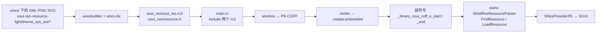

# SOUI4 on ESP32-S3（2.8" IPS / ILI9341V + FT6X36）

把 SOUI4 的 FreeRTOS 版（swinx 平台层 + SOUI 核心 + render-gdi/cairo）编成
ESP-IDF 固件，直接跑在这块 2.8 寸 SPI 屏开发板上：屏幕、电容触摸、消息循环、
XML 布局、图片、值动画全部走 SOUI 自己的路径，没有任何 LVGL 代码。

当前跑的界面就是 `soui_sim` 那个 demo（标题栏 / PNG 图 / 下拉框 / 按钮 /
两个值动画），不是简化版 Hello。

| 指标 | 实测 |
|---|---|
| 固件 | `soui_esp32s3.bin` = 4,537,248 字节（6MB app 分区剩 28%） |
| 启动到首帧上屏 | 约 4.4 s（上电 → COFF 资源解析 → 布局 + SVG 皮肤 → cairo 首帧 + 整屏 SPI；其中 UI 任务内部约 3.0 s） |
| 稳态刷新 | **20~22 fps**（`paint` 42~45 ms + `flush` <1.5 ms；两个动画：扫动 + alpha） |
| 资源 | windres COFF 81,298 B / 56 条（app uires 9 + 系统主题 47），`SResProviderPE` 加载 |
| 稳定性 | 连续运行无 panic、无 task_wdt |

> 只想跑一遍"编译 → 烧录 → 看日志"的话，看 **[BUILD_FLASH.md](BUILD_FLASH.md)**，
> 里面是可粘贴的完整命令和故障对照表。本文件讲的是设计与调试过程。

---

## 1. 硬件与参数

| 项 | 值 |
|---|---|
| SoC | ESP32-S3 rev0.2，16MB Flash，8MB Octal PSRAM |
| 屏 | ILI9341V，SPI，横屏 320×240 |
| 触摸 | FT6X36，I2C @0x38 |
| 连接 | 原生 USB-Serial/JTAG（303A:1001）→ COM4，921600 烧录 / 115200 日志 |

烧录参数与厂商 LVGL demo 完全一致：
`--flash_mode dio --flash_freq 80m --flash_size 16MB`，
`0x0 bootloader` + `0x8000 partition-table` + `0x10000 app`。

## 2. 目录

```
esp32s3/
├── CMakeLists.txt              顶层；把 IDF 工程挂到已装好的 IDF 上
├── sdkconfig.defaults          PSRAM / 16MB flash / C++ 异常 / 主任务栈
├── partitions.csv              无 BOM！6MB factory + NVS + phy
├── uires/                     原始应用资源（XML / PNG / SVG）——改界面就改这里
├── soui_res/                  uiresbuilder 产物：soui_res.rc2 + resource.h（入库）
├── main.rc                    把 app 与系统两个 rc2 合成一个资源脚本
├── cmake/soui_res.cmake       资源管线：uiresbuilder → windres → .incbin
├── components/
│   ├── soui_cairo/             cairo + pixman + libpng + zlib（纯 C）
│   └── soui/                   swinx(FreeRTOS 平台层) + SOUI + utilities
│       │                       + render-gdi + imgdecoder-stb/aupng
│       ├── include/soui_idf_compat.h   force-include 的 <climits> 等补丁
│       └── framebuffer_idf.cpp         ARGB32 framebuffer 放 PSRAM
├── main/
│   ├── app_main.cpp            UI 任务 + SResProviderPE 资源装配 + 消息泵
│   ├── soui_demo.h/.cpp        soui_sim 的 CMainDlg（combobox/按钮/动画）
│   ├── soui_board.h/.cpp       RGB565 转换 + present 回调 + 触摸注入
│   └── soui_board_esp32.cpp    ILI9341V / FT6X36 驱动（强实现）
└── tools/
    ├── idf_env.sh              手工装配 IDF 环境（绕开 export.sh 的 MSys 检查）
    └── serial_capture.py       复位 + 抓 N 秒串口日志（非交互）
```

**资源不是 C 数组**：`uires/` 下的原始文件由 `uiresbuilder` 生成 `.rc2`，
`windres` 编成一个 PE-COFF，再 `.incbin` 进 `.rodata.embedded`；运行时走
SOUI 桌面版同一条 `SResProviderPE` / `FindResource` 路径（见第 4.1 节）。

上游改动只有 4 处，其余全是新增文件：

| 文件 | 改动 |
|---|---|
| `swinx/include/sfr_config.h` | 新增 `SFR_ESPIDF`、`SFR_ARCH_XTENSA`，保留原有两态 |
| `swinx/src/platform/freertos/winobjs.cpp` | 新增 `#elif SFR_ARCH_XTENSA`：`portMUX_TYPE` + `taskENTER_CRITICAL`；Cortex-M3 的 `mrs primask/cpsid i` 留在 `#else` |
| `swinx/src/wnd.cpp` | `pthread_self()` 改走 `GetCurrentThreadId()`（见坑 8） |
| `SOUI/src/control/SRichEdit.cpp` | `printf("%s", dlerror())` 加判空（见坑 10） |

## 3. 环境

- ESP-IDF **v5.4.1**，装在本机 `D:\work\xiaozi\...\esp-idf-v5.4.1`
- 工具链 Xtensa GCC 14.2.0、CMake 3.30.2、Ninja 1.12.1

**官方的 `export.sh` / `export.ps1` 在这台机器上两个都用不了**，所以自备了
`tools/idf_env.sh`（第 4 节）。两个坑：

| 入口 | 失败点 |
|---|---|
| Git Bash `source export.sh` | `check-python-dependencies` 直接判 `MSys/Mingw is not supported` 退出 |
| PowerShell `export.ps1` | 把 shell 名传成 `powershell.EXE`（大写扩展名），不在 `activate.py` 白名单里 → 不走 `activate` 分支 |

`tools/idf_env.sh` 就是绕开这两层，手工把 PATH / `IDF_PATH` / `IDF_TOOLS_PATH`
装配好，顺带补上两个 `export.sh` 平时隐式设置、但手工装配时容易漏掉的变量：

```bash
# 这两个不设，只要改动任何 CMakeLists，cmake 重配就会崩
export ESP_ROM_ELF_DIR=...        # tools/cmake/gdbinit.cmake 里的 file(TO_CMAKE_PATH $ENV{ESP_ROM_ELF_DIR} ...)
export OPENOCD_SCRIPTS=...
```

`ESP_ROM_ELF_DIR` 漏了的表现很有欺骗性：`ninja` 报
`error: rebuilding 'build.ninja': subcommand failed`，真正的报错藏在上一行
`file must be called with exactly three arguments`（`gdbinit.cmake:40`，参数传个
空值就成了 2 个参数）。

## 4. 构建

用 `tools/idf_env.sh` 包住命令，它自己会装配环境再 exec 传进来的参数：

```bash
cd /d/work/soui4/soui-freertos/esp32s3
export CCACHE_DISABLE=1
./tools/idf_env.sh ninja -C build -j2 1> b.out 2> b.err
```

**`idf.py` 完全不要用，它是静默空转的**：

```
$ ./tools/idf_env.sh idf.py --version
MSys/Mingw is no longer supported. ...
$ echo $?
0
```

打印一行警告、**退出码 0、什么都不做**。这就是最早"`idf.py build` 只留下一行
`FAILED:`"的真相——它不是吞掉错误，它根本没开始编。同理 `idf.py flash` / `-C` /
`menuconfig` 全部无效。

所以：

- **配置**不用手动触发。改了 `CMakeLists.txt` 后 `ninja` 会自己重跑 cmake
  （`build.ninja` 里带 regeneration 规则）；改了 `sdkconfig` 靠 IDF 的 `confgen`
  依赖触发。  那条 regeneration 规则崩掉时，报错就是第 3 节说的 `ESP_ROM_ELF_DIR`。

  真要从头配（新建 `build/`）是这一条，**注意源目录是 `.` 不是 `..`**
  （`esp32s3/` 自己就是 CMake 工程根），而且 `-DPYTHON_DEPS_CHECKED=1`
  **不能省**：

  ```bash
  ./tools/idf_env.sh cmake -B build -G Ninja -DPYTHON_DEPS_CHECKED=1 .
  ```

  不加那个 define，配置阶段的 `idf_tools.py check-python-dependencies` 会因为
  Git Bash 里存在 `MSYSTEM=MINGW64` 而直接 `fatal('MSys/Mingw is not supported')`
  （`tools/idf_tools.py` 的 `__main__`）。现有 `build/CMakeCache.txt` 已缓存
  `PYTHON_DEPS_CHECKED=1`，所以只有新建目录才会撞到。
- **编译**只走 `ninja -C build`。
- **烧录**只走 `esptool ... @flash_args`（第 5 节）。

三条硬性要求，都是踩出来的：

1. **必须 `-j 2`**。本机默认并行度会随机挂死 `cc1plus`（CPU 占用归零、20 分钟
   无进展），清进程、关 ccache 都无效，降并行度立刻恢复。挂死时直接
   `Stop-Process cc1plus,cc1,ninja -Force` 然后重跑 `-j2` 即可**增量续编，
   不需要 clean**。
2. **必须 `cd build && ninja`**。理由见上：`idf.py` 是空转的，而 `ninja` 直接跑
   才能拿到真实的编译/链接器 stderr；重定向到文件是为了不被并行输出打散。
3. **全量重编（改 `sdkconfig`、改全局 `-O` 级别）之前先有心理准备**：这套源码
   （cairo + pixman + richedit41）全量编译在本机 `-j2` 要 15~20 分钟，中途
   别以为是挂死。

### 4.1 资源管线：改 XML / PNG / SVG 只要重新编译

早期版本用 `tools/gen_uires.py` 把资源转成一个 30 万行的 C++ 字符串字面量表
（`main/generated/uires_res.cpp`），改一个字符串要重跑脚本，控件 id 还得另外
手写一份 `soui_resource.h` 同步枚举。现在改成和 `soui_sim` / 桌面版同一条路，
**编辑原始资源文件后直接 `ninja` 即可**：



| 层 | 谁生成 | 说明 |
|---|---|---|
| `uires/` | 手工编辑 | 应用资源：`uires.idx` + XML / PNG / SVG。是 soui_sim 的副本，唯一差别是根窗口 `cache="0"`（见坑 16） |
| `soui_res/*.rc2`、`resource.h` | `uiresbuilder.exe` | 前者列出 9 条 app 资源，后者给出 `UIRES.*` / `R.id.*` / `R.name` / `R.ID.*`（13 个命名 id）。**产物入库**，非 Windows 宿主直接复用 |
| `main.rc` | 手工编辑 | 只做两件事：`#include "soui_res.rc2"` 和 `#include "theme_sys_res.rc2"`（后者来自 `soui-sys-resource-light`，47 条 SVG/PNG/XML 系统皮肤） |
| PE-COFF | `windres --target=pe-x86-64 -O coff` | 一个装了 56 条资源的 COFF **对象文件**，81,298 B |
| `.rodata.embedded` | `xtensa-esp32s3-elf-gcc -c blob.S` | `.incbin` 把 COFF 当数据塞进镜像，导出 `_binary_soui_coff_o_start/_end` |
| 运行时 | `swinx/src/resapi.cpp` | `LoadModuleResources()` 先试 `dlsym`，静态镜像回落到那两个弱符号，交给 `WindResResourceParser::Parse()`；`SResProviderPE` 通过 Win32 的 `FindResource`/`LoadResource`/`LockResource` 读字节 |

四个实现上必须讲清的点：

1. **为什么要多一次 `.incbin`。** COFF 是给链接器看的**对象文件**，但这里没有任何代码引用它，swinx 是把整个文件当**磁盘映象**解析（先读段头再定位 `.rsrc`）。所以它必须以"数据"的形式存在于镜像里，而不是被链接成代码。
2. **段名必须是 `.rodata.embedded`。** 桌面管线用 `.section .rdata`，但 IDF 的 linker fragment（`components/esp_common/common.lf`）只把 `.rodata+` / `.srodata+` 收进 flash；`.rdata` 匹配不到任何规则，符号会指到未放置的垃圾地址。`.rodata.embedded` 也是 IDF 自己 `target_add_binary_data()` 用的名字。实测符号落在 `0x3c39f6f8`（DROM 映射区）。
3. **判断宿主用 `CMAKE_HOST_WIN32`，不能用 `WIN32`。** IDF 的交叉工具链把 `CMAKE_SYSTEM_NAME` 设成 `Generic`，`WIN32` 恒为 `FALSE` —— 第一次配置就是走了"非 Windows 宿主"分支，导致 `uiresbuilder` 的自动重建规则根本没生成。`uiresbuilder.exe` 是宿主工具，能不能跑取决于宿主而不是目标平台。两个 GLOB 都带 `CONFIGURE_DEPENDS`，新增/删除资源文件也能被感知。
4. **windres 需要补齐 PATH。** 它默认用 `gcc -E -xc -DRC_INVOKED` 预处理 `.rc`；IDF 的 ninja 规则统一走 `cmd.exe`，其 PATH 是 Xtensa 工具链 + IDF python，没有 mingw 的 gcc / cc1 / 运行时 DLL，windres 只报一句含糊的 `preprocessing failed.`（在 Git Bash 里手工跑同一条命令却成功）。`cmake -E env --modify PATH=path_list_prepend:<windres 所在目录>` 只作用于这一条 custom command。试过显式 `--preprocessor=...gcc.exe`：gcc 找得到，但仍缺 PATH 里的运行时目录，照样退出 1。

`app_main.cpp` 里对 `_binary_soui_coff_o_start/_end` 是**强引用**：swinx 那边只声明成 weak（没资源的镜像也要能链接），而 weak undefined 不会把 archive member 拉进来；这里强引用既保证 blob 不被链接器丢掉，也让"忘了挂资源"在链接期就失败，而不是开机后报 resource not found。

**依赖**：需要 mingw 的 `windres`（MSYS2 `mingw-w64-x86_64-binutils`，Linux `binutils-mingw-w64-x86-64`）。它只用来编 `.rc`，C/C++ 仍全部由 Xtensa 工具链编译 —— 和"用不用 MinGW 编译器"无关。非 Windows 宿主上 `uiresbuilder` 跑不了，`soui_res.rc2` / `resource.h` 已入库可直接用；但**新增资源条目或改控件 `name`** 得回 Windows 重新生成一次。

**实测验证**（改 `uires/values/string.xml` 里的一个字符串后直接 `ninja`）：

```
[1/14]  [uiresbuilder] uires.idx -> soui_res.rc2 + resource.h
[2/14]  windres: main.rc (app + sys resources) -> COFF
[5/14]  embedding soui_res COFF into the image (.rodata.embedded)
[11/14] Linking CXX executable soui_esp32s3.elf
[12/14] Generating binary image from built executable
```

14 步增量（全量是 263 步），新字符串同时出现在 COFF 和 `.bin` 里。启动日志：

```
I (1845) soui_app: resource blob: 81298 bytes at 0x3c39f6f8
... coffparser,2,parse done, found 56 resources ...
I (2094) soui_app: system res flags=0x08   (skin/editmenu/msgbox 全部成功，theme 已加载)
I (2110) soui_app: app res provider added (UIDEF:XML_INIT)
I (2110) soui_app: named ids registered: 13
I (4401) soui_app: main window up
I (7475) soui_app: fps=20.0, paint=44.7ms, flush=0.9ms
```

`56` 与旧 C 数组的条目数逐个对得上（9 + 47），资源内容也逐字节比对过（除旧数组末尾的 `\0` 终止符和新增注释），帧率无退化。

## 5. 烧录与观察

`idf.py flash` 内部要起 Python 子进程做 `check-python-dependencies`，同样会撞上
"MSys/Mingw is no longer supported"。**绕开 idf.py，直接调 esptool**，用
`build/flash_args` 里已经生成好的地址表：

```bash
cd build
./../tools/idf_env.sh python -m esptool --chip esp32s3 -p COM4 -b 921600 \
    write_flash @flash_args
```

观察（复位 + 抓 22 秒串口日志，非交互）：

```bash
cd /d/work/soui4/soui-freertos/esp32s3
python tools/serial_capture.py COM4 22
```

## 6. 实测启动日志

```
I (1363) soui_app: == SOUI4 on ESP32-S3 (soui_sim demo) ==
I (1810) soui_app: Render_Gdi_SCreateInstance -> 1, obj=0x3fc9f3dc
I (1816) soui_app: imgdecoder-stb installed
I (1845) soui_app: SApplication created
I (1845) soui_app: resource blob: 81298 bytes at 0x3c39f6f8
... coffparser,2,parse done, found 56 resources ...
I (2094) soui_app: system res flags=0x08 (bit0-2 = skin/editmenu/msgbox failed, bit3 = theme ok)
I (2110) soui_app: app res provider added (UIDEF:XML_INIT)
I (2110) soui_app: named ids registered: 13
I (4401) soui_app: main window up, hwnd=0x3c479e44
I (4402) soui_app: IMessageLoop=0x3fcbe714
I (7475) soui_app: fps=20.0, paint=44.7ms, flush=0.9ms | presents=258 (+258/3s, 4.30/frame), pixels=493728 (+493728/3s), 165 kpix/s
I (10646) soui_app: fps=21.7, paint=42.3ms, flush=0.4ms | presents=534 (+276/3s, 4.25/frame), pixels=696480 (+202752/3s), 68 kpix/s
```

六点值得注意：

- `resource blob: 81298 bytes at 0x3c39f6f8` + `found 56 resources`：windres
  COFF 已经进了 DROM 映射区并被 `WindResResourceParser` 解析成功（9 条 app +
  47 条系统皮肤），见 4.1。这两个值是判断"资源到底挂上没有"最快的依据。
- `system res flags=0x08`：`LoadSystemNamedResource()` 的位掩码是**混合语义**——
  0-2 位表示皮肤/editmenu/msgbox **失败**，第 3 位却在主题色**成功**时置位
  （`SApp.cpp:701`）。所以 0x08 = 皮肤和主题色都正常。
- `named ids registered: 13`：来自 `uiresbuilder` 生成的 `R.name` / `R.id`，
  布局里 13 个带 `name` 的控件都能用 `EVENT_ID_COMMAND(R.id.xxx, ...)` 找到。
- `I (1326) spi_flash: flash io: qio`：QIO 真的生效了（镜像头里的 `dio` 是烧录模式，
  见 10.1）。
- `fps=` 就是帧率，直接由**完成的 `WM_PAINT` 次数**算出来，和屏上 `fps_label`
  是同一个口径。`presents` 是**blit 次数**，随重叠窗口数变（历史上 1.8~2 次/帧，
  现在 4.3 次/帧），不能当帧率读（见 10.1）。
- `paint=42ms` + `flush=0.4ms`：**paint 是绝对瓶颈，SPI 送屏只占约 1%**。
  最初 paint 是 133ms——说明"刷屏慢"的直觉是错的，时间全花在 CPU 侧的裁剪/
  绘制调度上（见 10.1、10.2）。这组数字是**两个动画**（扫动 + alpha）的场景；
  只有一个扫动时是 28ms / 35fps，两者的差就是 layered 窗口的价钱，拆解见 10.3。

## 7. 踩坑清单

按出现顺序，每条都是真问题，不是"重试就好了"。

| # | 现象 | 根因 / 修法 |
|---|---|---|
| 1 | 组件 requirement 子进程里 `SOUI_ROOT` 为空，路径变成 `/swinx/...` | IDF 的组件元数据阶段不继承顶层变量 → 每个组件 CMakeLists 自己 `get_filename_component(... ../../..)` 推导 |
| 2 | `Field 'type' can't be left empty` | `partitions.csv` 带 UTF-8 BOM，`gen_esp32part.py` 把注释首行当数据 → 无 BOM 重写。**生成配置文件后要复查前 3 字节** |
| 3 | `Invalid character escape '\w'` | `$ENV{IDF_PATH}` 是 `D:\work\...`，IDF 把 INCLUDE_DIRS 序列化成 C 字符串时 `\w` 成非法转义 → `file(TO_CMAKE_PATH ...)` |
| 4 | pixman 309 处指针不兼容报错 | GCC 14(Xtensa) 把 `-Wincompatible-pointer-types` 升级成 error，`-w` 压不住 → 显式 `-Wno-error=incompatible-pointer-types`（`pixman_fixed_t`=`int32_t`=`long`，32 位同宽安全） |
| 5 | `'d' was not declared` | `pixman*.c` glob 命中 `pixman-arm-neon.c` / `-simd.c`，它们不是 `.S` → 从源列表剔除 SIMD 文件 |
| 6 | `FreeRTOS.h: No such file` | IDF 5.3+ 内核头挪到 `FreeRTOS-Kernel/include/freertos/`，`REQUIRES freertos` 只导出 `include/` → 显式补该路径 |
| 7 | 17 处 `push_back({IDOK, u8"确定"})` 报错 | IDF 默认 `-std=gnu++2b`，C++20 起 `u8""` 是 `const char8_t[]` → 整个 soui 组件改 `-std=gnu++17` |
| 8 | `pthread_self` 多重定义 | **不能让 IDF 的版本赢**：它对 `xTaskCreatePinnedToCore` 建的任务直接 `assert(false)` → `winobjs.cpp` 的定义加 `&& !SFR_ESPIDF` 关掉，`wnd.cpp` 改用 `GetCurrentThreadId()` |
| 9 | `'swinx_fr' has not been declared` | 该命名空间原本靠 `stl/mutex` 垫片间接触发，而 ESP-IDF 用真 libstdc++ → `syncapi.cpp` / `SConnection.cpp` 显式 include |
| 10 | 启动即 `Guru Meditation / EXCVADDR 0x0`，回溯落在 `STextServiceHelper` 的 `printf` | `SRichEdit.cpp` 里 `printf(...err=%s, dlerror())`：swinx 的 `dlerror()` 按 POSIX 返回 NULL，**newlib 的 vfprintf 对 `%s`+NULL 不判空直接解引用**（glibc 才打 `(null)`）→ 加判空 |
| 11 | 启动日志 `no LCD driver linked`，屏全黑 | `libmain.a` 里 `__attribute__((weak))` 的桩已满足 `app_main` 的引用，链接器**不会**再抽出 `soui_board_esp32.cpp.obj` → 删掉弱桩，每个钩子一份强定义 |
| 12 | 跑起来 5 秒后 `task_wdt: CPU 1: soui_ui` | 值动画每 16ms 请求一帧，而一帧要几百 ms（cairo + polling SPI），一次性排空消息队列会让 UI 任务连续几秒不让出，IDLE1 饿死 → 给消息泵加预算：每轮最多 8 条 + 最长 200ms，然后 `vTaskDelay(1)`（1 tick = 1ms，见第 9 节第 5 点） |
| 13 | PNG 全部 `resource content ... not found!`（装了 imgdecoder 也没用） | 日志来自 `SResProviderMgr::LoadImage` 的**第二次**判断：`HasResource` 通过、但 `provider->LoadImage` 返回 NULL。当时的 `MemResProvider` 直接 `return NULL` → 照 `SResProviderPE` 的做法调 `SResLoadFromMemory::LoadImage(bytes,len)`（内部走 `GETRENDERFACTORY->CreateBitmap` + `LoadFromBitmap(_memory)`）。**现在已换成 `SResProviderPE`，这条由它原生满足**（见 4.1） |
| 14 | 引 `res.mgr/SResProvider.h` 报 `SStringT does not name a type` | 该头依赖 `souistd.h` 提供的 SStringT/SMap → 先 `#include <souistd.h>` |
| 15 | 触摸"点了没反应，过几秒才动"，且一次画一帧期间的点按直接丢失 | 两个独立缺陷：①`updateMsgQueue` 每个 16ms 动画 tick 都往队列压一条 `WM_TIMER`，慢渲染下队列无限增长，输入排在几百条过期计时器后面（Win32 的 `WM_TIMER` 是生成型消息，同 id 最多一条）；②采样在消息泵里做，一帧 100ms 内的按下+抬起**根本没被读到**。修法见第 9 节 |
| 16 | 脏矩形只有 40×16，一次 `WM_PAINT` 却要 162ms | 布局根窗口 `cache="1"`：`_PaintClient` 每次失效都把**整窗**重画进 cache 表面，再整幅 `AlphaBlend`。桌面在显存里做划算，PSRAM 上不划算 → 根窗口改 `cache="0"`（162ms → 126ms）。旧的 `gen_uires.py --strip-window-cache` 是在**生成时**做这个替换；现在资源按原样编译，所以 `uires/xml/dlg_main.xml` 里直接写的就是 `"0"`，别从 soui_sim 复制时把它带成 `"1"` |
| 17 | richedit41 一链就 53 个 `undefined reference` | 它是个完整 Win32 程序：剪贴板、OLE 剪贴板、拖放、IME、profile、kernel32 文件 API 全用。→ `swinx/src/platform/freertos/win32_rich.cpp` 补桩，剪贴板**真转发**到 `SConnection::SClipboard`，其余惰性返回失败（不要假装成功，否则 TOM 的 Save 会写出半截内容） |
| 18 | CPU 160→240MHz + 全局 `-O2` 只提升约 20% | 当时误判为"瓶颈是 PSRAM 访存、加时钟没用"。**这个结论后来被推翻**，见第 10.1 节：真正的瓶颈是每帧几十次 cairo 裁剪状态操作（固定开销，与像素数无关） |
| 19 | 加了 `[prof]` 才发现 `updRgn=6073px` 但 `dirty=76800px` | `BeginPaint` 没按 Win32 语义把 DC 裁到 update region，`GetClipBox()` 报整窗 → `SHostWnd::OnPrint()` 把 `rcInvalid` 并成整窗 → present 变成整幅 BitBlt（15.7ms/帧） |
| 20 | 40×16 的空窗口 `fade_box` 单独要 16ms | `DispatchPaint()` 每层无条件 2×`SaveClip` + 2×`PushClip`，每次都是一整套 `cairo_copy_clip_rectangle_list` + `CombineRgn` + `cairo_reset_clip` + `cairo_clip`；再加上 `IsClipClient()` 时 `rcClient==rcWnd` 也照样 `PushClipRect`（恒等裁剪）。修法见第 10.1 节 |
| 21 | 有动画的窗口 paint 时间是静止窗口的数倍 | `SWindow::IsDrawToCache()` 里 `m_isAnimating \|\| !m_pAnimatorHandler->IsEmpty()` 让**任何带动画的窗口**都走整窗离屏表面。桌面在显存里做划算，PSRAM 上是纯亏 → `SOUI_DISABLE_AUTO_CACHE` 编译开关 |
| 22 | 组件 `CMakeLists` 里写 `-O2` 却不生效 | `target_compile_options` 排在 `CMAKE_CXX_FLAGS` **之后**，组件里原有的 `-Os` 会**静默覆盖** `CONFIG_COMPILER_OPTIMIZATION_PERF` 给的 `-O2`。改 `sdkconfig` 的优化等级对这几个组件完全无效 |
| 23 | `idf.py build` 立刻返回、日志只有一行 `FAILED:` | `idf.py` 自己带 MSYS 检查，`MSYS_NO_PATHCONV` / 清 `MSYSTEM` 都绕不过 → 它打一行警告就 **`exit 0` 空转**。不是"吞掉错误"，是根本没执行。改用 `ninja -C build` |
| 24 | 改任何 `CMakeLists.txt` 后 `ninja: error: rebuilding 'build.ninja': subcommand failed` | 真正的报错在上一行：`tools/cmake/gdbinit.cmake:40` 的 `file(TO_CMAKE_PATH $ENV{ESP_ROM_ELF_DIR} ...)` 因变量为空退化成 2 个参数 → `export ESP_ROM_ELF_DIR=<idf_tools>/tools/esp-rom-elfs/<ver>/` |

其他非报错但要记住的点：

- **IDF 5.4 删了 legacy `driver/i2c.h`**（在废弃的 `driver` 组件里），`esp_driver_i2c`
  只有新 API：`i2c_new_master_bus` / `i2c_master_bus_add_device` /
  `i2c_master_transmit_receive`；`i2c_master_bus_config_t` 没有 `sda_pullup_en`，
  用 `flags.enable_internal_pullup`。
- **main 组件的 `REQUIRES` 要显式写全**：`esp_driver_gpio` / `esp_driver_spi` /
  `esp_driver_i2c`。IDF 5.x 的 main 不再隐式依赖所有组件。
- main 组件也要 `-w`、`-include soui_idf_compat.h`（`SWnd.h` 用 `LLONG_MAX`）、
  `-std=gnu++17`、`-fexceptions`，且 `IMessageLoop` 要写全 `SNS::IMessageLoop`。

## 8. soui_sim demo 是怎么搬过来的

`soui_sim` 本身是 Windows 上的 FreeRTOS 模拟器 + SDL2，不能直接烧。搬的是**应用层 +
资源**，下面的对应关系就是移植的完整工作量：

| 桌面/模拟器 | 这块板子 |
|---|---|
| `SAppCfg::DoConfig()`（头文件实现，内部 `CreateImgDecoder` 走 dlopen） | 手写装配：render 工厂 → `Decoder_Stb_SCreateInstance` → `SetImgDecoderFactory` → `SApplication` → 两个 `RES_PE` provider（`LoadSystemNamedResource` / `AddResProvider(app, "UIDEF:XML_INIT")`）→ `InitXmlNamedID` |
| uires → windres → `.section .rdata` | 同一条路，只是 COFF 用 `.incbin` 落到 `.rodata.embedded`，运行时 `SResProviderPE` 读（见 4.1）。**不再生成 C 数组** |
| `uiresbuilder` 的 `R.id.*` | 同一个 `uiresbuilder` 生成的 `soui_res/resource.h`，`R.id.*` / `R.ID.*` / `R.name` 直接用 |
| 系统资源 `soui_sys_res/theme_sys_res`（PNG 版） | 用 **SVG 版**（`soui-sys-resource-light/theme_sys_res`，内容与 `demos/android-demo/.../theme_sys_res` 只差一行 `_skin.sys.selband`）：render-gdi/cairo 走 nanosvg，不依赖位图解码 |
| `main()` + `vTaskStartScheduler()` | `app_main()` + `xTaskCreatePinnedToCore(49152B, prio 5, core 1)` |
| SDL 事件泵 + `SimHalRenderIfDirty` | `soui_board_poll_touch()` + `swinxFbPresent` 回调 |
| `PeekMessage` + `IMessageLoop::OnMsg` | 同左，但每轮限 8 条消息 / 200ms（见坑 12） |

`<edit>` 也搬过来了：桌面靠 `CreateTextServices()`（`Msftedit.dll`，运行时
dlopen），这里把 `third-part/richedit41` + 它的行服务库 `lssrc`（msls31 替代）
静态链接进来，`SRichEdit.cpp` 走 `INIT_RICHEDIT` 分支。代价是要补 53 个
richedit 会用、而 swinx FreeRTOS 垫片没实现的 Win32 入口
（`swinx/src/platform/freertos/win32_rich.cpp`：剪贴板转发到 `SConnection` 的
`SClipboard`，IME / OLE / 文件 API 是惰性桩）。这一步把固件从 3.50MB 推到
3.98MB，4MB 分区只剩 5%，所以 app 分区改成了 6MB（见 `partitions.csv`）。

## 9. 输入链路（触摸 → 控件）

这块是"为什么没有 LVGL 固件跟手"的答案，四个独立的问题叠在一起：

```
FT6X36 ──(soui_touch 任务, 8ms)──► FreeRTOS 队列 ──► 消息泵顶部重放 ──► SwinxInjectMouse
                                                        │
                          每个泵轮先 PeekMessage(WM_MOUSEFIRST..WM_MOUSELAST)
                                                        │
                                                   SOUI 控件 → Invalidate → WM_PAINT
```

1. **采样必须在自己的任务里**（`main/soui_board.cpp` 的 `touch_task`）。
   原先在消息泵里读一次 I2C：一帧要 100ms 以上，**手指按下再抬起如果整个落在一帧
   之内，这个点击不是延迟，而是彻底丢失**。现在 8ms 采样（厂商 LVGL 是 30ms），
   变化才入队，UI 线程只负责把队列按顺序重放成 DOWN/MOVE/UP。
2. **`WM_TIMER` 必须像 Win32 那样合并**（`SConnection.cpp:hasQueuedTimerMsg`）。
   SOUI 的值动画用 16ms `SetTimer` 驱动，一帧 100ms 就意味着每帧往队列压 6 条以上
   计时器消息；不合并的话队列长度随时间线性增长，触摸事件永远排在几百条过期计时器
   后面 —— 表现就是"点了没反应，过几秒才动"。Win32 语义是同一计时器在队列里最多
   一条，到期未取则丢这一拍。
3. **输入优先取**：每轮泵先按 `WM_MOUSEFIRST..WM_MOUSELAST` 范围 `PeekMessage`，
   最多 6 条，然后再处理绘制/计时器。这样一次点击最多等"正在画的那一帧"。
4. **相同坐标不重复注入**：8ms 一个 `WM_MOUSEMOVE` 会把队列灌满无意义消息，
   采样端和注入端各做一次去重。
5. 泵尾的 `vTaskDelay` 从 10ms 改成 **1 tick（`CONFIG_FREERTOS_HZ=1000` → 1ms）**，
   仍然让 IDLE1 跑到（看门狗），但不再给输入凭空加 10ms。

## 10. 显示链路

```
SOUI 控件树
  └─ render-gdi(cairo) 画到 ARGB32 framebuffer   ← PSRAM，307200 B
       └─ SConnection::commitCanvas() blit 脏矩形
            └─ swinxFbPresent(rect)   [soui_board.cpp 注册的回调]
                 └─ ARGB32 → RGB565            ← PSRAM，153600 B
                      └─ soui_board_lcd_flush() [soui_board_esp32.cpp]
                           └─ SPI 大块 polling 写 ILI9341V
```

首帧整屏 320×240 约 470ms（cairo 软件渲染 + 写入全屏）；之后只刷脏矩形，
典型的动画帧 6000~7000 像素。

**per-frame 诊断**：消息泵每 3 秒打一行

```
presents=146 (+48/3s), pixels=1198272 (+328104/3s), paint=116.0ms, flush=3.2ms, 109 kpix/s
```

`flush` 是 SPI 送屏耗时（大块传输后 3ms 左右，已经不是瓶颈），`paint` 是一次
`WM_PAINT` 的墙钟时间（含 cairo 渲染）。两者拆开才知道该优化哪一头。

已做的两项廉价优化：`sdkconfig.defaults` 里 CPU 160MHz → **240MHz**，
全局 **`-O2`**（`CONFIG_COMPILER_OPTIMIZATION_PERF`）。实测 12fps → 16fps。
当时据此判断"剩下的大头是 PSRAM 上软件渲染的访存"，**这个结论是错的**，
见 10.1。

### 10.1 帧率从 ~8fps 到 ~20fps：四个真正的瓶颈

上面那句"大头是 PSRAM 访存"是**错的**。加了 `SOUI_PORT_PROFILE=1` 的分阶段
计时后（`[prof]` 行，见下）才看清：一次 `WM_PAINT` 只脏 6k 像素，却要 133ms，
时间根本不是花在像素上。

复现方法：`components/soui/CMakeLists.txt` 里把 `SOUI_PORT_PROFILE=0` 改成 1，
串口每 20 帧输出

```
[prof] layout=366 paint=26904 present=1215 [begin=409 clip+clr=1880 tree=23873 tail=93] updRgn=5747px dirty=5747px clip=40 calls/42 rects
  [w] 4 windows touched
  [w]              total=21871 own=1369 pre=500 child=19841 post=154 lay=4 n=20
  [w] fade_box     total=6406  own=829  pre=1111 child=1835 post=1838 lay=792 n=20
```

| # | 瓶颈 | 现象 | 修法 | 收益 |
|---|---|---|---|---|
| 1 | `SWindow::IsDrawToCache()` 把"有动画"也算作要缓存 | 每帧 ClearRect 整窗 + 整窗重画进离屏 + 整幅 AlphaBlend，只为 6k 像素脏区 | 新增 `SOUI_DISABLE_AUTO_CACHE`：只有显式 `cache="1"` 才缓存（`Swnd.cpp`） | 162→133ms |
| 2 | `BeginPaint()` 没把 DC 裁剪到 update region | `GetClipBox()` 报整窗 → `SHostWnd::OnPrint()` 把 `rcInvalid` 并成整窗 → present 变成 307KB 整幅 BitBlt | `wnd.cpp` 的 `BeginPaint` 用 `wndObj->invalid.hRgn` 设 `RGN_AND` 裁剪（Win32 语义，`ReleaseDC` 的 `RestoreDC(-1)` 撤销） | present 15.7→1.2ms |
| 3 | `DispatchPaint()` 对**每个**可见窗口**无条件**付 2 次 `SaveClip` + 2 次 `PushClip` | 一屏 25 个窗口就是上百次裁剪运算，而真正相交的只有 3 个 | ① 整窗不在脏区 → 函数开头直接 return；② 只在真有 `m_clipRgn/m_clipPath` 时 `SaveClip`；③ `rcClient == rcWnd` 时跳过 `PushClipRect` | 85→54ms，窗口 25→4 |
| 4 | layered 窗口（alpha≠255，如 `fade_box`）每帧新建/释放离屏 RT | `CreateRenderTarget` + `cairo_create` + `Release` ≈ 6ms/帧，窗口只有 40×16 | 新增 `m_layeredRT` 成员跨帧复用，尺寸变化时在 `OnSize` 里丢弃重建 | 16.2→6.4ms |

顺带把 `ExtSelectClipRgn(RGN_AND)` 改成快路径（`ApplyRegionAnd`）：cairo 的裁剪
天生就是"与当前裁剪求交"，不需要先 `cairo_copy_clip_rectangle_list` 导出、再做
GDI 区域布尔运算、再 `cairo_reset_clip` 重新应用。

**编译/缓存配置**也补上了（之前漏的）：

- `soui` 组件的 `target_compile_options` 里原来写的是 `-Os`。它排在
  `CMAKE_CXX_FLAGS` 之后，**静默覆盖了全局 `-O2`** —— 整个 cairo/pixman/SOUI
  其实是按 `-Os` 编的。改成 `-O2` 后单这一项就让 paint 从 31.6ms 掉到 26.9ms
  （固件 4.01MB → 4.40MB，6MB 分区还剩 30%）。
- **同一个坑在 `components/soui_cairo/CMakeLists.txt` 里还有一份**（`-w -Os`），
  漏掉了 169 个文件：cairo 107、pixman 32、png、zlib 30 —— 也就是**真正碰像素的
  那部分代码**。改 `-O2` 后固件 4.40MB → 4.49MB（+94KB），但 `paint` 只从
  48.6ms 降到 46.3ms。**这个结果本身很有信息量**：把渲染代码全开到 -O2 只买回
  2ms，说明剩下的 46ms 不是指令数，而是别的东西（见下面"还剩的空间"）。
  核对方法：
  ```bash
  python -c "import json;from collections import Counter;
  db=json.load(open('build/compile_commands.json'));
  print(Counter(tuple(o for o in e['command'].split() if o.startswith('-O') and len(o)<=4) for e in db))"
  # 期望 {('-O2',): 1421}；出现 ('-O2','-Os') 就说明某个组件还在偷偷降级
  ```
- `CONFIG_ESPTOOLPY_FLASHMODE_QIO`（原来是 DIO，代码 XIP 取指带宽砍半）。
  注意镜像头里的 `spi_mode` 字节仍然是 `0x02`(DIO)，**这是正常的**：
  `CONFIG_ESPTOOLPY_FLASHMODE="dio"` 只是给 esptool 用的烧录模式，
  bootloader 起来后会自己升到 QIO。运行时看启动日志的
  `I spi_flash: flash io: qio` 才是真的。
- `CONFIG_ESP32S3_DATA_CACHE_64KB`（原来是 32KB，S3 的最大值）。

**最终实测**（COM4 @115200，`SOUI_PORT_PROFILE=0`）：

```
I ( 7345) presents=110 (+110/3s), pixels=912056,  paint=49.2ms, flush=3.9ms, 304 kpix/s
I (10521) presents=230 (+120/3s), pixels=1619096, paint=46.3ms, flush=2.7ms, 236 kpix/s
I (13586) presents=342 (+112/3s), pixels=2390648, paint=48.1ms, flush=3.2ms, 257 kpix/s
```

**先分清两个数，别被 `presents` 骗了**：

| 指标 | 值 | 说明 |
|---|---|---|
| `presents` | **37~40 /秒** | 脏矩形 blit 次数。**一帧会发 1.85 次**（窗口提交 + 重叠窗口重合成），不是帧率 |
| 真实帧率 | **~20 fps** | `paint` 46ms + `flush` 3ms。demo 的 `fps_label` 数的就是这个，屏上显示 18.5~20 |

两者互相对得上：`40 presents/s ÷ 21.6 frames/s = 1.85 presents/帧`。优化前
`presents` 是 14.7/秒，折合帧率 **~8fps**，所以仍是 **2.5×**。

（本文档早先把 `presents` 当成帧率写成"37fps"，是错的，已按上表更正。）

**和 LVGL 那个 100fps 不可直接比**：320×240×2B = 153600 B，40MHz SPI 全屏刷一次
就要 30.7ms（上限 33fps），所以 LVGL 的 100fps 一定是"只刷几十行"的局部刷新
数字，而不是整屏。SOUI 现在的脏区也只有 6k 像素，量级对得上。

**还剩的空间**：把 cairo/pixman 开到 `-O2` 只买回 2ms，说明 46ms 不是指令数问题。
`[prof]` 行里的 `clip=40 calls/42 rects` 是最可疑的线索——**一帧 40 次裁剪操作**，
而 `cairo_clip` 在这个后端单次 1~2ms（每次都要重建 pixman region），40 × 1.1ms
大约就是 45ms。也就是说每帧画的像素只有 6k，**时间全花在"反复告诉 cairo 要裁到
哪里"上**。下一步按收益排序：

1. `PushClipRect` / `PushClipRegion` 加**包含性快路径**：新矩形若已包含当前
   `GetClipBox()`，`RGN_AND` 是恒等操作，直接跳过（SOUI 每个窗口都推一次
   `rcClient`，而裁剪往往已经更小）。
2. 给 `SRenderTarget_GDI` 加一层 clip 状态缓存，同一组裁剪矩形不重复下发。
3. 渲染目标 ARGB32 → RGB565，内存和带宽都减半（改动面最大）。
4. SPI 提到 80MHz，把全屏刷新的上限从 33fps 抬到 66fps——只在脏区变大
   （整屏滑动）时才有意义，现在 `flush` 只占 3ms，不是瓶颈。

### 10.2 裁剪到底有多贵：直接量出来，然后修掉

10.1 的结论是"每帧 40 次裁剪 ≈ 45ms"，但这是推算。为了不靠推算，做了一次
**消融实验**，结论还差点把人带偏：

- 把 RT 层的 `PushClipRect / PushClipRegion / PopClip / SaveClip / RestoreClip`
  全部改成空实现（编译开关 `SOUI_ABLATE_CLIP`，见
  `components/render-gdi/linux/render-gdi.cpp`），板子上的帧率**反而从 19fps
  掉到 14fps**。原因是那些空实现把裁剪一起删掉了，绘制不再被限制在 6k 像素的
  脏区里，填充面积成倍放大——**"删掉裁剪"和"裁剪很贵"两件事被混在一起了**。

所以改成直接测量。在开机时对一块和绘制目标同尺寸（320×240 ARGB32）的 HDC
跑固定次数的操作（临时基准，现已删除）：

| 操作 | 单次成本 |
|---|---|
| `SelectClipRgn(NULL)`（只 `cairo_reset_clip`） | **0.5 µs** |
| `GetClipBox` | 5 µs |
| `SaveDC`+`RestoreDC`（无裁剪） | 58 µs |
| `CreateRectRgnIndirect`+`DeleteObject` | **193 µs** |
| `AND clip`，4×4 / 40×30 / 320×240 | **500 µs（三者相同）** |
| `COPY clip`，40×30 | 545 µs |
| `SaveDC`+`RestoreDC`（有裁剪） | 878 µs（含上一个 clip） |
| `PushClipRect` 1 矩形 + `PopClip` | **931 µs** |
| `PushClipRect` 4 矩形 + `PopClip` | **3359 µs** |

三点结论：

1. **裁剪成本与面积无关**（4×4 和 320×240 一样是 500µs），是纯固定开销，
   所以"减少脏区面积"对这个数字没用。
2. **每多一个矩形多 ~800µs**：4 矩形的区域是 1 矩形的 3.6 倍。SOUI 每次推的是
   多矩形的不规则区域，这才是最贵的一档。
3. 20 次/帧 × 0.9~3.4ms = **18~68ms**，和 `tree` 的 45ms 完全对得上。
   同时 `SelectClipRgn(NULL)` 只要 0.5µs，说明 cairo 本身不慢——贵的是
   "重建裁剪区"这一整套（建区域对象 + `SaveDC` 复制 gstate + `cairo_clip` 求交）。

修法（`SRenderTarget_GDI::PushClipRect / PushClipRegion / PopClip`）：

- **包含性快路径**：`RGN_AND` 时先 `GetClipBox`（5µs），若新矩形已完全包含当前
  裁剪框，则该裁剪是恒等操作，直接返回。SOUI 每个可见窗口都会推一次
  `rcClient`，而帧级裁剪通常已经更小，所以绝大多数推送都能跳过。
  跳过时必须在 `PopClip` 里也跳过对应的 `RestoreDC`，否则 DC 状态栈会失衡、
  裁剪会跨帧累积——用一个按嵌套层记录的位图 + 一个小 mark 栈实现
  （`SaveClip`/`RestoreClip` 也要带上它，因为 `SWindow::DispatchPaint`
  是用 `RestoreClip` 而不是 `PopClip` 撤销裁剪的）。
- **复用区域对象**：`PushClipRect` 原来每次 `CreateRectRgnIndirect` +
  `DeleteObject`（193µs），改成构造时建一个 `m_hClipTmp`，每次 `SetRectRgn`。

当时为了把"动画本身的帧率"单独量出来，把 demo 临时精简成**只有一个动画**
（删掉 `fade_box`）。这一刀后来按用户要求撤回了，两种动画混跑的真实代价见 10.3。

**结果**（COM4 @115200）：

| | 优化前 | 现在 |
|---|---|---|
| `paint` | 46.3 ms | **28.0 ms** |
| `flush` | 2.7 ms | 0.5 ms |
| `presents` | 40/s | **62/s** |
| 帧率 | ~20 fps | **~35 fps** |

（这是"只有一个动画"的对照点。两个动画都开时的最新数字是 20.3fps，见 10.4。）

固件 4,492,976 字节，6MB 分区剩 29%。

**下一步**：`paint` 仍是 28ms，而每帧只脏约 1000 像素——还是固定开销主导，
不是像素。剩下的候选：`SaveClip`/`RestoreClip` 每窗口一对（58µs×2）、
`ClearRect` 的 cairo 填充、以及每帧 4 次 `cairo_create`（`cairo_new=4`）。

### 10.3 两个动画混跑的真实代价：35fps → 18fps（+20ms/帧）

> LVGL 是专门为嵌入式写的，SOUI 是全平台框架——两者目标不同，绝对数字不该直接
> 横向比。这一节只是把"多一个 alpha 动画要付多少钱"量出来，供取舍用。

`fade_box`（40×16 的 layered 窗口，`SByteAnimator` 驱动 alpha 40↔255，
900ms 往返）恢复后重新实测，并加了一个中间点 B 来把"layered 窗口存在"和
"alpha 每帧在变"分开：

| 点 | 场景 | fps | `paint` | 其中 `tree` | clip 次数/帧 | `cairo_create`/帧 | 脏区 bbox |
|---|---|---|---|---|---|---|---|
| A | 只有 `anim_box` 扫动 | **35** | 28.0 ms | ~19 ms | 20 | 1~2 | 46×16 |
| B | `anim_box` + `fade_box`（静态不驱动 alpha） | **30.7** | 29.6 ms | 19.4 ms | 20~22 | 1~2 | 46×16 |
| C | `anim_box` + `fade_box` alpha 动画 | **18** | 50 ms | 30.4 ms | **40~44** | **4** | **292×36** |

所以那 20ms 的构成是：

1. **+11ms 在 `tree`**：alpha 每变一次，整个 layered 窗口就要重走一遍
   "离屏表面 → 绘制 → `AlphaBlend` 提交"，裁剪操作数**翻倍**（20 → 42 次）。
   每次裁剪 ~0.5ms 的固定开销又回来了，只是这次不是 SOUI 乱推，而是 layered
   路径本身要求的两段：画离屏一次、合成一次。
2. **+4ms 在 flush**：两次提交的 SPI 时间是 3.2ms/次（A 点是 1.3ms/次）。
3. 剩下是 `present` 与窗口遍历。

第 2 条背后有个容易被忽略的坑：`SConnection::commitCanvas()` 用的是
**`GetRgnBox()` 的外接矩形**，不是区域里的矩形列表。两个 40×16 的小方块
（y 204..220 和 224..240）合并后，送去屏上的是 **292×36 = 10512 像素**的一条
横带（串口日志里能直接看到 `flush #200 rect (14,204)-(306,240)`），而实际脏
像素只有 1280。**面积被放大了 8 倍**。单个动画时两行不并存，所以这个问题一直
没暴露——它是"加第二个动画"才浮出来的。

`paint` 里剩下的固定开销（20 次裁剪 × ~0.5ms）依然是最大的一块，但再往下压就
不是"修 bug"而是改架构了（渲染目标换 RGB565、cairo clip 状态缓存）。

### 10.4 逐矩形提交（18 → 20.3fps），以及"能不能靠 SIMD 救 AlphaBlend"

#### (1) `commitCanvas` 改成按矩形列表提交

10.3 里发现提交用的是脏区**外接矩形**。改成遍历 `invalid.hRgn` 的矩形逐个
blit + flush（`kMaxPresentRects = 8`，超了退回外接框；`GetRegionData` 失败也退回）：

```c
flush #200 rect (14,224)-(54,240)      // 之前是 (14,204)-(306,240) 一条 292x36 的横带
```

| | 外接矩形 | 逐矩形 |
|---|---|---|
| 送屏面积/帧 | 10512 px | **约 4200 px** |
| 首帧后 `flush` | 2.9 ms/次 | 0.4~0.9 ms/次 |
| `paint` | 50 ms | **43 ms** |
| 帧率 | 18.0 | **20.3** |

代价是每帧多付几次 SPI 事务的固定开销（实测每次 flush ≈ 1.1ms 固定 + 0.27µs/px），
所以矩形数超过 8 个就不划算了，这也是那个上限的来由。

#### (2) BitBlt 替掉 AlphaBlend：只快 1ms

把 `SWindow::OnCommitSurface()` 里的 `AlphaBlend` 换成 `BitBlt`（等于完全不做
混合、丢失半透明）：

| | `paint` | 帧率 |
|---|---|---|
| `AlphaBlend` | 42.5 ms | 20.7 |
| `BitBlt` | 41.5 ms | **21.7** |

**混合本身只值 1ms。** 所以"cairo 没有 SIMD 导致 AlphaBlend 慢"这个方向可以排除，
这也和下面（3）的微观数据一致。既然只差 1ms 还要丢半透明，就保留了 `AlphaBlend`。

#### (3) 微观基准：混合是内存带宽，不是算力

开机时对一块 ARGB32 表面做固定次数的操作（临时基准，现已删除）：

| 操作 | 40×16（640px） | 320×240（76800px） |
|---|---|---|
| cairo `save`+`clip`+`restore` | 21 µs | 24 µs |
| **cairo `paint`（`AlphaBlend` 的内部路径）** | **709 µs**（1.11 µs/px） | **24063 µs**（0.31 µs/px） |
| 手写标量 ARGB 混合 | 75 µs（0.12 µs/px） | 16030 µs（0.21 µs/px） |

三点：

1. cairo 的**状态开销极低**（21µs），之前在 10.2 里量到的 `PushClipRect` 931µs
   属于 GDI 那层（建区域 + 导出矩形 + 求交），不是 cairo 本身。
2. `cairo_paint` 对小面积的**单价**反而高 3.6 倍（1.11 vs 0.31 µs/px），说明它每次
   调用有一笔几百微秒的固定开销，与面积无关。
3. 手写标量循环是 **0.21 µs/px ≈ 50 周期/像素**，而它每像素只有十来个整数操作
   —— 也就是**卡在 PSRAM 带宽**（614KB / 16ms ≈ 38MB/s），不是 ALU。
   加 SIMD 换不来带宽，所以对 640px 的 alpha 方块，SIMD 的理论收益是"最多 1ms"。
   只有"全屏级半透明叠加"才值得考虑，而且上限也就 24ms → 16ms 这个量级。

#### (4) 真正的钱花在哪：每帧的绘制操作次数

同一份插桩（`SOUI_PORT_PROFILE=1`）按窗口拆出来的每帧微秒数：

| 窗口 | `total` | `own`(自绘) | `pre` | `child` | `post` | `lay`(离屏提交) |
|---|---|---|---|---|---|---|
| root | 30459 | 6948 | 400 | 22968 | 8 | 0 |
| **fade_box**（40×16 layered） | **8125** | 3046 | 1164 | 77 | ~~3726~~ | 1540 |
| anim_box（40×16 普通） | 5807 | 2923 | 425 | 74 | ~~2232~~ | 0 |
| fps_label（每 7 帧才动一次） | 5010/3 次 | 4594 | 56 | 19 | 319 | 0 |

> **`post` 这一列作废**（划掉的两格）。`post` 的定义是 `pw4 - pw3`，而这一段
> 只剩 `_PaintNonClient` 和 `RestoreClip(nSave1)`：前者在 `rcWnd == rcClient`
> 时立刻 `return`（`Swnd.cpp:1854`），后者只在 app 层真的调过 `SetWindowRgn`
> （即 `m_clipRgn`/`m_clipPath` 非空）时才有 `nSave1 != -1`。demo 里两个都不
> 成立，所以 `post` 只能是 0 —— 实测却报了 2.2ms，说明我把串口里
> `child`/`post` 两列读串了。**下面只依赖 `own` 和 `lay` 两列**，这两列的位置
> 没有歧义（`lay` 还和 10.4(2) 的 BitBlt 实验互相印证）。

- `lay`（`EndDraw` + `AlphaBlend`）只有 **1.54ms**，和 (2) 的结论一致。
- 一个 40×16 的普通窗口每帧要 **5.8ms**，其中**自绘 2.9ms 是画 640 个像素**——
  折合 4.5µs/px，而全屏填充实测是 0.13µs/px，差 35 倍，所以这 2.9ms 也不是像素。
- 结论仍然是 (3) 第 2 条的固定开销：一个窗口每帧有 4~6 次绘制调用，每次 ~0.7ms，
  跟画了多少像素无关。**每帧的绘制调用次数**才是要压的东西。

## 10.5 下拉窗的"黑一帧"：画布的 alpha 被 memcpy 丢掉了

**现象**：弹出 combobox 的下拉列表时，下拉窗的位置会先整块变黑一帧，下一帧才正常。

**根因**（不是"未初始化的内存"，也不是"隐藏窗口被上屏"）：

1. `SConnection::SetWindowVisible()` 里先 `dwStyle |= WS_VISIBLE`，再
   `InvalidateRect(hWnd, NULL, TRUE)`，**最后**才 `SendMessage(WM_SHOWWINDOW)`
   （`swinx/src/wnd.cpp:3352-3353`）。所以第一次 `WM_PAINT` 送到 SOUI 时，
   Win32 侧已经可见、SOUI 侧 `SWindow::m_bVisible` 还是 false。
2. `SHostWnd::_RedrawRegion()` 先 `ClearRect(rcInvalid, 0)`——
   **第二个参数是 alpha，0 表示清成全透明**（`shostwnd.cpp:723`）。
3. 接着 `SWindow::DispatchPaint()` 第一句 `if (!IsVisible(FALSE)) return;`
   直接返回，**一个像素都没画**。于是整块画布停在"全透明"。
4. `EndPaint → ReleaseDC → commitCanvas` 照常提交，而这一版移植的
   `blitCanvas()` 是**整行 `memcpy`**——它不看 alpha，把
   `ARGB32(0,0,0,0)` 原样写进 framebuffer。framebuffer 里没有合成器能兜底，
   于是这块就是纯黑。

**证据**（`SOUI_PORT_PROFILE=1` 时给 `blitCanvas` 加的 see-through 计数）：

```
[show]   hwnd=0x3c657e6c show rc=(14,130)-(306,194)
[blit]   see-through px=18688 of 292x64  hwnd=0x3c657e6c
[commit] first hwnd=0x3c657e6c n=1 rc=(0,0)-(292,64) wnd=(14,130)-(306,194)
```

`292×64 = 18688`，而 see-through 也是 **18688**：首帧**每一个像素**都是
alpha=0。同理 root 的首帧是 `see-through px=76800 of 320x240`（整屏），
只是那里 framebuffer 本来就是空的，看不出来。

**修法**：`blitCanvas()` 改成 source-over 合成。cairo 的 `ARGB32` 是**预乘**
alpha，所以混合就是 `src + dst * (1 - src.a)`，不用再除 alpha：`BlendOverFb()`。
每行先扫一段"连续不透明"的前缀直接 `memcpy`（`memcpy` 是向量化的，混合循环
不是），遇到第一个透明像素才开始逐像素混合——root 这种全不透明窗口的代价
只有那次扫描。

**收益**：黑帧消失，并且是通用修法——下拉列表的圆角、边距、阴影等一切
"窗口没画满"的区域都不会再变成黑块。代价在噪声内：

| | 修前 | 修后 |
|---|---|---|
| `paint` | 42.8 ms | 42.7~45.7 ms |
| fps | 20.3 | 19.7~21.3 |

顺带关掉一个同类的洞：`commitCanvas()` 现在开头就
`if (!IsWindowVisible(hWnd)) return;`。Win32 允许隐藏窗口收到 `WM_PAINT`，
而这里的 `BeginPaint`/`EndPaint` 都不检查可见性，那种提交会 blit 一块
从没画过的画布。（实测下拉窗不是这个路径——它 commit 在 show 之后——
但这个洞是真的，补上不要钱。）

**怎么定位的**（可复用）：在 demo 的 `OnTimer` 里临时让
`cbx_speed->DropDown()` / `CloseUp()` 按固定节拍跑（`#if SOUI_PORT_PROFILE`
包起来，验证完就删），串口按 `[surface] → [show] → [blit] → [commit] first`
的顺序就能读出 popup 的完整首帧时序，不用手点屏幕。

## 10.6 关闭下拉窗闪两下：先贴旧画布，再被新画面盖掉

**现象**：10.5 修掉黑帧之后，弹出正常了；但**关闭**下拉列表时屏幕上会连续变
两次（用户的原话是"弹出窗口和背景窗口的交换"）。

**这个端口的合成模型**（决定了所有这类问题的形状）：framebuffer 没有合成器，
每个窗口一块 cairo 画布，`commitCanvas()` 把自己的脏区 blit 上去，**谁最后
blit，那块地盘就归谁**。所以"上层窗口消失"必须有人主动把露出来的区域补上，
否则那里就停在上层窗口的最后一帧（残影）。原来这件事交给
`composeScreen()`——按 z 序把每个窗口的**整幅画布**自底向顶重贴一遍。

**根因一：整屏重排被当成了"补一块"用。** `composeScreen()` 的 `rcFull` 是
`0,0,320,240`，一次就是 76800px（~21ms 的 SPI 传输，屏幕上能看出自上而下扫
一遍）。它被四个地方调用：

| 调用点 | 原来 | 实际只需要 |
|---|---|---|
| `OnWindowDestroy` | 整屏 | 被销毁窗口的矩形 |
| `SetWindowVisible(FALSE)` | 整屏 | 被隐藏窗口的矩形 |
| `SetWindowPos` / `SetWindowSize` | 整屏 | 该窗口的**旧**矩形 |
| `SetZOrder` | 整屏 | 该窗口自己的矩形 |

打点后一眼就看出来了——**打开一次下拉会连打 4 条整屏重排**：

```
[auto] DropDown
[surface] hwnd=0x3c659128 100x100
[surface] hwnd=0x3c66f388 1x1
[compose] h=0x3c478acc rc=(0,0)-(320,240) local=(0,0)-(320,240)   x4
[show] hwnd=0x3c659128 show rc=(14,130)-(306,194)
```

四条 `[blit] see-through px=46 of 320x240`，内容一模一样——4 × 21ms 纯粹花在
重贴屏幕上根本没变过的像素上（`SetWindowPos` 在 `ShowWindow` 里被走好几次，
而弹出的窗口还没画过，根本没有像素需要"还回去"）。

**根因二：关闭时贴的是旧画布，而下一帧它就过时了。** 关下拉的时序是：

```
SComboBox 自己 Invalidate 了 combobox 区域   ← 内容要变了
SDropDownWnd::EndDropDown → DestroyWindow
  → OnWindowDestroy → composeScreen/composeRegion(弹窗矩形)   ← 贴的是"变之前"的画布
  → 下一帧 WM_PAINT：同一块又被重画一遍（这次才是"变之后"的）
```

于是屏幕上先出现一帧**旧内容**（弹窗消失、combobox 还是旧状态），~50ms 后
再变成**新内容**。两次刷新 = 两次闪烁，用户看到的"交换"就是这个。

**修法**：

1. `composeScreen(HWND hSkip)` 拆成 `composeRegion(rcScreen, hSkip)`——只重排
   传进来的那块屏幕区域，整屏版本退化成 `composeRegion({0,0,320,240})`。
   四个调用点全部改成传自己的矩形。
2. `SetWindowPos` / `SetWindowSize` / `SetZOrder` 先看 `m_committed`：**从没上过
   屏的窗口没有像素在屏幕上，重排是纯粹的浪费**，直接返回（打开下拉的 4 次
   整屏重排就是这样变成 0 的）。`SetZOrder` 不跳过自己——它是 z 序变动的主角，
   那块要按新顺序完整叠一遍。
3. 关闭/隐藏时不再贴旧画布，改成 `invalidateBelow(rcGone)`：把这块交给最上面
   那个与它相交的**下层窗口**，让它自己重绘（`InvalidateRect`，异步，与它本轮
   的其他 invalidate 合并成一次 `WM_PAINT`）。内容和它当时的状态一定一致，
   而且只有一次刷新。代价是这块要等一帧（~45ms）才更新——"晚一帧消失"而不是
   "闪两下"。

**顺带修掉的两个 Win32 语义偏差**（这两个正是让"补一块"变得不可控的原因）：

| 函数 | 原来 | Win32 语义 |
|---|---|---|
| `IntersectRect`（`swinx/src/winuser.cpp`） | 无条件 `return TRUE`，不相交时留下 `left>right` 的退化矩形 | 不相交返回 `FALSE` 并把结果清空 |
| `IsRectEmpty`（同上） | `left == right` | `left >= right` |

`IntersectRect` 恒真的后果是每个 `if (!IntersectRect(...))` 都永远不成立——
`swinx/src/wndclip.h` 的注释白纸黑字写着"返回 FALSE 表示裁剪后为空"，实际
从来没生效过。freertos 的合成路径因此会把面积为零的区域当成有效区域去 blit，
打点里那条 `[compose] rc=(14,130)-(0,0) local=(0,0)-(-14,-130)` 就是它吐出来的。

**证据**（修后，同一段脚本化开关）：

```
[auto] DropDown
[show] hwnd=0x3c657df8 show rc=(14,130)-(306,194)     ← 不再有整屏 compose
[auto] CloseUp
[destroy] h=0x3c66e648 rc=(0,0)-(0,0) rect=1 ztop=3   ← 1x1 消息窗，空矩形直接跳过
[destroy] h=0x3c657df8 rc=(14,130)-(306,194) ztop=2
[invalidate] h=0x3c478acc local=(14,130)-(306,194)    ← 交给 root 自己重绘
```

**收益**（两个动画都在跑）：

| | 修前 | 修后 |
|---|---|---|
| 打开下拉的全屏重排 | 4 × 76800px | 0 |
| 关闭下拉的补绘 | 贴旧画布 + 下一帧再重绘 | 一次重绘 |
| `paint` | 46.1~46.8 ms | 39.4~41.7 ms |
| fps | 19.7~20.3 | 21.3~23.0 |

`paint` 掉了近 6ms 是意外收获：`IsRectEmpty` 改成 `>=` 之后，面积为零的
invalidate 在 `InvalidateRect()` 第一道检查就被挡掉了，不再进入"建区域 → 合并
→ 投递 WM_PAINT → 进 DispatchPaint 空跑一遍"那条链。

**踩坑提醒**：诊断时我打了一条 `[commit] BIG`（脏区 bbox ≥ 20000px 就报），
结果关个弹窗连报两条，一度以为"有两帧各刷了 38252px"。实际上 `rcDirty` 是
**多个小矩形的并集外接框**——`n=6` 个分散的小块（fade_box / anim_box /
fps_label / combobox …）的 bbox 正好是 `(14,109)-(306,240)`，而同一帧
`[prof]` 写着 `updRgn=6229px dirty=6229px`。**判断"刷了多少像素"只能看
`aPresent[]` 各项之和，不能看并集的外接框**，和 10.4 里"外接矩形放大脏区"
是同一个坑的第二次踩。


本机有两份 16MB 整片备份：

- `firmware_backup/factory_flash_16MB_20261113.bin` — 出厂状态
- `firmware_backup/before_soui_16MB_20261113.bin` — 首次烧 SOUI 前

```bash
python -m esptool -p COM4 -b 921600 write_flash --flash_mode dio --flash_freq 80m --flash_size 16MB \
    0x0 firmware_backup/factory_flash_16MB_20261113.bin
```

## 12. 已知限制

- 动画 **21~23fps**（两个动画：扫动 + layered 窗口的 alpha；`paint` 一次 40ms，
  `flush` 只 0.4ms）。只有一个扫动时是 35fps / 28ms。两种都不是像素问题：每帧
  真正脏的只有 1~2k 像素，时间全是"每次绘制调用 ~0.7ms 的固定开销"乘以
  调用次数，见 10.3、10.4。
- 每个窗口的画布是 ARGB32，提交到 framebuffer 时做 source-over 合成（10.5）；
  **没有合成器**，所以"谁最后 blit 谁的地盘就归谁"。遮挡关系的维护分两条路：
  下层重绘时用 `composeAbove()` 把上层重贴回来；上层消失/挪走时只用
  `composeRegion()` 重排它自己那块，或者干脆 `invalidateBelow()` 交给下层
  自己重绘（10.6）。整屏 `composeScreen()` 现在只在"不知道范围"时兜底。
- 资源现在是 **windres COFF 数据段 + `SResProviderPE`**（4.1），改原始文件重新
  编译即可；但它仍编在 app 分区里，换皮肤必须整包重烧。要 OTA 换皮肤得改成
  独立分区 + 自定义 `IResProvider`。
- `<edit>` 已可用（richedit41 静态链接），但**没有输入法**：板上没有键盘，
  `WM_CHAR` 只能由 `SwinxInjectKey` 注入；IME 接口是惰性桩，中文输入需要
  内嵌 TTF + FreeType + 一个软键盘控件。
- 中文显示需要内嵌 TTF + FreeType：`textbridge.cpp` 目前只暴露 cairo 的 toy font
  （ASCII 够用，demo 里全是英文）。
- 剪贴板只在本进程内有效（`SClipboard` 是内存表），没有系统剪贴板。
