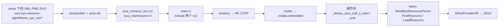

# SOUI4 on ESP32-S3（2.8" IPS / ILI9341V + FT6X36）

把 SOUI4 的 FreeRTOS 版（swinx 平台层 + SOUI 核心 + render-gdi/cairo）编成
ESP-IDF 固件，直接跑在这块 2.8 寸 SPI 屏开发板上：屏幕、电容触摸、消息循环、
XML 布局、图片、值动画全部走 SOUI 自己的路径，没有任何 LVGL 代码。

当前跑的界面就是 `soui_sim` 那个 demo（标题栏 / PNG 图 / 下拉框 / 按钮 /
两个值动画），不是简化版 Hello。

| 指标 | 实测 |
|---|---|
| 固件 | `soui_esp32s3.bin` = **4,098,192 字节（≈3.91 MB，6MB app 分区剩 35%）**（2026-11-17 磁盘实测） |
| 启动到首帧上屏 | 约 4.4 s（上电 → COFF 资源解析 → 布局 + SVG 皮肤 → cairo 首帧 + 整屏 SPI；其中 UI 任务内部约 3.0 s） |
| 稳态刷新 | 双动画（**当前设备版本**，`fade_box visible="1"`）**约 40 fps**；单动画（`visible="0"`）**56~58 fps**（探针关，frame 17.3 ms / paint 14.2 ms） |
| 资源 | windres COFF 87,352 B / 59 条（app uires 9 + 系统主题 47 + 测试图标 3：`GRPICONDIR` 与两帧 `RT_ICON`），`SResProviderPE` 加载 |
| 稳定性 | 连续运行无 panic、无 task_wdt |

> 只想跑一遍"编译 → 烧录 → 看日志"的话，看 **[BUILD_FLASH.md](BUILD_FLASH.md)**，
> 里面是可粘贴的完整命令和故障对照表。帧率是怎么测出来、怎么优化的，看 **[PERFORMANCE.md](PERFORMANCE.md)**。
> 本文件只保留**当前状态**，以及用户需要关心的**编译 / 性能 / 限制**；设计与优化过程见 **[PERFORMANCE.md](PERFORMANCE.md)**。

---

## 1. 硬件与参数

| 项 | 值 |
|---|---|
| SoC | ESP32-S3 rev0.2，16MB Flash，8MB Octal PSRAM |
| 屏 | ILI9341V，SPI，横屏 320×240 |
| 触摸 | FT6X36，I2C @0x38 |
| 连接 | 原生 USB-Serial/JTAG（303A:1001）→ COM4，921600 烧录 / 115200 日志 |

烧录参数与厂商 LVGL demo 完全一致：
`--flash_mode dio --flash_freq 80m --flash_size 16MB`，
`0x0 bootloader` + `0x8000 partition-table` + `0x10000 app`。

## 2. 目录

```
esp32s3/
├── CMakeLists.txt              顶层；把 IDF 工程挂到已装好的 IDF 上
├── sdkconfig.defaults          PSRAM / 16MB flash / C++ 异常 / 主任务栈
├── partitions.csv              无 BOM！6MB factory + NVS + phy
├── uires/                     原始应用资源（XML / PNG / SVG）——改界面就改这里
├── soui_res/                  uiresbuilder 产物：soui_res.rc2 + resource.h（入库）
├── main.rc                    把 app 与系统两个 rc2 合成一个资源脚本
├── cmake/soui_res.cmake       资源管线：uiresbuilder → windres → .incbin
├── components/
│   ├── soui_cairo/             cairo + pixman + libpng + zlib（纯 C）
│   └── soui/                   swinx(FreeRTOS 平台层) + SOUI + utilities
│       │                       + render-gdi + imgdecoder-stb/aupng
│       ├── include/soui_idf_compat.h   force-include 等补丁
│       └── framebuffer_idf.cpp         ARGB32 framebuffer 放 PSRAM
├── main/
│   ├── app_main.cpp            UI 任务 + SResProviderPE 资源装配 + 消息泵
│   ├── soui_demo.h/.cpp        soui_sim 的 CMainDlg（combobox/按钮/动画）
│   ├── soui_board.h/.cpp       RGB565 转换 + present 回调 + 触摸注入
│   └── soui_board_esp32.cpp    ILI9341V / FT6X36 驱动（强实现）
└── tools/
    ├── esp-idf-v5.4.1/        ESP-IDF v5.4.1 源码，须含子模块（本地下载，不入库）
    ├── .espressif/            工具链 + python env（install 脚本装的，不入库）
    ├── idf_env.sh             手工装配 IDF 环境（绕开 export.sh 的 MSys 检查）
    ├── serial_capture.py      复位 + 抓 N 秒串口日志（非交互）
    └── serial_monitor.py      持续看串口日志（Ctrl+C 停，默认不复位）
```

**资源不是 C 数组**：`uires/` 下的原始文件由 `uiresbuilder` 生成 `.rc2`，
`windres` 编成一个 PE-COFF，再 `.incbin` 进 `.rodata.embedded`；运行时走
SOUI 桌面版同一条 `SResProviderPE` / `FindResource` 路径（见第 4.1 节）。

## 3. 环境

| 项目 | 版本 | 位置 |
|---|---|---|
| ESP-IDF | v5.4.1（须含子模块） | `tools/esp-idf-v5.4.1/` |
| 工具链 | Xtensa GCC 14.2.0_20241119 | `tools/.espressif/tools/xtensa-esp-elf/` |
| CMake / Ninja | 3.30.2 / 1.12.1 | `tools/.espressif/tools/{cmake,ninja}/` |
| Python | 3.13（venv `idf5.4_py3.13_env`） | `tools/.espressif/python_env/` |
| openocd / esp-rom-elfs | v0.12.0-esp32-20241016 / 20241011 | `tools/.espressif/tools/` |

两个目录都不入库（`esp32s3/.gitignore` 里的 `tools/esp-idf*/`、`tools/.espressif/`）。
`tools/idf_env.sh` 用 `$BASH_SOURCE` 定位它们，**不写死任何绝对路径**，所以在
`esp32s3/`、仓库根、`build/` 里调用都等价。要放到别处就设环境变量覆盖：
`IDF_ROOT`（含 `esp-idf-v5.4.1/` 的目录）、`IDF_TOOLS_DIR`（含 `tools/`、
`python_env/` 的目录）。

### 3.1 这些工具从哪里来

两步，装完就是上表的样子。体积：IDF 源码 640 MB，工具链目录本机是 5.1 GB
（`install.bat esp32s3` 单目标约 1.5 GB，多出来的 `riscv32-esp-elf` 等是给
esp32c/p 系列的，本工程用不到）。

**① ESP-IDF v5.4.1 源码 —— 必须带子模块**

```bash
cd esp32s3/tools
git clone -b v5.4.1 --recursive https://github.com/espressif/esp-idf.git esp-idf-v5.4.1
```

**② 工具链 + Python 环境 —— 用 IDF 自带的 install 脚本**

```bash
cd esp32s3/tools
# Windows cmd
IDF_TOOLS_PATH=%CD%\.espressif esp-idf-v5.4.1\install.bat esp32s3
# Git Bash / Linux / macOS
IDF_TOOLS_PATH="$PWD/.espressif" ./esp-idf-v5.4.1/install.sh esp32s3
```

**`IDF_TOOLS_PATH` 必须指向 `tools/.espressif`**：不设就会装到默认的
`~/.espressif`，`idf_env.sh` 到时候报 `ESP-IDF tools not found`。这一步会下
xtensa-esp-elf、cmake、ninja、esp-rom-elfs、openocd-esp32、python venv
（esp32s3 单目标解压后约 1.5 GB）。各工具版本由
`esp-idf-v5.4.1/tools/tools.json` 锁定，不要手工换。

国内网络建议先挂 Espressif 的镜像（`idf_tools.py` 会用 `IDF_GITHUB_ASSETS`
替换 github.com 的下载地址）：

```bash
export IDF_GITHUB_ASSETS=dl.espressif.cn/github_assets
```

另外 `windres` 不在 IDF 里，编资源要用宿主 mingw 的一份，见 4.1。

**官方的 `export.sh` / `export.ps1` 在这台机器上两个都用不了**，所以自备了
`tools/idf_env.sh`（第 4 节）。两个坑：

| 入口 | 失败点 |
|---|---|
| Git Bash `source export.sh` | `check-python-dependencies` 直接判 `MSys/Mingw is not supported` 退出 |
| PowerShell `export.ps1` | 把 shell 名传成 `powershell.EXE`（大写扩展名），不在 `activate.py` 白名单里 → 不走 `activate` 分支 |

`tools/idf_env.sh` 就是绕开这两层，手工把 PATH / `IDF_PATH` / `IDF_TOOLS_PATH`
装配好，顺带补上两个 `export.sh` 平时隐式设置、但手工装配时容易漏掉的变量：

```bash
# 这两个不设，只要改动任何 CMakeLists，cmake 重配就会崩
export ESP_ROM_ELF_DIR=...        # tools/cmake/gdbinit.cmake 里的 file(TO_CMAKE_PATH $ENV{ESP_ROM_ELF_DIR} ...)
export OPENOCD_SCRIPTS=...
```

`ESP_ROM_ELF_DIR` 漏了的表现很有欺骗性：`ninja` 报
`error: rebuilding 'build.ninja': subcommand failed`，真正的报错藏在上一行
`file must be called with exactly three arguments`（`gdbinit.cmake:40`，参数传个
空值就成了 2 个参数）。

**IDF 目录换过位置（或从别处拷来的 `build/`）之后，第一次编译要清 bootloader**：

```bash
rm -rf build/bootloader && mkdir -p build/bootloader
rm -f build/bootloader-prefix/src/bootloader-stamp/bootloader-{configure,done}
```

顶层 `build/CMakeCache.txt` 里存的是主工程，`build/bootloader/` 是 ExternalProject
拉起来的**第二份独立配置**，两者不共享缓存。只清顶层的话主工程编得过，一到
bootloader 就 `does not match the source ... used to generate cache`（见 BUILD_FLASH.md 的换 IDF 目录说明）。

## 4. 构建

用 `tools/idf_env.sh` 包住命令，它自己会装配环境再 exec 传进来的参数：

```bash
cd /d/work/soui4/soui-freertos/esp32s3
export CCACHE_DISABLE=1
./tools/idf_env.sh ninja -C build -j2 1> b.out 2> b.err
```

**`idf.py` 完全不要用，它是静默空转的**：

```
$ ./tools/idf_env.sh idf.py --version
MSys/Mingw is no longer supported. ...
$ echo $?
0
```

打印一行警告、**退出码 0、什么都不做**。这就是最早"`idf.py build` 只留下一行
`FAILED:`"的真相——它不是吞掉错误，它根本没开始编。同理 `idf.py flash` / `-C` /
`menuconfig` 全部无效。

所以：

- **配置**不用手动触发。改了 `CMakeLists.txt` 后 `ninja` 会自己重跑 cmake
  （`build.ninja` 里带 regeneration 规则）；改了 `sdkconfig` 靠 IDF 的 `confgen`
  依赖触发。  那条 regeneration 规则崩掉时，报错就是第 3 节说的 `ESP_ROM_ELF_DIR`。

  真要从头配（新建 `build/`）是这一条，**注意源目录是 `.` 不是 `..`**
  （`esp32s3/` 自己就是 CMake 工程根），而且 `-DPYTHON_DEPS_CHECKED=1`
  **不能省**：

  ```bash
  ./tools/idf_env.sh cmake -B build -G Ninja -DPYTHON_DEPS_CHECKED=1 .
  ```

  不加那个 define，配置阶段的 `idf_tools.py check-python-dependencies` 会因为
  Git Bash 里存在 `MSYSTEM=MINGW64` 而直接 `fatal('MSys/Mingw is not supported')`
  （`tools/idf_tools.py` 的 `__main__`）。现有 `build/CMakeCache.txt` 已缓存
  `PYTHON_DEPS_CHECKED=1`，所以只有新建目录才会撞到。
- **编译**只走 `ninja -C build`。
- **烧录**只走 `esptool ... @flash_args`（第 5 节）。

三条硬性要求，都是踩出来的：

1. **必须 `-j 2`**。本机默认并行度会随机挂死 `cc1plus`（CPU 占用归零、20 分钟
   无进展），清进程、关 ccache 都无效，降并行度立刻恢复。挂死时直接
   `Stop-Process cc1plus,cc1,ninja -Force` 然后重跑 `-j2` 即可**增量续编，
   不需要 clean**。
2. **必须 `cd build && ninja`**。理由见上：`idf.py` 是空转的，而 `ninja` 直接跑
   才能拿到真实的编译/链接器 stderr；重定向到文件是为了不被并行输出打散。
3. **全量重编（改 `sdkconfig`、改全局 `-O` 级别）之前先有心理准备**：这套源码
   （cairo + pixman + richedit41）全量编译在本机 `-j2` 要 15~20 分钟，中途
   别以为是挂死。

### 4.1 资源管线：改 XML / PNG / SVG 只要重新编译

早期版本用 `tools/gen_uires.py` 把资源转成一个 30 万行的 C++ 字符串字面量表
（`main/generated/uires_res.cpp`），改一个字符串要重跑脚本，控件 id 还得另外
手写一份 `soui_resource.h` 同步枚举。现在改成和 `soui_sim` / 桌面版同一条路，
**编辑原始资源文件后直接 `ninja` 即可**：



| 层 | 谁生成 | 说明 |
|---|---|---|
| `uires/` | 手工编辑 | 应用资源：`uires.idx` + XML / PNG / SVG。是 soui_sim 的副本，唯一差别是根窗口 `cache="0"`（每帧都 invalidate 的窗口不要用 `cache="1"`） |
| `soui_res/*.rc2`、`resource.h` | `uiresbuilder.exe` | 前者列出 9 条 app 资源，后者给出 `UIRES.*` / `R.id.*` / `R.name` / `R.ID.*`（13 个命名 id）。**产物入库**，非 Windows 宿主直接复用 |
| `main.rc` | 手工编辑 | 三件事：`#include "soui_res.rc2"`、`#include "theme_sys_res.rc2"`（后者来自 `soui-sys-resource-light`，47 条 SVG/PNG/XML 系统皮肤），以及一行 `"APP_ICON" ICON "../res/app.ico"`（标题栏 `<icon src="APP_ICON:16">` 用的 `RT_GROUP_ICON` + 两帧 `RT_ICON`） |
| PE-COFF | `windres --target=pe-x86-64 -O coff` | 一个装了 59 条资源的 COFF **对象文件**，87,352 B |
| `.rodata.embedded` | `xtensa-esp32s3-elf-gcc -c blob.S` | `.incbin` 把 COFF 当数据塞进镜像，导出 `_binary_soui_coff_o_start/_end` |
| 运行时 | `swinx/src/resapi.cpp` | `LoadModuleResources()` 先试 `dlsym`，静态镜像回落到那两个弱符号，交给 `WindResResourceParser::Parse()`；`SResProviderPE` 通过 Win32 的 `FindResource`/`LoadResource`/`LockResource` 读字节 |

四个实现上必须讲清的点：

1. **为什么要多一次 `.incbin`。** COFF 是给链接器看的**对象文件**，但这里没有任何代码引用它，swinx 是把整个文件当**磁盘映象**解析（先读段头再定位 `.rsrc`）。所以它必须以"数据"的形式存在于镜像里，而不是被链接成代码。
2. **段名必须是 `.rodata.embedded`。** 桌面管线用 `.section .rdata`，但 IDF 的 linker fragment（`components/esp_common/common.lf`）只把 `.rodata+` / `.srodata+` 收进 flash；`.rdata` 匹配不到任何规则，符号会指到未放置的垃圾地址。`.rodata.embedded` 也是 IDF 自己 `target_add_binary_data()` 用的名字。实测符号落在 `0x3c39f6f8`（DROM 映射区）。
3. **判断宿主用 `CMAKE_HOST_WIN32`，不能用 `WIN32`。** IDF 的交叉工具链把 `CMAKE_SYSTEM_NAME` 设成 `Generic`，`WIN32` 恒为 `FALSE` —— 第一次配置就是走了"非 Windows 宿主"分支，导致 `uiresbuilder` 的自动重建规则根本没生成。`uiresbuilder.exe` 是宿主工具，能不能跑取决于宿主而不是目标平台。两个 GLOB 都带 `CONFIGURE_DEPENDS`，新增/删除资源文件也能被感知。
4. **windres 需要补齐 PATH。** 它默认用 `gcc -E -xc -DRC_INVOKED` 预处理 `.rc`；IDF 的 ninja 规则统一走 `cmd.exe`，其 PATH 是 Xtensa 工具链 + IDF python，没有 mingw 的 gcc / cc1 / 运行时 DLL，windres 只报一句含糊的 `preprocessing failed.`（在 Git Bash 里手工跑同一条命令却成功）。`cmake -E env --modify PATH=path_list_prepend:<windres 所在目录>` 只作用于这一条 custom command。试过显式 `--preprocessor=...gcc.exe`：gcc 找得到，但仍缺 PATH 里的运行时目录，照样退出 1。

`app_main.cpp` 里对 `_binary_soui_coff_o_start/_end` 是**强引用**：swinx 那边只声明成 weak（没资源的镜像也要能链接），而 weak undefined 不会把 archive member 拉进来；这里强引用既保证 blob 不被链接器丢掉，也让"忘了挂资源"在链接期就失败，而不是开机后报 resource not found。

**依赖**：需要 mingw 的 `windres`（MSYS2 `mingw-w64-x86_64-binutils`，Linux `binutils-mingw-w64-x86-64`）。它只用来编 `.rc`，C/C++ 仍全部由 Xtensa 工具链编译 —— 和"用不用 MinGW 编译器"无关。非 Windows 宿主上 `uiresbuilder` 跑不了，`soui_res.rc2` / `resource.h` 已入库可直接用；但**新增资源条目或改控件 `name`** 得回 Windows 重新生成一次。

## 5. 烧录与观察

`idf.py flash` 内部要起 Python 子进程做 `check-python-dependencies`，同样会撞上
"MSys/Mingw is no longer supported"。**绕开 idf.py，直接调 esptool**，用
`build/flash_args` 里已经生成好的地址表：

```bash
cd build
./../tools/idf_env.sh python -m esptool --chip esp32s3 -p COM4 -b 921600 \
    write_flash @flash_args
```

观察日志（两种，按需求选）：

```bash
cd /d/work/soui4/soui-freertos/esp32s3

# 1) 一直看，Ctrl+C 停。默认不复位，不打断正在跑的程序
./tools/idf_env.sh python tools/serial_monitor.py COM4
./tools/idf_env.sh python tools/serial_monitor.py COM4 --reset      # 先复位再看
./tools/idf_env.sh python tools/serial_monitor.py COM4 --log run.log # 同时存文件

# 2) 复位 + 抓 22 秒后退出，适合"只想知道启动阶段有没有问题"
./tools/idf_env.sh python tools/serial_capture.py COM4 22
```

两条都要用 `tools/idf_env.sh` 包着：系统 python 没有 pyserial，缺了会
`ModuleNotFoundError`。**不要用 `idf.py monitor`** —— 它在 Git Bash 下直接拒绝
（`MSys/Mingw is no longer supported`），在 PowerShell 下又卡在 IDF 5.4.1 的
`export.ps1` bug（把 shell 名传成 `powershell.EXE`，而白名单里只有
`powershell.exe`）。

不想用脚本的话，任何串口终端连 **COM4 @115200 8N1、UTF-8** 都可以
（PuTTY / MobaXterm / VS Code 的 Serial Monitor）。日志之所以能在 COM4 看到，
是因为 sdkconfig 里 `CONFIG_ESP_CONSOLE_SECONDARY_USB_SERIAL_JTAG=y`：ESP_LOG
同时从 UART0（GPIO43/44，115200）和原生 USB 出去。副作用是 **ROM 引导那几行
（`ESP-ROM:esp32s3-...`）只在 UART0 上**，USB 侧从 `I (xx) boot:` 开始。

串口是独占的：看日志时烧不进去，烧写/`serial_capture.py` 之前要先关掉。

### 5.1 恢复出厂固件

`firmware_backup/` 下有两份 16 MB 整片备份：`factory_flash_16MB_20261113.bin`（出厂状态）、
`before_soui_16MB_20261113.bin`（首次烧 SOUI 前）。恢复出厂：

```bash
python -m esptool -p COM4 -b 921600 write_flash --flash_mode dio --flash_freq 80m --flash_size 16MB \
    0x0 firmware_backup/factory_flash_16MB_20261113.bin
```

## 6. 显示链路

```
SOUI 控件树
  └─ render-gdi(cairo) 画到 ARGB32 framebuffer   ← PSRAM，307200 B
       └─ SConnection::commitCanvas() blit 脏矩形
            └─ swinxFbPresent(rect)   [soui_board.cpp 注册的回调]
                 └─ ARGB32 → RGB565            ← PSRAM，153600 B
                      └─ soui_board_lcd_flush() [soui_board_esp32.cpp]
                           └─ SPI 大块 polling 写 ILI9341V
```

首帧整屏 320×240 约 470ms（cairo 软件渲染 + 写入全屏）；之后只刷脏矩形，
典型的动画帧 6000~7000 像素。

**日志字段**：`flush` 是 SPI 送屏耗时（大块传输后约 3 ms，不是瓶颈）；`paint` 是一次 `WM_PAINT` 的墙钟时间（含 cairo 渲染）；`pixels` 是本轮脏区像素累计。当前帧率见下一节。

> 本节只描述当前显示链路。帧率实测与逐项优化过程见 **[PERFORMANCE.md](PERFORMANCE.md)**。

## 7. 性能

| 场景 | 帧率 | frame | paint |
|---|---|---|---|
| 单动画（`fade_box visible="0"`，探针关） | **56~58 fps** | 17.3 ms | 14.2 ms |
| 双动画（当前设备版本，`visible="1"`，扫动 + layered alpha） | **约 40 fps** | — | — |

- 固件 **4,098,192 B（≈3.91 MB）**，冷启动到首帧约 **4.4 s**；资源 COFF 87,352 B / 59 条。
- `fps=` 由完成的 `WM_PAINT` 次数算出；`presents` 是脏矩形 blit 次数，不是帧率。
- 早期 20~27 / 20~22 / 35 fps 是优化前旧值。为什么是这个帧率、每一微秒花在哪、怎么优化——全部在 [PERFORMANCE.md](PERFORMANCE.md)。

## 8. 已知限制

- **帧率**：双动画约 40 fps（当前设备版本，`fade_box visible="1"`）/ 单动画 56~58 fps（探针关）。`cache="1"` 只对"内容变化才脏"的窗口有效；每帧都 invalidate 的窗口用了反而更慢，判据是 `MarkCacheDirty()` 的频率。逐项优化见 PERFORMANCE.md。
- **合成模型**：每个窗口画布是 ARGB32，提交时做 source-over 合成；framebuffer 没有合成器，"谁最后 blit 谁的地盘就归谁"。下层重绘时用 `composeAbove()` 贴回上层；上层消失 / 挪走时用 `composeRegion()` 或 `invalidateBelow()` 交给下层重绘。
- **资源**：windres COFF 数据段 + `SResProviderPE`，改原始文件重新编译即可；仍编在 app 分区里，换皮肤必须整包重烧。要 OTA 换皮肤需独立分区 + 自定义 `IResProvider`。
- **编辑框**：`<edit>` 可用（SEditLite 轻量实现，不链 richedit41），但没有输入法：`WM_CHAR` 只能由 `SwinxInjectKey` 注入，中文输入需软键盘控件。富文本（RTF / 字符级格式 / 拖放）是有意 no-op，剪贴板是进程内静态缓冲。
- **字体**：烘焙位图字体，不依赖 FreeType，只覆盖 ASCII 0x20-0x7E，中文显示成 `?`；要中文用 `bakefont --chars` 烘所需码位（见 `swinx/tools/bakefont/README.md`）。
- **图标**：`ICON:` 已可用，但不支持 PNG 压缩的 ICO 分帧（测试图标用未压缩 32bpp DIB 分帧）。
- **剪贴板**：只在本进程内有效（`SClipboard` 是内存表），没有系统剪贴板。
- **屏幕**：framebuffer 尺寸已运行时化，换屏改板层两个常量即可，不必重编 swinx；但真机只在 320×240 ILI9341V + FT6X36 上验证过。
